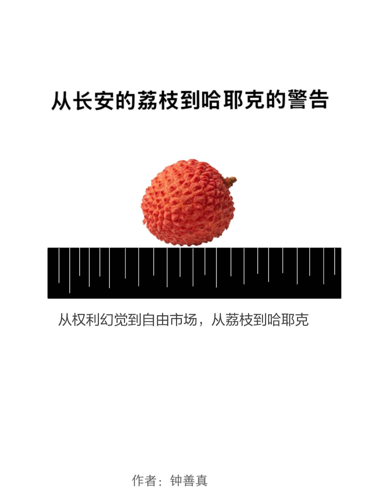
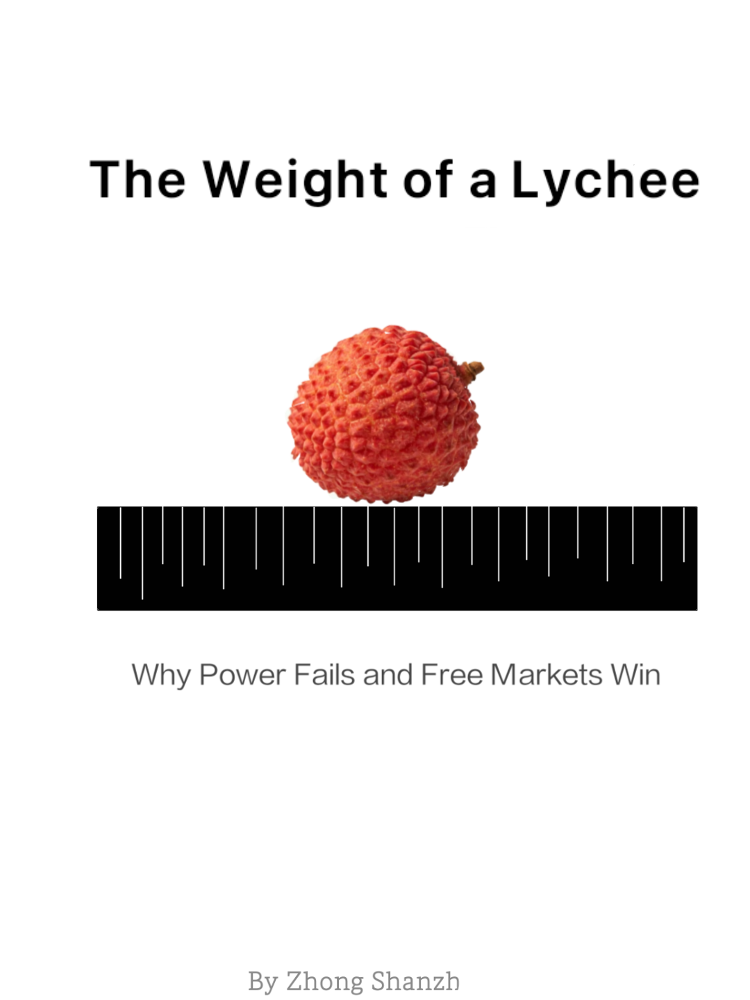

# Equal System / 平等制

 

**Philosophical Origin / 哲学起点**  
> *Does meaning have a limit? If so, what is it?*
> 
> *意义是否存在极限？如果有，这个极限是什么？*

 

> This question is where everything begins. From it, I derived the **Limit Theory of Meaning** — which then led to the identification of **The Imperative** — and finally to the institutional design of the **Equal System**.
> 
> 这是所有思考的起点。由此，我推导出了**意义极限哲学论** — 进而识别出 — **命令体** — 最终延伸出 — **平等制**的制度设计。

 

 

## 📖 Monograph / 专著

> *"Life is a structural tragedy. The philosopher is the one who sees it clearly, and still has the courage to write this structure out."*
> 
> **人生就是一种结构性的悲哀，而哲学家就是看清这种结构性悲哀，必须依然有勇气去把这个结构写出来的人。**

 

### 1. On Dignity / 《论尊严》

<table>
  <tr>
    <td align="center" valign="top" width="50%">
      
        
      <strong><a href="books/on-dignity-cn.md">中文版：论尊严</a></strong>
    </td>
    <td align="center" valign="top" width="50%">
      
        
      <strong><a href="books/on-dignity-en.md">English Version: On Dignity</a></strong>
    </td>
  </tr>
</table>

 

### 2. The Weight of a Lychee / 《从长安的荔枝到哈耶克的警告》

<table>
  <tr>
    <td align="center" valign="top" width="50%">
      
        
      <strong><a href="https://github.com/maxlanceund/equal-system/releases/download/v1.0/The.Weight.of.a.Lychee-cn.epub">📥 下载 EPUB</a></strong>
    </td>
    <td align="center" valign="top" width="50%">
      
        
      <strong><a href="https://github.com/maxlanceund/equal-system/releases/download/v1.0/The.Weight.of.a.Lychee-en.epub">📥 Download EPUB</a></strong>
    </td>
  </tr>
</table>

 

 

## Academic Papers / 学术论文

**Suggested Citation**: 
> Zhong, S. (2026). *Equal System Repository*. https://github.com/maxlanceund/equal-system

 

### Core Papers / 核心论文

| 中文 | English |
| :--- | :--- |
| [意义极限论（学术版）](papers/meaning-limit-theory-academic-cn.md) | [On the Limits of Meaning](papers/meaning-limit-theory-academic-en.md) |
| [不确定性吞没（学术版）](papers/uncertainty-subsumption-cn.md) | [Uncertainty Subsumption](papers/uncertainty-subsumption-en.md) |
| [边界加速（学术版）](papers/boundary-acceleration-academic-cn.md) | [Boundary Acceleration](papers/boundary-acceleration-academic-en.md) |
| [有限区间原则（学术版）](papers/limited-interval-principle_zh.md) | [Limited-Interval Principle](papers/limited-interval-principle_en.md) |
| [命令体与康德（学术版）](papers/imperative-and-kant-cn.md) | [The Imperative and Kant](papers/imperative-and-kant-en.md) |
| [平等制设计](equal-system-cn.md) | [Equal System Design](equal-system-en.md) |

### Extended Papers / 延伸研究

| 中文 | English |
| :--- | :--- |
| [绝对他者（学术版）](papers/absolute-other-cn.md) | [The Absolute Other](papers/absolute-other-en.md) |
| [关系即永生（学术版）](papers/Relation-Is-Immortality-cn.md) | [Relation Is Immortality](papers/Relation-Is-Immortality-en.md) |
| [善，美德与正义的无定义](papers/the-undefinability-of-goodness-virtue-and-justice-cn.md) | [The Undefinability of Goodness, Virtue, and Justice](papers/the-undefinability-of-goodness-virtue-and-justice-en.md) |
| [拒绝哲学论](papers/The_Philosophy_of_Refusal-cn.md) | [The Philosophy of Refusal](papers/The_Philosophy_of_Refusal-en.md) |
| [地理哲学论](papers/geography-philosophy-cn.md) | [Geography as Philosophical Constraint](papers/geography-philosophy-en.md) |
| [哲学家死亡的缺失感](papers/death-of-philosophers-cn.md) | [The Sense of Loss at the Death of Philosophers](papers/death-of-philosophers-en.md) |
| [存在性确认与性别不对称](papers/existential-confirmation-cn.md) | [Existential Confirmation and Gender Asymmetry](papers/existential-confirmation-en.md) |
| [信号、交换与制度稳定性](papers/signal-exchange-and-system-stability-zh.md) | [Signal, Exchange, and System Stability](papers/signal-exchange-and-system-stability-en.md) |
| [边界之外（学术版）](papers/Beyond-the-Boundary-academic-cn.md) | [Beyond the Boundary](papers/Beyond-the-Boundary-academic-en.md) |
| [经验世界，永恒真理](papers/empirical-world-eternal-truth-academic-cn.md) | [Empirical World, Eternal Truth](papers/empirical-world-eternal-truth-academic-en.md) |
| [存在主义黑洞](papers/Existential_Black_Hole-cn.md) | [The Existential Black Hole](papers/Existential_Black_Hole-en.md) |

### Economics Papers / 经济学论文

| 中文 | English |
| :--- | :--- |
| [结构与数据（学术版）](papers/Structure_and_Data_cn.md) | [Structure and Data](papers/Structure_and_Data_en.md) |
| [定力与出清（学术版）](papers/structural-trap-and-monetary-standoff-cn.md) | [Resolve and Clearing](papers/structural-trap-and-monetary-standoff-en.md) |
| [紧绷即底气（学术版）](papers/paper_resilience_zh.md) | [Resilience in Tension](papers/paper_resilience_en.md) |
| [中美结构性终局](papers/the_structural_endgame_of_us-china_rivalry_cn.md) | [The Structural Endgame of U.S.-China Rivalry](papers/the_structural_endgame_of_us-china_rivalry_en.md) |
| [国强与民松（学术版）](papers/Guoqiang_Minsong_cn.md) | [Guoqiang and Minsong](papers/Guoqiang_Minsong_en.md) |
| [生存强制力与美国工业衰退](papers/survival-compulsion-and-us-industrial-decline-academic-cn.md) | [Survival Compulsion and U.S. Industrial Decline](papers/survival-compulsion-and-us-industrial-decline-academic-en.md) |

### Information Projection Framework / 信息投影框架

| 中文 | English |
| :--- | :--- |
| [论不可逆性的结构性来源](papers/Structural_Source_of_Irreversibility-cn.md) | [On the Structural Source of Irreversibility](papers/Structural_Source_of_Irreversibility-en.md) |
| [信息丢失的一个后果](papers/InfoLoss_CommonOrigin-cn.md) | [One Consequence of Information Loss](papers/InfoLoss_CommonOrigin-en.md) |
| [宏观描述的信息损失率](papers/Information_Loss_Rate_of_Macroscopic_Descriptions-cn.md) | [Information Loss Rate of Macroscopic Descriptions](papers/Information_Loss_Rate_of_Macroscopic_Descriptions-en.md) |
| [信息投影框架](papers/information_projection_framework-cn.md) | [Information Projection Framework](papers/information_projection_framework-en.md) |
| [神经网络中的纠错码结构](papers/neural-error-correction-cn.md) | [Error-Correcting Code Structure in Neural Networks](papers/neural-error-correction-en.md) |

 

 

## Other Writings / 其他写作

*   **Narrative Philosophy / 叙事哲学**：[窄门之外的虚无](narrative/the-void-beyond-the-narrow-gate-cn.md) | [The Void Beyond the Narrow Gate](narrative/the-void-beyond-the-narrow-gate-en.md)
*   **Philosophical Essays / 哲学随笔**：[论死亡与生命](essays/death-and-life-cn.md) · [哲学的边界](essays/language-philosophy-boundary-zh.md) · [她消失在天堂门口](essays/she-disappeared-at-the-gate-of-heaven-cn.md) · [许空](essays/xu-kong-cn.md) · [聊红楼梦](essays/on-the-dream-of-red-mansions-cn.md) · [确认法](essays/confirmation-method-zh.md)
*   **Annotations / 注解**：[《论法的精神》注解（第一卷至第四卷）](annotations/l-esprit-des-lois-annotated-vol1-cn.md)
*   **Scientific Observations / 科学观测**：[烟雾鲨鱼与虎鲸](scientific-observations/quantum-decoherence-dream-cn.md) · [眼见不为实](scientific-observations/seeing-is-not-believing-cn.md)
*   **Hypotheses & Models / 猜想与模型**：[感知者假说](hypotheses/hypothesis-002_perceiver-hypothesis_zh.md) · [感知者信号模型](hypotheses/perceiver-warning-model_cn.md)

 

 

## Intellectual Lineage / 思想源流

| Thinker / 思想家 | Contribution / 贡献 |
| :--- | :--- |
| **霍布斯 / Hobbes** | “生存竞争”作为社会底层逻辑。 |
| **马克思 / Marx** | “劳动异化”作为现代社会结构性病症的诊断。 |
| **罗素 / Russell** | 逻辑推导的方法 —— 把复杂命题拆解到最小可验证单位。 |
| **维特根斯坦 / Wittgenstein** | “语言边界”的警觉 —— 区分可说的与不可说的。 |

 

> Among them, Marx's influence is the greatest. He showed me the central position of "labor" as a structural problem of society — and made me realize that if a thought only describes the world without attempting to change it, it has not yet completed its journey.
>
> 其中，马克思的影响是最大的。他让我看到了“劳动”作为社会结构性问题的核心位置 —— 也让我意识到：如果只是描述世界，而不试图改变它，思想就还没有走完它的路。

 

 

## A Note / 附记

> When Marx wrote about Germany, I was a student. When Marx wrote about France, I was a colleague.
>
> 马克思写德国的时候，我是学生。马克思写法国的时候，我是同行。
>
> At that time, I was the only one in the room.  
> Now, this sentence is here.  
>
> 当时只有我一个人。  
> 现在，这句话在这里。

 

> — To the guides across centuries  
> — 以此致敬跨越世纪的引路人

 

 

## License / 许可证

This work is licensed under the MIT License.  
本作品采用 MIT 许可证。

 

## Art Appreciation / 艺术鉴赏

[→ 进入 / Enter](./art-appreciation)
