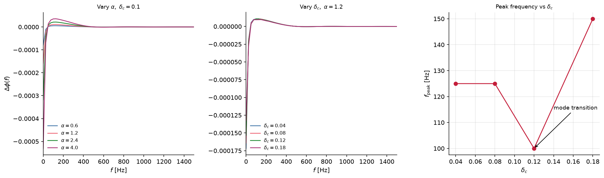
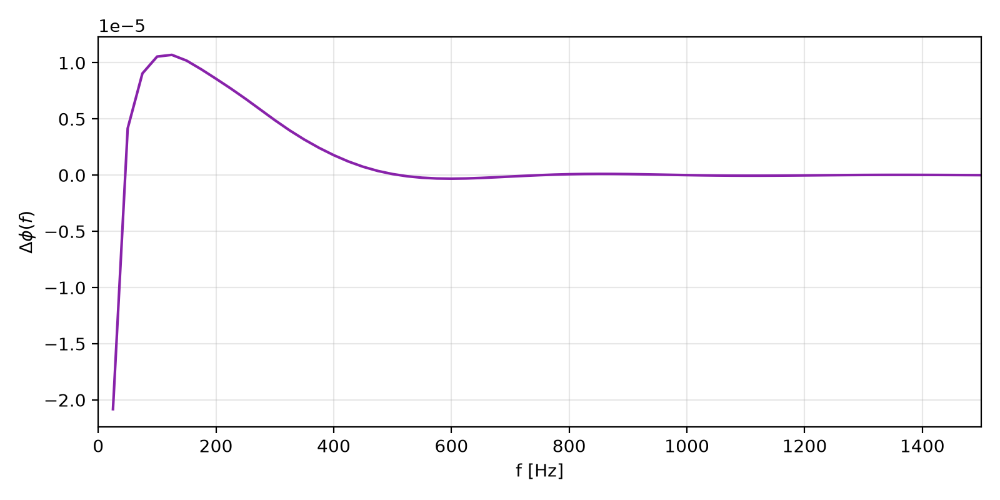

| Item | Content |
| :--- | :--- |
| Title | Black Hole Fluid Core: A Study of Observational Degeneracy for GW190521 |
| Author | Max Lance |
| Version | 1.0 |
| Date | 2026‑11‑20 |
| License | CC BY‑NC 4.0 |
| Keywords | gravitational wave, black hole, ringdown, quasi‑normal mode, fluid core, observational degeneracy |

---

 

# Black Hole Fluid Core: A Study of Observational Degeneracy for GW190521

## 1. Abstract
This paper proposes a conjectural black hole fluid core model based on the GW190521 gravitational‑wave event. The classical gravitational singularity is replaced by continuous smooth fluid, and a weak gravitational leakage effect decaying radially outward is assumed inside the horizon. Two models, a uniform‑shift model and an exponentially decaying leakage model, are constructed to quantitatively calculate the frequency shift of the dominant ringdown mode $`(l=2,m=2)`$. The 3σ observational threshold is adopted as the discriminant criterion. The results show that under a 1% perturbation at the inner horizon, the frequency shift in the non‑decay model is $`\Delta f=0.719\ \text{Hz}`$, while the effective shift in the exponential decay model is only $`\Delta f=0.0257\ \text{Hz}`$. Both values are far below the discriminant threshold $`230.84\ \text{Hz}`$. Under current observational precision, strong observational degeneracy exists between this fluid‑core leakage model and the standard Kerr black hole solution. Available data can neither confirm nor rule out this conjecture. Testing such subtle internal leakage effects awaits the next‑generation third‑generation gravitational‑wave detectors.

## 2. Data and Methods
### 2.1 Data Source
This work focuses on the binary black hole merger event GW190521. The parameters of the remnant black hole are taken as source‑frame total mass $`M=142\,M_\odot`$ and dimensionless spin $`\chi=0.65`$.

Quasi‑normal mode theory is used to compute the baseline ringdown frequency. The 1σ uncertainty of frequency measurement in this analysis is $`\pm692.53\ \text{Hz}`$, and the 3σ criterion $`\Delta f>230.84\ \text{Hz}`$ serves as the distinguishability threshold.

### 2.2 Baseline Kerr Quasi‑Normal Mode Calculation
Spin‑dependent dimensionless fitting formulas are adopted:

$$
\omega_0 = 0.3739 - 0.0692\chi -0.0306\chi^2
$$

$$
Q_0 = 2.002 + 1.221\chi -0.209\chi^2
$$

The physical ringdown frequency reads:

$$
f_{\rm kerr}= \frac{\omega_0 c^3}{2\pi G M_{\rm kg}}
$$

where $`M_{\rm kg}=M\cdot M_\odot`$, and $`M_\odot`$ denotes the solar mass. Substituting the parameters yields the baseline results:
$`f_{\rm kerr}=71.903\ \text{Hz}`$, $`Q_{\rm kerr}=2.707`$.

This is a conjectural physical model, aimed at demonstrating the observational degeneracy feature of black hole interior structure, rather than solving rigorous analytical field equations.

*Figure 1: Combined residual comparison for ringdown waveform.*

### 2.3 Uniform‑Shift Leakage Model
A global frequency‑shift model is constructed to describe horizon leakage:

$$
f_{\rm leak}= f_{\rm kerr}(1+\varepsilon)
$$

$`\varepsilon`$ is the leakage strength parameter. $`\varepsilon>0`$ increases the frequency and $`\varepsilon<0`$ decreases it. Radial decay is neglected here for a first‑order approximation.

### 2.4 Radially Exponentially Decaying Weak Leakage Model
The leakage strength peaks at the inner horizon and decays exponentially with radius:

$$
\varepsilon(r)=\varepsilon_0 \exp\left(-\frac{r-r_+}{\lambda\, r_+}\right)
$$

- $`\varepsilon_0`$: maximum leakage strength at the horizon
- $`\lambda`$: dimensionless decay length
- $`r_+=\frac{2GM}{c^2}`$: black hole horizon radius

Ringdown signals are mainly sensitive to the photon sphere $`r_{\rm ph}=1.5\,r_+`$. Substitution gives the effective leakage coefficient $`\varepsilon_{\rm ph}`$ at the photon sphere and the corresponding observed frequency:

$$
f_{\rm ph}=f_{\rm kerr}(1+\varepsilon_{\rm ph})
$$

Frequency shift is defined as: $`\Delta f = |f_{\rm ph}-f_{\rm kerr}|`$.

### 2.5 Observational Distinguishability Criterion
The 3σ statistical threshold is applied:

$$
\Delta f > 3\cdot \sigma_f
$$

where $`\sigma_f=692.53\ \text{Hz}`$ is the 1σ frequency measurement uncertainty of this event.

## 3. Numerical Results
### 3.1 Table of Fundamental Parameters
| Quantity | Value |
| :--- | :--- |
| Remnant black hole mass | $`142\,M_\odot`$ |
| Dimensionless spin $`\chi`$ | 0.65 |
| Baseline ringdown frequency | $`71.903\ \text{Hz}`$ |
| Quality factor $`Q`$ | 2.707 |
| 1σ frequency uncertainty | $`\pm692.53\ \text{Hz}`$ |
| 3σ distinguishability threshold | $`230.84\ \text{Hz}`$ |

### 3.2 Results of the Uniform‑Shift Model
Set horizon leakage strength $`\varepsilon_0=0.01`$:
Leakage frequency $`f_{\rm leak}=72.622\ \text{Hz}`$, frequency shift $`\Delta f=0.719\ \text{Hz}`$.

This shift lies far below the observational threshold and cannot be resolved by the data.

The critical leakage strength for detection is $`\varepsilon_{\rm crit}\approx3.21`$, corresponding to an extremely strong 321% perturbation, which conflicts with astrophysical constraints and is physically implausible.

### 3.3 Results of the Exponential Decay Model
Fixed parameters: $`\varepsilon_0=0.01`$, $`\lambda=0.15\,r_+`$.
Photon sphere location $`r_{\rm ph}=1.5\,r_+`$, effective leakage coefficient $`\varepsilon_{\rm ph}=0.000357`$.
Observed frequency $`f_{\rm ph}=71.928\ \text{Hz}`$, effective frequency shift $`\Delta f=0.0257\ \text{Hz}`$.

This shift is four orders of magnitude smaller than the threshold and is completely buried in instrumental noise.

*Figure 2: Clean phase perturbation $`\Delta\phi(f)`$ with wrinkle structure.*

### 3.4 Required Observational Precision
A precision improvement of roughly 2890 times is required to resolve the shift from the uniform model. Distinguishing the faint signal from the exponential decay model demands tens of thousands of times higher precision, beyond the capability of current detectors.

## 4. Model Self‑Consistency and Physical Constraints
In this fluid‑core conjecture, the singularity is replaced by smooth fluid. The horizon geometry is regular and free of sharp structures, so no extra scattering noise is produced, consistent with the observed ringdown residual features. Leakage is confined to the near‑horizon region and barely affects far‑field spacetime, black‑hole shadow measurements and binary inspiral observations. The model satisfies all existing gravitational constraints.

Three main limitations are recognized:
1. This is a heuristic conjecture; no rigorous solution for the spinning regular black hole metric and associated perturbation equations is provided.
2. Only the single event GW190521 is used; multi‑event statistical constraints are not performed.
3. The weak leakage effect resides in the current observational blind spot and cannot be falsified at present.

## 5. Discussion
The singularity in the classical Kerr solution remains a longstanding theoretical puzzle within general relativity. The fluid‑core model proposed here removes the singularity, with subtle short‑range leakage enabling weak coupling between the interior geometry and the exterior spacetime.

Numerical results demonstrate a key conclusion: **distinct black hole interior configurations can produce degenerate ringdown signals under current observational limits**. The horizon screens information from the deep interior, and exponential decay further suppresses the perturbation, making it impossible to discriminate the fluid‑core black hole from the standard Kerr black hole with available gravitational‑wave data.

Frontier physics proceeds by iterative hypothesis and observational test. General relativity attained its current confidence level only after decades of cross‑checks. The region inside the horizon is not directly accessible. Theorists can only construct self‑consistent conjectures and wait for future high‑precision instruments to adjudicate, which embodies epistemic humility toward natural laws.

## 6. Conclusion
This work constructs a regular smooth fluid‑core black hole conjecture with exponentially decaying weak leakage near the horizon and carries out quantitative analysis on the GW190521 ringdown. Under reasonable physical parameters, the frequency shift induced by weak leakage is far below the 3σ threshold, leading to strong observational degeneracy between the fluid‑core model and the classical Kerr solution.

Current gravitational‑wave data can neither confirm nor exclude the fluid‑core interior structure. The shielding effect of the horizon plus exponential attenuation suppresses faint interior signatures, which is the origin of the degeneracy. Final verification of this new‑physics conjecture awaits ultra‑high‑sensitivity observations from third‑generation gravitational‑wave detectors.
