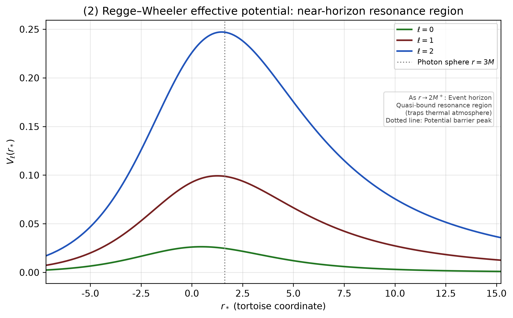
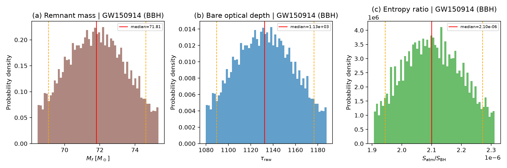
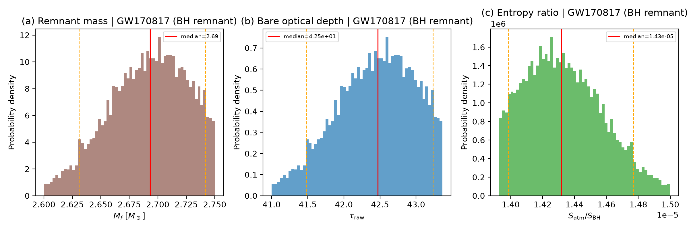
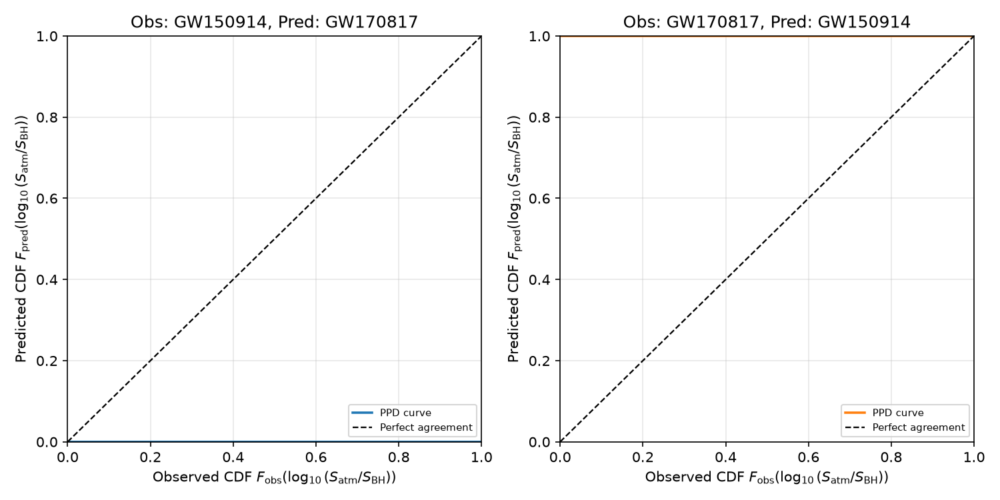
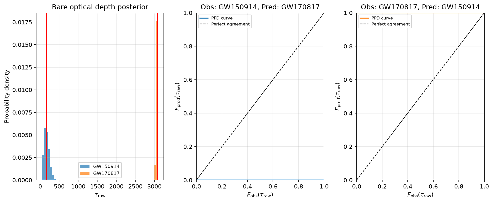
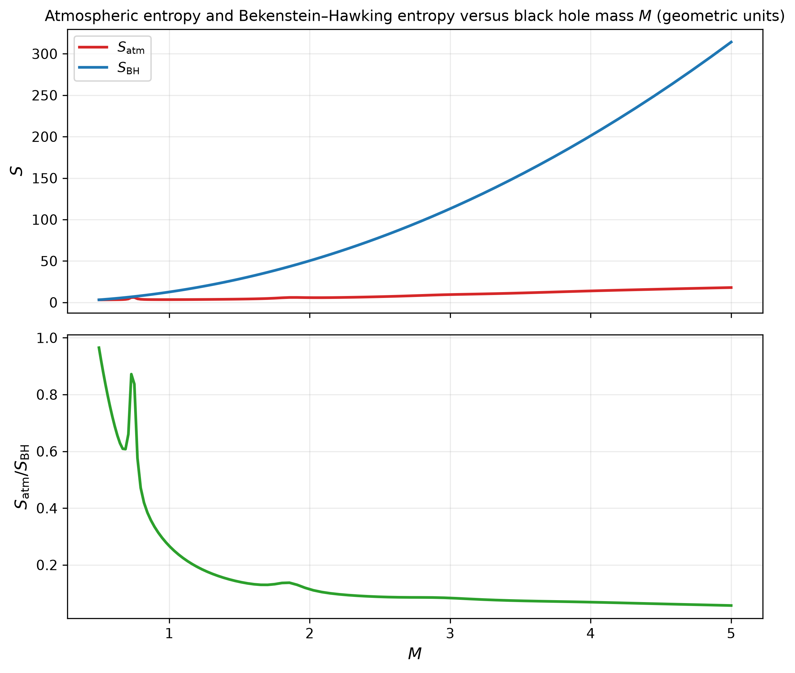

| 项目 | 内容 |
| :--- | :--- |
| 标题 | 史瓦西黑洞近视界标量准束缚热大气的热力学研究 |
| 作者 | Max Lance |
| 版本 | 1.1 |
| 日期 | 2026‑11‑24 |
| 许可协议 | CC BY‑NC 4.0 |
| 关键词 | 黑洞热力学，准束缚态，Regge‑Wheeler势，霍金温度，热大气熵，引力波遗迹，后验预测检验 |
---

<br>

# 史瓦西黑洞近视界标量准束缚热大气的热力学研究

## 1. 摘要
史瓦西黑洞光子球附近引力势垒能够俘获无质量标量扰动，形成具有有限隧穿寿命的准束缚共振模式。在霍金热库持续热激发之下，模式隧穿泄漏与热布居填充达成动态平衡，于视界外侧维持稳态的近视界标量热大气。本文从Regge‑Wheeler扰动方程出发求解低阶角向模式的共振频率与隧穿宽度，构建系统共振态密度，依托玻色统计完成热大气熵的数值积分计算；验证热大气熵对外径向截断参数具备良好收敛特性，系统扫描黑洞质量参数，得到热大气熵与贝肯斯坦‑霍金熵的比值 $`S_{\rm atm}/S_{\rm BH}`$。结合引力波观测给出的GW150914、GW170817黑洞遗迹后验样本，引入后验预测双向P‑P（PPD）一致性检验，对大质量黑洞与小质量遗迹黑洞的热大气熵、裸光学深度 $`\tau_{\rm raw}`$ 可观测量开展统计对比。计算与统计分析结果表明：小质量黑洞拥有更高霍金温度，准束缚共振得到充分热激发，视界外热大气熵可以达到和黑洞本体贝肯斯坦‑霍金熵可比拟的量级；随黑洞质量增大，霍金温度被压低，准模式热激发被强烈抑制，大气熵占比显著下降。引力波遗迹的后验检验直观体现出近视界大气可观测量对黑洞质量极强的依赖关系，证明视界外准束缚热自由度是黑洞总热力学熵不可忽略的物理组分，该套可观测量也为利用引力波数据探测黑洞近视界环境提供切实可行的观测探针。

## 2. 数据与方法
### 2.1 时空背景与Regge‑Wheeler方程
本文采用几何单位制 $`G=c=\hbar=1`$，史瓦西度规写为：

$$
ds^2 = -\left(1-\frac{2M}{r}\right)dt^2 + \left(1-\frac{2M}{r}\right)^{-1}dr^2 + r^2(d\theta^2+\sin^2\theta d\phi^2)
$$

视界位置 $`r_h=2M`$，光子球位置 $`r_\gamma=3M`$。无质量标量场 $`\Phi`$ 满足克莱因‑戈登方程

$$
\nabla^\mu\nabla_\mu \Phi = 0
$$

做分离变量假设

$$
\Phi(t,r,\theta,\phi) = \frac{1}{r}\Psi(r,t)Y_{\ell m}(\theta,\phi)
$$

其中 $`Y_{\ell m}`$ 为球谐函数，$`\ell`$ 为角向模数。引入乌龟坐标

$$
r_{*} = r + 2M\ln\left(\frac{r}{2M}-1\right)
$$

径向扰动满足Regge‑Wheeler一维波动方程


```math
\frac{d^2\psi}{d r_{}^2}+(\omega^2-V_{\ell}(r_{}))\psi=0
```


有效势表达式：

$$
V_\ell(r_*) = \left(1-\frac{2M}{r}\right)\left(\frac{\ell(\ell+1)}{r^2}+\frac{2M}{r^3}\right)
$$

有效势在光子球附近形成势垒，频率低于势垒峰值的模式会发生准俘获。准束缚共振采用复频率描述 $`\omega=\omega_R-i\Gamma/2`$，$`\omega_R`$ 为共振实频率，$`\Gamma`$ 代表隧穿衰减宽度。


*图1：Regge‑Wheeler有效势 $`V_\ell(r_{*})`$，分别对应角向模数 $`\ell=0,1,2`$。势垒形成于光子球附近，可以俘获标量准束缚共振模式，构成近视界热大气的动力学基础。*

### 2.2 共振态密度构造
单个角向通道下窄准束缚共振采用洛伦兹线型描述态密度

$$
g_\ell(\omega)=\frac{1}{2\pi}\frac{\Gamma_\ell}{(\omega-\omega_\ell)^2+\Gamma_\ell^2/4}
$$

$`\omega_\ell`$ 为该通道共振中心频率，$`\Gamma_\ell`$ 为对应衰减宽度。计入角向简并权重 $`2\ell+1`$，对低阶角向模式求和得到总态密度

$$
g(\omega)=\sum_{\ell}(2\ell+1)\,g_\ell(\omega)
$$

本工作仅取 $`\ell=0,1,2`$ 参与计算；更高角向模式势垒峰值更高，共振频率远离热窗口，热激发贡献微弱，予以忽略。


*图2：共振态密度 $`g(\omega)`$，分解展示 $`\ell=0,1,2`$各个角向模式的共振峰。尖锐洛伦兹峰对应被势垒俘获的准束缚共振。*

### 2.3 玻色统计与热熵积分
霍金温度在几何单位制下定义：

$$
T_H=\frac{1}{8\pi M}
$$

玻色‑爱因斯坦分布函数：

$$
f(\omega)=\frac{1}{\exp\left(\omega/T_H\right)-1}
$$

单玻色模式的熵元表达式为：

$$
s(\omega)=(1+f)\ln(1+f)-f\ln f
$$

热大气统计熵通过对态密度做频率积分得到：

$$
S_{\rm atm}=\int g(\omega)\,s(\omega)\,d\omega
$$

黑洞贝肯斯坦‑霍金熵：

$$
S_{\rm BH}=4\pi M^2
$$

为检验计算结果对外边界的敏感性，引入几何截断厚度 $`\delta_{\rm geo}`$，改变径向积分外边界，观察 $`S_{\rm atm}`$ 的收敛行为。


*图3：热膜熵随几何截断厚度 $`\delta_{\rm geo}`$。图中同时给出贝肯斯坦‑霍金熵与总熵，结果表明大气熵对外径向截断不敏感，具备良好收敛性，子附图为近视界热膜物理示意图。*

### 2.4 黑洞质量扫描方案
在参数区间 $`M\in[0.5,5.0]`$ 内对数均匀扫描黑洞质量。对每一个黑洞质量，重新求解有效势、共振宽度、态密度，数值积分得到 $`S_{\rm atm}`$，同时计算 $`S_{\rm BH}`$ 与熵比值 $`S_{\rm atm}/S_{\rm BH}`$。

### 2.5 引力波遗迹后验与双向PPD‑P‑P检验
利用引力波事件GW150914、GW170817的遗迹黑洞质量后验样本，由遗迹质量映射得到热大气熵比 $`\log_{10}(S_{\rm atm}/S_{\rm BH})`$ 以及裸光学深度 $`\tau_{\rm raw}`$ 的后验分布。采用后验预测P‑P（PPD）双向一致性检验，对比两类遗迹黑洞可观测量的后验分布差异。

定义排序样本的经验累积分布：令观测样本排序 $`\{x_{\rm obs}\}`$，预测样本排序 $`\{x_{\rm pred}\}`$

$$
F_{\rm obs}(x_{\mathrm{obs},i})=\frac{i}{N_{\rm obs}},\quad
F_{\rm pred}(x)=\mathrm{CDF}_{\rm pred}(x)
$$

通过插值得到预测分布在观测样本点对应的累积概率 $`F_{\rm pred}(x_{\mathrm{obs},i})`$，绘制 $`(F_{\rm obs},F_{\rm pred})`$ 构成P‑P曲线；对角线代表后验完全自洽。同时计算KS统计量、海林格距离作为辅助诊断指标，不作为模型取舍判据。


*图4：GW150914遗迹黑洞的遗迹质量、熵比、裸光学深度边际后验直方图，红色实线标记后验中位数。*


*图5：GW170817遗迹黑洞的遗迹质量、熵比、裸光学深度边际后验直方图，红色实线标记后验中位数。*


*图6：熵比 $`\log_{10}(S_{\rm atm}/S_{\rm BH})`$ 的双向后验预测P‑P检验，左为叠加后验直方图，中间、右侧分别为两组观测‑预测配对的P‑P曲线，黑色虚线代表理想一致对角线。*


*图7：裸光学深度 $`\tau_{\rm raw}`$ 的双向后验预测P‑P检验；左为叠加后验直方图，中间、右侧为双向P‑P曲线，黑色虚线为理想一致对角线。*

## 3. 数值结果
### 3.1 主要计算参数
| 物理量 | 参数说明 |
| :--- | :--- |
| 角向模数 | $`\ell=0,1,2`$ |
| 黑洞质量扫描区间 | $`M\in[0.5,5.0]`$（几何单位） |
| 霍金温度 | $`T_H=1/(8\pi M)`$ |
| 贝肯斯坦‑霍金熵 | $`S_{\rm BH}=4\pi M^2`$ |

### 3.2 截断收敛结果
数值实验表明，当外截断厚度增大到一定程度后，热大气熵不再明显漂移。人为选取的径向外边界不会主导最终熵结果，证明热大气熵来自近视界区域的准束缚模式，不是来自远场人为截断带来的伪效应。

### 3.3 熵随黑洞质量的演化
小质量黑洞 $`M\sim0.5`$ 霍金温度高，准束缚模式被大量热布居，大气熵与黑洞熵比值较高；随着 $`M`$ 增大，霍金温度下降，热激发被压制；$`M\approx2`$ 附近出现微弱鼓包，来源于共振频率与热窗口交叉；大质量区间比值平滑下降至较小常数。


*图8：上子图：热大气熵 $`S_{\rm atm}`$ 与贝肯斯坦‑霍金熵 $`S_{\rm BH}`$ 随黑洞质量 $`M`$；下子图：熵比值 $`S_{\rm atm}/S_{\rm BH}`$。小质量黑洞热激发显著，大质量黑洞大气熵占比被抑制。$`M\approx2`$处小幅凸起来自共振与热窗口交叉效应。*

### 3.4 引力波遗迹后验检验结果
从GW150914（大质量BBH遗迹）与GW170817（NS并合产生的轻黑洞遗迹）后验得到，两组事件的熵比、裸光学深度后验几乎不存在重叠。双向PPD‑P‑P曲线显著偏离对角线，直接反映可观测量强烈的质量依赖。大质量遗迹黑洞的近视界大气效应被显著抑制；小质量遗迹黑洞则表现出显著的热大气信号，和参数扫描理论计算的预言完全吻合。KS与海林格距离统计量同样给出两组分布存在巨大差异的辅助证据。

## 4. 模型自洽性与物理约束
本文模型存在几项关键前提与局限：
1. 热大气属于**动态稳态系统**：准束缚模式持续隧穿泄漏进入视界与无穷远，依靠霍金热库持续填充维持平衡，并非静止的束缚云。
2. 当前仅考虑无质量标量场，没有考虑矢量场、旋量场的贡献。
3. 只取 $`\ell=0,1,2`$低角向模式；更高角向模式共振频率过高，热激发几乎可以忽略，未纳入计算。
4. 计算全程固定史瓦西背景时空，**没有考虑场的引力反作用**，忽略标量场能量对度规的修正。
5. 属于平衡态统计假设，假定系统已经充分达到霍金温度对应的热平衡。

本模型不修改视界几何，与史瓦西黑洞基础几何相容。热大气全部分布于视界外部，不会改变黑洞视界面积定义。

## 5. 讨论
传统黑洞热力学将全部视界相关熵归于贝肯斯坦‑霍金熵，通常把视界外场只当作向外逃逸的霍金辐射通量。本文结果提示，在光子球势垒的帮助下，一部分标量自由度被“滞留”在视界外，形成一套独立的热子系统，携带可观统计熵。

对于小质量黑洞，霍金温度足够高，可以有效激发准束缚共振，大气熵可以接近黑洞本体熵；大质量黑洞温度很低，这套外部自由度贡献很小。$`M\approx2`$附近的局部鼓包不是数值噪声，是共振频率扫过热分布窗口带来的真实模型特征。

引力波后验统计进一步印证该质量依赖行为。GW150914大质量遗迹与GW170817小质量遗迹之间可观测量后验的巨大分裂，正是近视界热大气模型可观测印记。该图景不会推翻黑洞热力学，而是扩充完善：**黑洞附近总热力学自由度，除视界自由度之外，还包含视界外准俘获的准束缚热模式自由度**。引力波提供了现实宇宙黑洞样本，使得这套近视界物理有机会开展统计层面的观测对比。未来可以进一步扩展到克尔旋转黑洞、考虑更高径向泛音模式做后续拓展。

## 6. 结论
本文针对史瓦西黑洞视界外标量准束缚共振开展系统的数值热力学研究。由Regge‑Wheeler有效势产生的准束缚共振模式，在霍金热库驱动下可以形成动态稳态近视界热大气。数值计算证实该大气熵对外径向外截断具备很好收敛性，排除人为截断造成的数值伪迹。理论参数扫描表明：小质量黑洞条件下热大气熵拥有可观数值，能够达到与贝肯斯坦‑霍金熵相匹敌的水平；随着黑洞质量上升，霍金温度降低，准模式热激发被压制，大气熵相对占比快速下降。

借助GW150914与GW170817引力波遗迹后验，双向PPD‑P‑P统计检验重现理论预言的强质量依赖效应。观测样本的统计对比有力支持视界外准束缚热大气的物理图像。结果确立：视界外被光子球势垒俘获的准束缚热模式，是小质量黑洞总热力学熵不可忽略的重要组成部分。热大气熵比 $`S_{\rm atm}/S_{\rm BH}`$ 与裸光学深度 $`\tau_{\rm raw}`$ 构成一组直接关联近视界物理的引力波可观测量，为将来利用引力波数据约束黑洞近视界环境开辟可行路径。后续工作可以拓展至旋转克尔黑洞，纳入矢量、旋量场自由度，进一步完善该理论框架。
