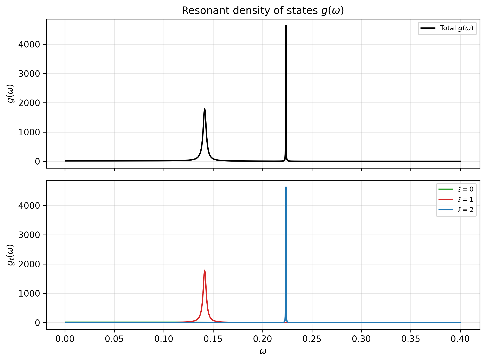
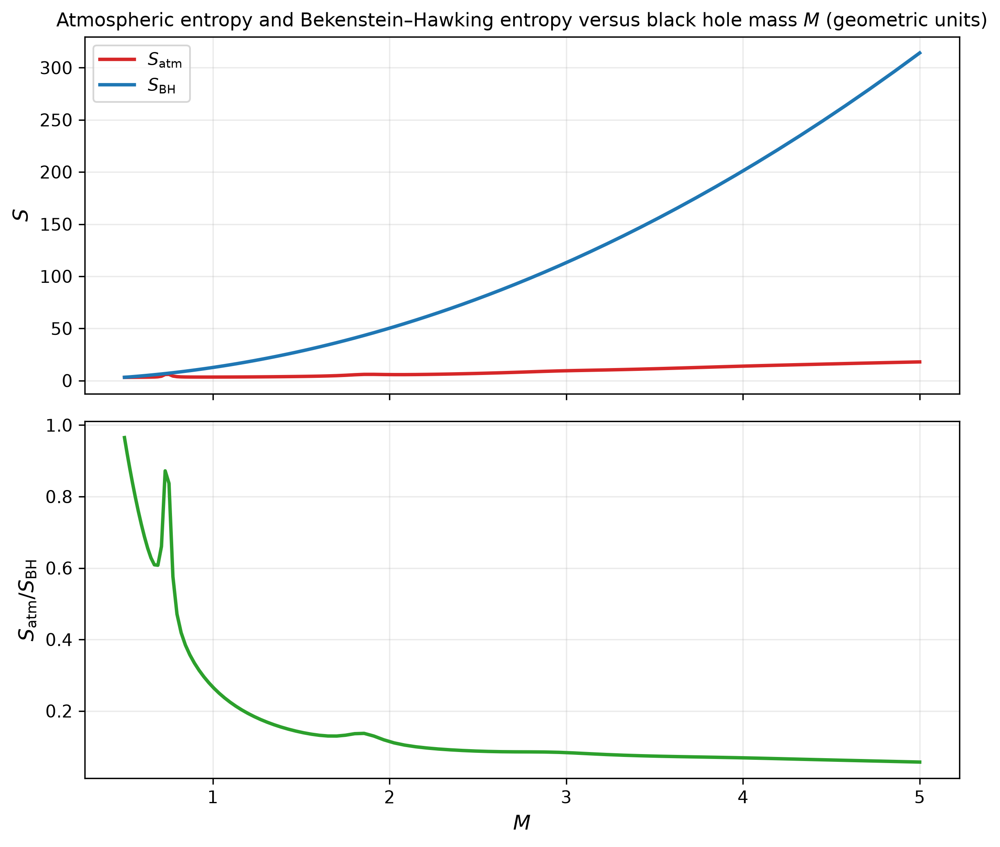

| Item | Content |
| :--- | :--- |
| Title | Thermodynamic Study of Scalar Quasi‑Bound Thermal Atmosphere near the Horizon of Schwarzschild Black Holes |
| Author | Max Lance |
| Version | 1.0 |
| Date | 2026‑11‑21 |
| License | CC BY‑NC 4.0 |
| Keywords | black‑hole thermodynamics, quasi‑bound states, Regge‑Wheeler potential, Hawking temperature, thermal‑atmosphere entropy |
---
<br>

# Thermodynamic Study of Scalar Quasi‑Bound Thermal Atmosphere near the Horizon of Schwarzschild Black Holes
## 1. Abstract
The gravitational potential barrier near the photon sphere of a Schwarzschild black hole can trap massless scalar perturbations and form quasi‑bound resonant modes with finite tunneling lifetime. Under continuous thermal excitation from the Hawking thermal bath, dynamical equilibrium is established between mode tunneling decay and thermal population, sustaining a steady‑state near‑horizon scalar thermal atmosphere outside the horizon. Starting from the Regge‑Wheeler perturbation equation, this paper determines resonant frequencies and tunneling decay widths for low‑order angular modes and constructs the resonant density of states of the system. The statistical entropy of the thermal atmosphere is numerically evaluated within Bose statistics, and the dependence of entropy on the outer radial cutoff thickness is examined. By scanning the black‑hole‑mass parameter, we compare the thermal‑atmosphere entropy with the Bekenstein‑Hawking entropy. The numerical results show that quasi‑bound resonances are significantly excited for small‑mass black holes with high Hawking temperature, such that the atmospheric entropy can be comparable to the intrinsic black‑hole entropy. As the black‑hole mass increases, the Hawking temperature drops and thermal excitation is suppressed; the atmospheric entropy accounts for only a small fraction of black‑hole entropy. Our results indicate that quasi‑bound thermal degrees of freedom outside the horizon can contribute non‑negligibly to the total thermodynamic entropy of small black holes.

## 2. Data and Methods
### 2.1 Spacetime Background and the Regge‑Wheeler Equation
We adopt geometric units $`G=c=\hbar=1`$. The Schwarzschild metric reads:

$$
ds^2 = -\left(1-\frac{2M}{r}\right)dt^2 + \left(1-\frac{2M}{r}\right)^{-1}dr^2 + r^2(d\theta^2+\sin^2\theta d\phi^2)
$$

The horizon locates at $`r_h=2M`$, and the photon‑sphere position is $`r_\gamma=3M`$. The massless scalar field $`\Phi`$ satisfies the Klein‑Gordon equation

$$
\nabla^\mu\nabla_\mu \Phi = 0
$$

We impose the separation‑of‑variables ansatz

$$
\Phi(t,r,\theta,\phi) = \frac{1}{r}\Psi(r,t)Y_{\ell m}(\theta,\phi)
$$

where $`Y_{\ell m}`$ are spherical harmonics and $`\ell`$ denotes the angular harmonic index. Introduce the tortoise coordinate

$$
r_* = r + 2M\ln\left(\frac{r}{2M}-1\right)
$$

Radial perturbations obey the one‑dimensional Regge‑Wheeler wave equation

```math
\frac{d^2\psi}{d r_{*}^2}+(\omega^2-V_{\ell}(r_{*}))\psi=0
```

The effective potential is given by:

$$
V_\ell(r_*) = \left(1-\frac{2M}{r}\right)\left(\frac{\ell(\ell+1)}{r^2}+\frac{2M}{r^3}\right)
$$

A potential barrier forms near the photon sphere. Modes with frequencies below the barrier peak undergo quasi‑trapping. Quasi‑bound resonances are described by complex frequencies $`\omega=\omega_R-i\Gamma/2`$, where $`\omega_R`$ is the real resonant frequency and $`\Gamma`$ denotes the tunneling decay width.


*Figure 1: Regge‑Wheeler effective potential $`V_\ell(r_*)`$ for angular indices $`\ell=0,1,2`$. The potential barrier arises near the photon sphere and traps scalar quasi‑bound resonant modes, forming the dynamical foundation of the near‑horizon thermal atmosphere.*

### 2.2 Construction of Resonant Density of States
Narrow quasi‑bound resonances in each angular channel are described by Lorentzian line shapes for the density of states

$$
g_\ell(\omega)=\frac{1}{2\pi}\frac{\Gamma_\ell}{(\omega-\omega_\ell)^2+\Gamma_\ell^2/4}
$$

$`\omega_\ell`$ is the central resonant frequency of the channel and $`\Gamma_\ell`$ is the corresponding decay width. Summing over low‑order angular modes with degeneracy weight $`2\ell+1`$ yields the total density of states

$$
g(\omega)=\sum_{\ell}(2\ell+1)\,g_\ell(\omega)
$$

Only $`\ell=0,1,2`$ are included in our calculation. Higher‑angular‑order modes possess higher potential‑barrier peaks, their resonant frequencies lie far outside the thermal window, and their thermal‑excitation contributions are negligible and discarded.


*Figure 2: Resonant density of states $`g(\omega)`$, decomposed for angular harmonics $`\ell=0,1,2`$. Sharp Lorentzian peaks correspond to quasi‑bound resonances trapped by the potential barrier.*

### 2.3 Bose Statistics and Thermal‑Entropy Integration
The Hawking temperature in geometric units is defined as:

$$
T_H=\frac{1}{8\pi M}
$$

The Bose‑Einstein distribution function reads:

$$
f(\omega)=\frac{1}{\exp\left(\omega/T_H\right)-1}
$$

The entropy element for a single bosonic mode is:

$$
s(\omega)=(1+f)\ln(1+f)-f\ln f
$$

The statistical entropy of the thermal atmosphere is obtained via frequency integration over the density of states:

$$
S_{\rm atm}=\int g(\omega)\,s(\omega)\,d\omega
$$

The Bekenstein‑Hawking entropy of the black hole is:

$$
S_{\rm BH}=4\pi M^2
$$

To test the outer‑boundary sensitivity of our results, we introduce a geometric cutoff thickness $`\delta_{\rm geo}`$ and vary the outer radial integration boundary to examine convergence behavior of $`S_{\rm atm}`$.


*Figure 3: Thermal‑film entropy as a function of geometric cutoff thickness $`\delta_{\rm geo}`$. The Bekenstein‑Hawking entropy and total entropy are also plotted. Results show that atmospheric entropy is insensitive to the outer radial cutoff and exhibits good convergence. The inset provides a schematic diagram for the near‑horizon thermal‑film picture.*

### 2.4 Black‑Hole‑Mass Scanning Scheme
We perform logarithmically uniform scanning of black‑hole mass over the parameter range $`M\in[0.5,5.0]`$. For each black‑hole mass, we recompute effective potentials, resonance widths and density of states. Numerical integration yields $`S_{\rm atm}`$, together with $`S_{\rm BH}`$ and entropy ratio $`S_{\rm atm}/S_{\rm BH}`$.

## 3. Numerical Results
### 3.1 Main Computational Parameters
| Physical quantity | Parameter description |
| :--- | :--- |
| Angular harmonic indices | $`\ell=0,1,2`$ |
| Black‑hole‑mass scanning interval | $`M\in[0.5,5.0]`$ (geometric units) |
| Hawking temperature | $`T_H=1/(8\pi M)`$ |
| Bekenstein‑Hawking entropy | $`S_{\rm BH}=4\pi M^2`$ |

### 3.2 Cutoff Convergence Results
Numerical experiments show that thermal‑atmosphere entropy saturates and exhibits little drift once the outer‑cutoff thickness exceeds a certain value. The artificially chosen outer radial boundary does not dominate final entropy results. This demonstrates that thermal‑atmosphere entropy originates from near‑horizon quasi‑bound modes rather than spurious effects introduced by the far‑field artificial cutoff.

### 3.3 Evolution of Entropy with Black‑Hole Mass
Small‑mass black holes at $`M\sim0.5`$ possess high Hawking temperature, quasi‑bound modes are heavily thermally populated and the ratio between atmospheric entropy and black‑hole entropy is large. As $`M`$ increases, Hawking temperature decreases and thermal excitation is suppressed. A mild bump near $`M\approx2`$ arises from crossing between resonant frequencies and the thermal window. The ratio smoothly decreases toward a small constant in the large‑mass regime.


*Figure 4: Upper subplot: thermal‑atmosphere entropy $`S_{\rm atm}`$ and Bekenstein‑Hawking entropy $`S_{\rm BH}`$ against black‑hole mass $`M`$. Lower subplot: entropy ratio $`S_{\rm atm}/S_{\rm BH}`$. Thermal excitation is prominent for small‑mass black holes and suppressed for large‑mass black holes. The mild convex feature near $`M\approx2`$ originates from crossing between resonances and the thermal window.*

## 4. Model Self‑Consistency and Physical Constraints
Our model contains several key assumptions and limitations:
1. The thermal atmosphere is a **dynamical steady‑state system**: quasi‑bound modes continuously tunnel into the horizon and infinity; steady‑state balance is maintained via continuous replenishment from the Hawking thermal bath, instead of static bound clouds.
2. Only massless scalar fields are considered; contributions from vector and spinor fields are omitted.
3. Only low‑order angular modes $`\ell=0,1,2`$ are adopted. Higher‑angular‑order modes have excessively high resonant frequencies and negligible thermal excitation and are not included.
4. Calculations are performed on a fixed Schwarzschild background spacetime. **Gravitational back‑reaction from scalar‑field energy onto the metric is neglected**.
5. Equilibrium‑statistical assumptions are adopted; the system is supposed to have fully reached thermal equilibrium at Hawking temperature.

Our model does not modify horizon geometry and is compatible with the fundamental Schwarzschild black‑hole geometry. The thermal atmosphere resides entirely outside the horizon and does not alter the definition of black‑hole horizon area.

## 5. Discussion
Conventional black‑hole thermodynamics attributes all horizon‑associated entropy to Bekenstein‑Hawking entropy. Outside‑horizon fields are conventionally treated merely as outgoing Hawking‑radiation flux. Our results suggest that part of scalar degrees of freedom can be “trapped” outside the horizon by the photon‑sphere potential barrier, forming an independent thermal subsystem carrying considerable statistical entropy.

For small‑mass black holes, sufficiently high Hawking temperature efficiently excites quasi‑bound resonances, and atmospheric entropy can approach the intrinsic black‑hole entropy. For large‑mass black holes, low temperature renders contributions from these outer degrees of freedom minor. The local bump near $`M\approx2`$ is not numerical noise but a genuine model feature produced when resonant frequencies sweep across the thermal‑distribution window.

This picture does not overthrow black‑hole thermodynamics; rather it provides supplementary insight: **apart from horizon‑located degrees of freedom, quasi‑trapped quasi‑bound thermal modes outside the horizon also contribute to total thermodynamic degrees of freedom near black holes**. At present this effect remains a theoretical numerical prediction without direct observational tests. Future extensions can include rotating Kerr black holes and higher radial overtone modes.

## 6. Conclusion
This paper carries out numerical thermodynamic investigations on scalar quasi‑bound resonances outside the horizon of Schwarzschild black holes. Quasi‑bound modes generated by the Regge‑Wheeler potential can form dynamically sustained near‑horizon thermal atmospheres driven by the Hawking bath. Numerical computations verify that atmospheric entropy converges and is insensitive to the outer radial cutoff. For small‑mass black holes, thermal‑atmosphere entropy reaches considerable magnitudes comparable to Bekenstein‑Hawking entropy. As black‑hole mass grows, Hawking temperature decreases and the fractional contribution of atmospheric entropy declines.

Our results demonstrate that besides intrinsic horizon degrees of freedom, quasi‑bound thermal modes trapped by outer‑horizon potential barriers can yield non‑negligible corrections to total thermodynamic entropy for small black holes. This work represents a purely theoretical model and awaits further extensions and observational examinations.
