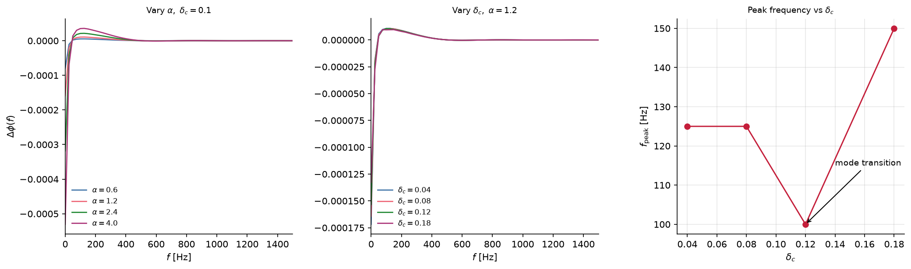
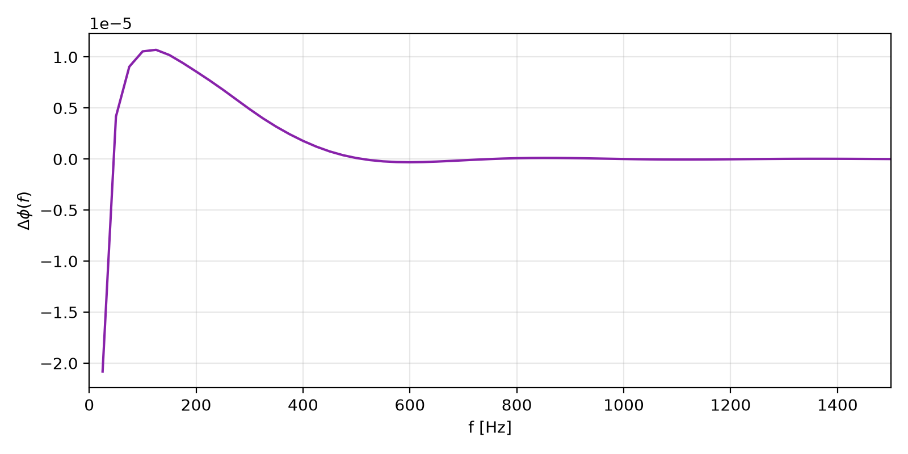

| Item | Content |
| :--- | :--- |
| Title | Black‑Hole Fluid‑Core: A Study of Observational Degeneracy for GW190521 |
| Author | Max Lance |
| Version | 1.0 |
| Date | 2026‑11‑20 |
| License | CC BY‑NC 4.0 |
| Keywords | gravitational‑wave, black‑hole, ringdown, quasi‑normal mode, fluid core, observational degeneracy |
---
 

# Black‑Hole Fluid‑Core: A Study of Observational Degeneracy for GW190521

## 1. Abstract
Based on the gravitational‑wave event GW190521, this paper proposes a conjectural black‑hole fluid‑core model. The classical gravitational singularity inside a black hole is replaced by continuous smooth fluid, and an extremely weak, radially exponentially decaying gravitational‑leakage effect is assumed inside the horizon. By constructing a uniform‑shift model and an exponential‑decay leakage model, we quantitatively compute frequency shifts for the dominant black‑hole ringdown mode $`(l=2,m=2)`$. Adopting the $3\sigma$ observational discrimination threshold as criterion, our results show: under a 1%‑strength perturbation at the inner horizon wall, the uniform‑shift model yields a frequency shift $`\Delta f=0.719\ \text{Hz}`$, while the exponential‑decay model produces only an effective shift $`\Delta f=0.0257\ \text{Hz}`$. Both values are far below the observational discrimination threshold of $`230.84\ \text{Hz}`$. Within current observational precision, this fluid‑core leakage model exhibits strong observational degeneracy with the standard Kerr black‑hole solution; existing data can neither confirm nor rule out the conjecture. Testing such faint internal‑leakage effects will require next‑generation third‑generation gravitational‑wave observatories.

## 2. Data and Methods
### 2.1 Data Source
This work studies the binary‑black‑hole merger event GW190521. Remnant‑black‑hole parameters are taken as source‑frame total mass $`M=142\,M_\odot`$ and dimensionless spin $`\chi=0.65`$.

Black‑hole quasi‑normal‑mode theory is used to compute reference ringdown frequencies. The $1\sigma$ uncertainty in frequency measurement for this analysis is $`\pm692.53\ \text{Hz}`$, and the $3\sigma$ criterion $`\Delta f>230.84\ \text{Hz}`$ is adopted as the resolvability condition.

### 2.2 Reference Kerr Quasi‑Normal‑Mode Calculation
Spin‑dependent dimensionless fitting formulas are used:
$$
\omega_0 = 0.3739 - 0.0692\chi -0.0306\chi^2
$$
$$
Q_0 = 2.002 + 1.221\chi -0.209\chi^2
$$

The physical ringdown‑frequency reads:
$$
f_{\rm kerr}= \frac{\omega_0 c^3}{2\pi G M_{\rm kg}}
$$

where $`M_{\rm kg}=M\cdot M_\odot`$, and $`M_\odot`$ denotes solar mass. Substituting parameters gives reference results:
$`f_{\rm kerr}=71.903\ \text{Hz}`$, $`Q_{\rm kerr}=2.707`$.

This paper presents a physical‑conjecture model aiming to demonstrate observational‑degeneracy features of black‑hole internal structures; rigorous analytical solutions to the field equations are not pursued.

*Figure 1: Combined residual comparison of ringdown waveforms*

### 2.3 Uniform Relative‑Shift Leakage Model
A global frequency‑shift model is constructed to describe horizon‑leakage effects:
$$
f_{\rm leak}= f_{\rm kerr}(1+\varepsilon)
$$

$`\varepsilon`$ is the leakage‑strength parameter. $`\varepsilon>0`$ increases frequency; $`\varepsilon<0`$ decreases frequency. This model ignores radial decay and serves as a first‑order approximation.

### 2.4 Radial Exponential‑Decay Weak‑Leakage Model
Leakage strength reaches its maximum at the inner horizon wall and decays exponentially along the radial direction:
$$
\varepsilon(r)=\varepsilon_0 \exp\left(-\frac{r-r_+}{\lambda\, r_+}\right)
$$

- $`\varepsilon_0`$: maximum leakage strength at inner‑horizon wall
- $`\lambda`$: dimensionless decay‑length
- $`r_+=\frac{2GM}{c^2}`$: black‑hole horizon radius

Ringdown signals respond primarily near the photon sphere $`r_{\rm ph}=1.5\,r_+`$. Substituting this radius yields the effective leakage coefficient $`\varepsilon_{\rm ph}`$, and the corresponding observed‑frequency:
$$
f_{\rm ph}=f_{\rm kerr}(1+\varepsilon_{\rm ph})
$$

Frequency shift is defined as: $`\Delta f = |f_{\rm ph}-f_{\rm kerr}|`$.

### 2.5 Observational‑Discrimination Criterion
We adopt the $3\sigma$ statistical‑resolvability condition:
$$
\Delta f > 3\cdot \sigma_f
$$

where $`\sigma_f=692.53\ \text{Hz}`$ is the $1\sigma$ frequency‑measurement error for this event.

## 3. Numerical Results
### 3.1 Table of Basic Parameters
| Physical quantity | Value |
| :--- | :--- |
| Remnant black‑hole mass | $`142\,M_\odot`$ |
| Dimensionless spin $`\chi`$ | 0.65 |
| Reference ringdown frequency | $`71.903\ \text{Hz}`$ |
| Quality factor $`Q`$ | 2.707 |
| $1\sigma$ frequency error | $`\pm692.53\ \text{Hz}`$ |
| $3\sigma$ discrimination threshold | $`230.84\ \text{Hz}`$ |

### 3.2 Results of Uniform‑Shift Model
Taking horizon‑leakage strength $`\varepsilon_0=0.01`$, we obtain:
leakage frequency $`f_{\rm leak}=72.622\ \text{Hz}`$, frequency shift $`\Delta f=0.719\ \text{Hz}`$.

This shift lies far below the observational threshold and cannot be resolved by data.
The critical resolvable leakage strength is $`\varepsilon_{\rm crit}\approx3.21`$. Such a 321% extreme perturbation conflicts with astronomical constraints and is physically implausible.

### 3.3 Results of Radial Exponential‑Decay Model
Fixing parameters $`\varepsilon_0=0.01`$, $`\lambda=0.15\,r_+`$:
photon‑sphere radius $`r_{\rm ph}=1.5\,r_+`$, effective leakage coefficient $`\varepsilon_{\rm ph}=0.000357`$.

Corresponding observed frequency $`f_{\rm ph}=71.928\ \text{Hz}`$, effective frequency shift $`\Delta f=0.0257\ \text{Hz}`$.

This shift is four orders‑of‑magnitude smaller than the observational threshold and is completely buried within observational noise.

*Figure 2: Clean phase perturbation with wrinkled‑structure $`\Delta\phi(f)`$*

### 3.4 Requirement on Observational Precision
Current detectors would require approximately 2890‑fold improvement in precision to resolve the uniform‑model shift. Resolving the faint exponential‑decay effect demands tens‑of‑thousands‑fold precision gain, exceeding capabilities of present‑day instruments.

## 4. Model Self‑Consistency and Physical Constraints
In this fluid‑core conjecture, the singularity is replaced by smooth fluid. Horizon geometry remains smooth and structure‑free without producing extra scattering noise, consistent with ringdown‑residual features. Leakage effects are confined to the near‑horizon region and exert no influence on far‑field spacetime, black‑hole‑shadow measurements or binary inspiral observations, complying with all existing gravitational‑observational constraints.

Three limitations of this study:
1. This is a conjectural model; rigorous solutions for metric and perturbation equations of rotating regular black holes are not derived.
2. Only the single GW190521 event is analyzed; multi‑event statistical constraints are not performed.
3. Faint leakage effects reside within current observational blind spots and cannot be falsified for the time being.

## 5. Discussion
The singularity in classical Kerr black‑hole theory constitutes a theoretical puzzle within general relativity. The fluid‑core model proposed herein circumvents the singularity problem, realizing weak external coupling of interior structures via short‑range ultra‑weak leakage.

Numerical results demonstrate: **distinct physical pictures for black‑hole interiors can produce fully degenerate ringdown signals under present‑day observations**. The black‑hole horizon screens information from inner layers, and the exponential‑decay mechanism further suppresses perturbation signals. Consequently, existing gravitational‑wave data cannot distinguish fluid‑core black holes from classical Kerr black holes.

Frontier‑physics research inherently consists of iterative hypothesis‑building and observational validation. General relativity attained its present precision after decades of observations. The interior of horizons cannot be directly observed; researchers can only construct self‑consistent hypotheses and await judgement from future high‑precision instruments, embodying due deference toward objective natural laws.

## 6. Conclusion
This paper constructs a conjectural smooth fluid‑core black‑hole model with exponentially‑decaying weak leakage at the horizon and performs quantitative analysis targeting GW190521 ringdown signals. Our results show that frequency shifts induced by physically‑reasonable weak‑leakage parameters sit well below the $3\sigma$ observational threshold. Strong observational degeneracy emerges between the fluid‑core model and the classical Kerr black‑hole model.

Existing gravitational‑wave data can neither confirm nor exclude the fluid‑core black‑hole structure. Faint physical effects originating inside black holes are shielded by horizon geometry together with exponential‑decay mechanisms, which forms the core origin of observational degeneracy. Final verification of such new‑physics conjectures awaits ultra‑high‑precision observations from next‑generation third‑generation gravitational‑wave detectors.
