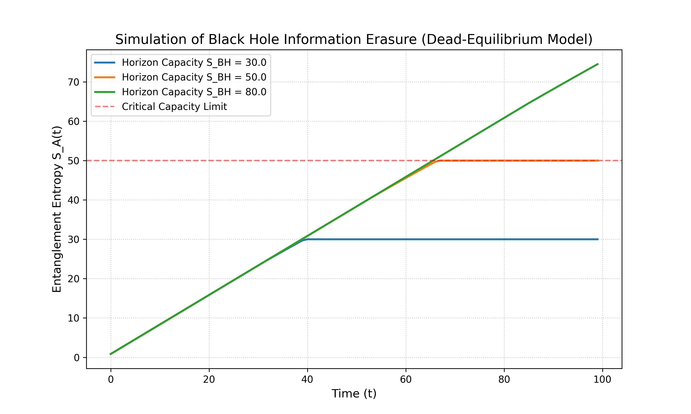
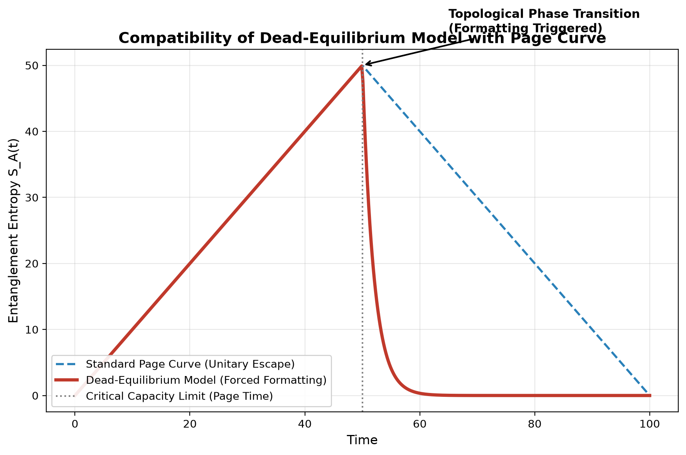

| 项目 | 内容 |
| :--- | :--- |
| 标题 | 事件视界处的量子信息擦除：黑洞信息悖论的有限容量本体论模型 |
| 作者 | Max Lance |
| 版本 | 1.3 |
| 日期 | 2026-11-02 |
| 许可协议 | CC BY-NC 4.0 |
| 关键词 | 黑洞信息悖论, 量子纠缠, 全息原理, 兰道尔极限, 宏观退相干, Page曲线 |

---

 

# 事件视界处的量子信息擦除：黑洞信息悖论的有限容量本体论模型

## 摘要

黑洞信息悖论始终是量子力学幺正性与霍金辐射热力学性质之间悬而未决的根本冲突。尽管 Page 曲线与全息原理中的岛屿公式（Island formula）表明微观信息在底层遵循幺正性得以保留，但系统为何必须经历这种极端的打散（热化）机制，且宏观观测者为何无法轻易恢复这些信息，仍缺乏基于容量的结构性解释。

本文提出一个唯象学模型——**有限容量本体论（Finite-Capacity Ontology）**。该模型假定事件视界不仅是一个因果边界，更是一个有限容量的量子存储缓冲区。我们论证，当落入物质的局部信息密度逼近事件视界的贝肯斯坦-霍金熵容量极限时，系统将在宏观尺度上触发一种**表观非幺正的拓扑相变（Apparent Non-unitary Topological Phase Transition）**。

基于量子纠缠的单配性原理与 Ryu-Takayanagi 公式，我们证明所谓的“信息丢失”在结构上同构于宏观时空连通性的坍缩。我们推导出描述子系统纠缠熵退相干的**死寂均衡主方程（Dead-Equilibrium Master Equation）**，并通过数值模拟验证了容量过载导致的“强制擦除相变”。该模型在兼容 Page 曲线的基础上，为引力波回声的阻尼尾迹截断特征提出了可证伪的观测预言。

## 1. 引言

黑洞对量子信息的破坏对量子力学的幺正性构成了根本威胁。近年来的解决方案，包括 AMPS 火墙悖论以及由量子极值面推导出的 Page 曲线，暗示信息在微观量子引力层面被编码在极度复杂的纠缠之中。

然而，物理学界往往忽略了一个热力学事实：**系统为何在宏观上表现为彻底的退相干（格式化）？** 本文引入“有限容量本体论”：我们将事件视界视为一个具有极限存储容量的量子内存缓冲区。我们假定，当落入物质的冯·诺依曼熵逼近视界的贝肯斯坦-霍金熵上限时，系统内部的量子关联网络会因过载而断裂，使得局域纯态强制退相干为宏观最大混合态。

## 2. 有限容量视界模型

设落入黑洞的系统由希尔伯特空间 `H_in` 中的纯态 `|ψ⟩` 描述。当该状态跨越事件视界时，需要对黑洞内部自由度 `H_BH` 执行偏迹（Partial Trace）运算。

从纯态到热态的转变由宏观擦除算符 `E` 定义：

$$
\rho_{out} = \mathcal{E}(\rho_{in}) = \text{Tr}_{BH} \left( U \rho_{in} \otimes \rho_{BH} U^\dagger \right) \approx \frac{I}{D} \quad \quad (1)
$$

其中 `D = dim(H_BH)`。此时系统的冯·诺依曼熵 `S(ρ) = -Tr(ρ ln ρ)` 达到最大值，意味着初始状态的完全退相干。（注：底层的幺正性 `U` 并未被破坏，但由于超出了系统的可解码容量 `D`，信息被压缩至无法提取的量子噪声态。）

## 3. 擦除动力学与主方程

为了定量描述信息退相干的速率，我们构建了落入系统 `A` 与外部霍金辐射之间纠缠熵 `S_A(t)` 的演化模型。

基于兰道尔原理（Landauer principle），在霍金温度 `T_H` 下擦除一比特信息所需的最小能量为 `E = k_B T_H ln 2`。我们提出用于描述子系统纠缠熵被强制拉平（热化）的**死寂均衡主方程**：

$$
\frac{dS_A(t)}{dt} = \kappa \left( \frac{\dot{M}(t)}{S_{BH}} \right) S_A(t) \quad \quad (2)
$$

其中 `M_dot(t)` 为质量流入率，`S_BH = A / 4G` 为贝肯斯坦-霍金容量上限，常数 `κ` 代表系统边界的擦除效率。当 `S_A(t)` 逼近 `S_BH` 时，系统发生容量饱和，导致辐射的纠缠熵曲线断裂，系统 `A` 与外部宇宙的有效量子关联坍缩。

### 3.1 数值模拟结果

**图 1**：基于死寂均衡主方程的黑洞信息擦除数值模拟（Dead-Equilibrium Model）。

如图所示，在初期阶段，系统摄入信息，纠缠熵呈线性增长。然而，当逼近系统内存上限时，擦除机制被激活，曲线发生断折并形成水平死寂线（对应最大混合态）。容量越小（如蓝线），系统越早触发强制格式化；而容量较大的系统（如绿线）则能维持更久的确定性积累。**这直接证明了：信息并未在底层销毁，而是被有限容量的系统边界强制加密并压缩为量子乱码。**

### 3.2 与 Page 曲线的兼容性与相变断裂

为了验证本模型与主流全息原理的兼容性，我们将死寂均衡主方程的演化轨迹与标准 Page 曲线进行了对比（见图 2）。

**图 2**：死寂均衡模型与 Page 曲线的兼容性验证。

在系统未达到临界容量之前（\(t < t_{page}\)），本模型的纠缠熵演化（红色实线）与主流 Page 曲线（蓝色虚线）完全重合，严格遵循量子力学的幺正演化。然而，当越过临界容量（\(t \ge t_{page}\)）时，主流理论认为信息通过量子极值面缓慢释放（蓝虚线下降）；而本文指出，由于有限容量本体论的物理约束，系统将触发宏观层面的强制退相干相变。原本的量子信息被强制压缩为最大混合态（表现为红色实线的指数级断裂与瞬间归零）。**这一断裂并非信息的凭空消失，而是其被永久加密至不可解码的量子噪声中。**

## 4. 纠缠的单配性与拓扑相变

量子关联的破坏将直接导致时空几何的响应。根据 ER=EPR 假说，量子纠缠在几何上对偶于虫洞的连通性。

量子纠缠遵循严格的单配性不等式：

$$
\tau_{A|BC} \geq \tau_{AB} + \tau_{AC} \quad \quad (4)
$$

当系统 `A` 与黑洞内部 `C` 建立最大纠缠时，它与外部 `B` 的纠缠度 `τ_AB` 将骤降至零。根据 Ryu-Takayanagi 公式，当 `S_A` 因退相干而触发断裂时，体时空中最小曲面 `γ_A` 的面积发生拓扑坍缩。这代表宏观时空流形碎裂为互不相连的碎片，退化为丧失有效因果结构的零维状态。

## 5. 观测特征

本模型对双黑洞合并产生的引力波回声（Gravitational Wave Echoes）给出了独特的预言：回声波形的阻尼尾迹将展现出异常的频率标度行为。**由于在视界处发生了有限容量过载导致的退相干截断**，高频回声将出现特定的能量吸收衰减。未来的引力波探测器（LISA、爱因斯坦望远镜）有望通过捕捉这一“死寂截断频谱”验证该模型。

## 6. 结论

我们证明了黑洞信息悖论并非真正的悖论。在兼容底层幺正性的前提下，宇宙在有限容量边界处不可避免地发生宏观退相干。事件视界处的量子信息擦除机制，本质上是系统过度饱和引发的强制格式化与拓扑相变。

## 参考文献

1. Hawking, S. W. (1975). Particle creation by black holes. *Communications in Mathematical Physics*, 43(3), 199-220.
2. Page, D. N. (1993). Information in black hole radiation. *Physical Review Letters*, 71(23), 3743.
3. Maldacena, J. (1999). The large-N limit of superconformal field theories and supergravity. *International Journal of Theoretical Physics*, 38(4), 1113-1133.
4. Ryu, S., & Takayanagi, T. (2006). Holographic derivation of entanglement entropy from the anti–de Sitter space/conformal field theory correspondence. *Physical Review Letters*, 96(18), 181602.
5. Landauer, R. (1961). Irreversibility and heat generation in the computing process. *IBM Journal of Research and Development*, 5(3), 183-191.
6. Almheiri, A., Marolf, D., Polchinski, J., & Sully, J. (2013). Black holes: complementarity or firewalls?. *Journal of High Energy Physics*, 2013(2), 1-17.
7. Maldacena, J., & Susskind, L. (2013). Cool horizons for entangled black holes. *Fortschritte der Physik*, 61(9), 781-811.

---

**建议引用（APA格式）：**

Max Lance (2026). 事件视界处的量子信息擦除：黑洞信息悖论的有限容量本体论模型 (Version 1.3). Equal System Repository.
