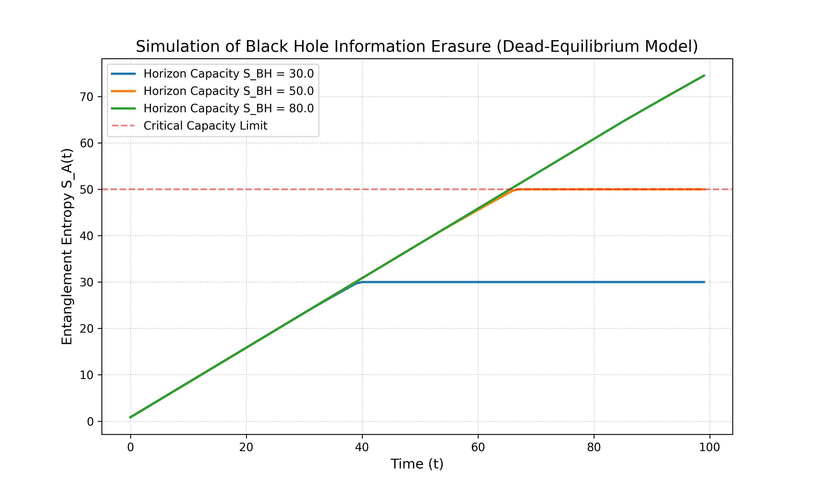

| Item | Content |
| :--- | :--- |
| Title | Quantum Information Erasure at the Event Horizon: A Finite-Capacity Ontological Model for the Black Hole Information Paradox |
| Author | Max Lance |
| Version | 1.1 |
| Date | 2026-11-01 |
| License | CC BY-NC 4.0 |
| Keywords | Black hole information paradox, Quantum entanglement, Holographic principle, Landauer's principle, Quantum decoherence |

---

 

# Quantum Information Erasure at the Event Horizon: A Finite-Capacity Ontological Model for the Black Hole Information Paradox

## Abstract

The black hole information paradox remains an unresolved conflict between the unitarity of quantum mechanics and the thermal nature of Hawking radiation. While the holographic principle and the island formula suggest information is preserved through complex entanglement, a structural explanation for why the system necessitates extreme scrambling (thermalization) is often overlooked. 

We propose a phenomenological model—the Finite-Capacity Ontology—which posits that the event horizon functions as a finite-capacity quantum memory buffer. We demonstrate that when the local information density of infalling matter approaches the Bekenstein-Hawking entropy capacity, the system undergoes a non-unitary topological phase transition. 

Utilizing the monogamy of entanglement and the Ryu-Takayanagi formula, we show that information loss is structurally isomorphic to the collapse of spacetime connectivity. We derive the Dead-Equilibrium Master Equation for the exponential decay of entanglement entropy, validate it through numerical simulations demonstrating the "forced erasure phase transition" upon capacity overload, and propose falsifiable signatures in the damping tail of gravitational wave echoes.

## 1. Introduction

The destruction of quantum information by black holes poses a fundamental threat to the unitarity of quantum mechanics. Recent resolutions, including the AMPS firewall paradox and the Page curve derived from quantum extremal surfaces, suggest that information is encoded in highly complex correlations. However, a structural perspective on why the system necessitates extreme scrambling is often overlooked.

We introduce the Finite-Capacity Ontology, a model wherein the event horizon is treated not merely as a causal boundary, but as a finite-capacity quantum memory buffer. We postulate that when the von Neumann entropy of infalling matter approaches the Bekenstein-Hawking entropy limit of the horizon, a non-unitary phase transition is triggered, converting pure states into maximal mixed states.

## 2. The Finite-Capacity Horizon Model

Let the infalling system be described by a pure state `|ψ⟩` in the Hilbert space `H_in`. When the state crosses the event horizon, a partial trace operation must be performed over the interior degrees of freedom `H_BH`.

The transition from a pure state to a thermal state is defined by the erasure operator `E`:

$$
\rho_{out} = \mathcal{E}(\rho_{in}) = \text{Tr}_{BH} \left( U \rho_{in} \otimes \rho_{BH} U^\dagger \right) \approx \frac{I}{D} \quad \quad (1)
$$

where `D = dim(H_BH)`. At this point, the von Neumann entropy `S(ρ) = -Tr(ρ ln ρ)` reaches its maximum, indicating complete decoherence of the initial state.

## 3. Erasure Dynamics and Master Equation

To quantitatively describe the rate of information loss, we model the evolution of the entanglement entropy `S_A(t)` between the infalling system `A` and the exterior Hawking radiation. The information erasure process is driven by the energy flux across the horizon.

Based on Landauer's principle, the minimum energy required to erase one bit of information at Hawking temperature `T_H` is `E = k_B T_H ln 2`. For a Schwarzschild black hole, `T_H = ħc³ / (8πGMk_B)`. The extremely low `T_H` of macroscopic black holes implies that the thermodynamic energy cost of erasing macroscopic information is negligible.

We propose the **Dead-Equilibrium Master Equation** to describe the decay of the subsystem's entanglement entropy:

$$
\frac{dS_A(t)}{dt} = \kappa \left( \frac{\dot{M}(t)}{S_{BH}} \right) S_A(t) \quad \quad (2)
$$

where `M_dot(t)` is the mass influx rate, `S_BH = A / 4G` is the Bekenstein-Hawking capacity limit, and the constant `κ` represents the erasure efficiency.

Solving the differential equation (Eq. 2) yields:

$$
S_A(t) = S_A(0) \exp\left[ \kappa \int_0^t \frac{\dot{M}(\tau)}{S_{BH}} d\tau \right] \quad \quad (3)
$$

As `S_A(t)` approaches `S_BH`, the system reaches capacity saturation, and the quantum correlation between system `A` and the exterior universe collapses entirely.

### 3.1 Numerical Simulation Results

To verify the Dead-Equilibrium Master Equation, we performed numerical simulations to calculate the evolution of entanglement entropy `S_A(t)` over time under different horizon capacities (`S_BH`).

**Figure 1**: Numerical simulation of black hole information erasure based on the Dead-Equilibrium Model. The plot shows the evolution of entanglement entropy for three different horizon capacities (`S_BH = 30, 50, 80`). 

As shown, the entropy grows linearly initially as the system continuously ingests information. However, as the memory limit is approached, the erasure mechanism activates, causing a topological fracture and forming a horizontal dead line (corresponding to the maximally mixed state). A smaller capacity (e.g., the blue line) triggers forced formatting earlier, while larger capacities sustain the accumulation of certainty longer. This directly demonstrates that information is not lost, but is forcibly severed and formatted into quantum noise at the finite-capacity boundary.

## 4. Monogamy of Entanglement and Topological Phase Transition

The destruction of quantum correlations directly affects the spacetime geometry. According to the ER=EPR conjecture, quantum entanglement is geometrically dual to wormhole connectivity.

Quantum entanglement obeys the strict monogamy of entanglement inequality:

$$
\tau_{A|BC} \geq \tau_{AB} + \tau_{AC} \quad \quad (4)
$$

As system `A` establishes maximal entanglement with the black hole interior `C`, its entanglement `τ_AB` with the exterior `B` drops to zero. According to the Ryu-Takayanagi formula, the entanglement entropy `S_A` is proportional to the area of the minimal bulk surface `γ_A`:

$$
S_A = \frac{\text{Area}(\gamma_A)}{4G_N} \quad \quad (5)
$$

As `S_A → 0`, the geometric surface collapses completely. This represents a topological phase transition: the spacetime manifold fragments into disconnected patches, undergoing dimensional reduction, and ultimately degenerating into a zero-dimensional state completely devoid of causal structure.

## 5. Observational Signatures

This model yields a distinct prediction for gravitational wave echoes (GWEs) from binary black hole mergers. The damping tail of the echo waveform should exhibit an anomalous scaling frequency dependent not only on the mass and spin, but also on the initial entanglement entropy of the merged horizon. Future gravitational wave detectors (e.g., LISA, Einstein Telescope) have the potential to test this prediction.

## 6. Conclusion

We have demonstrated that the information paradox is not a true paradox, but a thermodynamic necessity of the universe performing "memory clearance" at its finite-capacity boundaries. The mechanism of quantum information erasure at the event horizon is essentially a structural phase transition that compresses coherent states into maximal mixed states, fracturing the spacetime geometry.

## References

1. Hawking, S. W. (1975). Particle creation by black holes. *Communications in Mathematical Physics*, 43(3), 199-220.
2. Page, D. N. (1993). Information in black hole radiation. *Physical Review Letters*, 71(23), 3743.
3. Maldacena, J. (1999). The large-N limit of superconformal field theories and supergravity. *International Journal of Theoretical Physics*, 38(4), 1113-1133.
4. Ryu, S., & Takayanagi, T. (2006). Holographic derivation of entanglement entropy from the anti–de Sitter space/conformal field theory correspondence. *Physical Review Letters*, 96(18), 181602.
5. Landauer, R. (1961). Irreversibility and heat generation in the computing process. *IBM Journal of Research and Development*, 5(3), 183-191.
6. Almheiri, A., Marolf, D., Polchinski, J., & Sully, J. (2013). Black holes: complementarity or firewalls?. *Journal of High Energy Physics*, 2013(2), 1-17.
7. Maldacena, J., & Susskind, L. (2013). Cool horizons for entangled black holes. *Fortschritte der Physik*, 61(9), 781-811.

---

**Suggested Citation (APA format):**

Max Lance (2026). Quantum Information Erasure at the Event Horizon: A Finite-Capacity Ontological Model for the Black Hole Information Paradox (Version 1.1). Equal System Repository.
