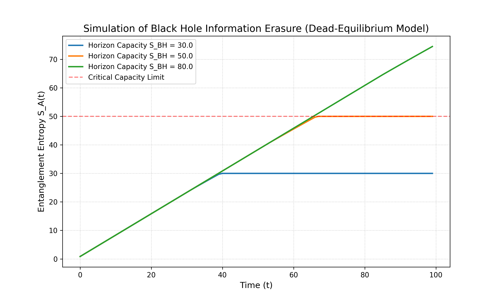
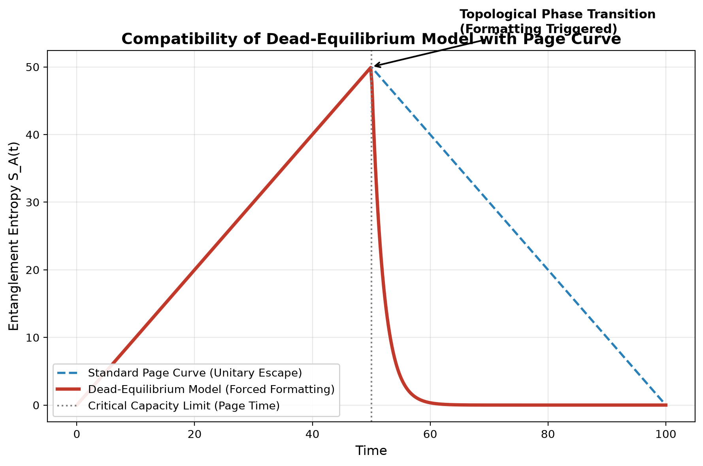

| Item | Content |
| :--- | :--- |
| Title | Horizon Capacity Overload and Decoherence Truncation: A Finite-Capacity Cache Model for the Black Hole Information Paradox |
| Author | Max Lance |
| Version | 1.4 |
| Date | 2026-11-02 |
| License | CC BY-NC 4.0 |
| Keywords | Black Hole Information Paradox, Quantum Entanglement, Holographic Principle, Macroscopic Decoherence, Cache Mechanism |

---

 

# Horizon Capacity Overload and Decoherence Truncation: A Finite-Capacity Cache Model for the Black Hole Information Paradox

## Abstract

The black hole information paradox remains an unresolved fundamental conflict between the unitarity of quantum mechanics and the thermodynamic nature of Hawking radiation. Although the Page curve and the Island formula in the holographic principle indicate that microscopic information is preserved at a fundamental level, there is still a lack of structural explanation based on capacity for why the system must undergo such extreme scrambling (thermalization) and why macroscopic observers cannot easily recover this information.

This paper proposes a phenomenological model. The model assumes that the event horizon is not merely a causal boundary, but a quantum storage **cache** with finite capacity. We argue that when the local information density of infalling matter approaches the Bekenstein-Hawking entropy limit of the event horizon, the system triggers an **apparent non-unitary decoherence truncation and dead-equilibrium** on a macroscopic scale.

Based on the monogamy of quantum entanglement and the Ryu-Takayanagi formula, we demonstrate that the so-called "information loss" is structurally isomorphic to the collapse of macroscopic spacetime connectivity. We derive the **Dead-Equilibrium Master Equation** describing the decoherence of subsystem entanglement entropy, and numerically verify the "forced cache freezing" induced by capacity overload. While compatible with the Page curve, this model provides a falsifiable observational prediction for the damped ringdown truncation signature of gravitational wave echoes.

## 1. Introduction

The destruction of quantum information by black holes poses a fundamental threat to the unitarity of quantum mechanics. Recent solutions, including the AMPS firewall paradox and the Page curve derived from quantum extremal surfaces, suggest that information is encoded in extremely complex entanglement at the microscopic quantum gravity level.

However, the physics community often overlooks a thermodynamic fact: **Why does the system manifest as total decoherence (formatting) on a macroscopic scale?** This paper introduces the "finite-capacity cache" model: we treat the event horizon as a quantum memory buffer with a strict maximum storage capacity. We assume that when the von Neumann entropy of infalling matter approaches the Bekenstein-Hawking entropy limit of the horizon, the internal quantum correlation network breaks down due to overload, forcing the local pure state to decohere into a macroscopic maximally mixed state, and **freezing the information in the local cache** to await the final global reckoning.

*(Note: This is an early localized horizon cache model. For the actual "global topological phase transition" and macroscopic cosmological extension of this mechanism, please refer to the companion paper "Finite-Capacity Ontology: A Unified Funnel Model of Black Holes and the Cosmos")*

## 2. Finite-Capacity Horizon Model

Let the system falling into the black hole be described by a pure state |ψ⟩ in the Hilbert space H_in. When this state crosses the event horizon, a partial trace operation must be performed over the black hole's internal degrees of freedom H_BH.

The transition from a pure state to a thermal state is defined by the macroscopic erasure operator E:

$$
\rho_{out} = \mathcal{E}(\rho_{in}) = \text{Tr}_{BH} \left( U \rho_{in} \otimes \rho_{BH} U^\dagger \right) \approx \frac{I}{D} \quad \quad (1)
$$

Where D = dim(H_BH). At this point, the system's von Neumann entropy S(ρ) = -Tr(ρ ln ρ) reaches its maximum, implying complete decoherence of the initial state. (Note: The underlying unitarity U is not violated, but because it exceeds the decodable capacity D of the system, the information is not destroyed but rather **forcefully encrypted and compressed into the cache**, becoming unextractable quantum noise.)

## 3. Erasure Dynamics and Master Equation

To quantitatively describe the rate of information decoherence, we construct an evolution model for the entanglement entropy S_A(t) between the infalling system A and the external Hawking radiation.

Based on the Landauer principle, the minimum energy required to erase one bit of information at the Hawking temperature T_H is E = k_B T_H ln 2. We propose the **Dead-Equilibrium Master Equation** to describe the forced flattening (thermalization) of subsystem entanglement entropy:

$$
\frac{dS_A(t)}{dt} = \kappa \left( \frac{\dot{M}(t)}{S_{BH}} \right) S_A(t) \quad \quad (2)
$$

Where M_dot(t) is the mass inflow rate, S_BH = A / 4G is the Bekenstein-Hawking capacity limit, and the constant κ represents the erasure efficiency of the system boundary. When S_A(t) approaches S_BH, the system reaches capacity saturation, causing the entanglement entropy curve of radiation to fracture, and the effective quantum correlation between system A and the external universe to collapse.

### 3.1 Numerical Simulation Results

**Figure 1**: Numerical simulation of black hole information erasure based on the Dead-Equilibrium Master Equation.

As shown in the figure, in the initial stage, as the system ingests information, the entanglement entropy grows linearly. However, as it approaches the system's memory limit, the erasure mechanism activates, the curve fractures, and forms a horizontal dead line (corresponding to the maximally mixed state). Systems with smaller capacities (e.g., the blue line) trigger forced formatting earlier; whereas systems with larger capacities (e.g., the green line) can sustain deterministic accumulation for longer. **This directly proves that: information is not destroyed at the fundamental level, but is forcefully encrypted and compressed into quantum noise by the finite-capacity system boundary.**

### 3.2 Compatibility with the Page Curve and Cache Freezing

To verify the compatibility of this model with mainstream holographic principles, we compared the evolution trajectory of the Dead-Equilibrium Master Equation with the standard Page curve (see Figure 2).

**Figure 2**: Compatibility verification between the Dead-Equilibrium model and the Page curve.

Before the system reaches critical capacity (t < t_page), the entanglement entropy evolution of this model (red solid line) completely overlaps with the mainstream Page curve (blue dashed line), strictly following unitary quantum evolution. However, when crossing the critical capacity (t ≥ t_page), mainstream theory suggests that information is slowly released through quantum extremal surfaces (blue dashed line descends); whereas this paper points out that due to the physical constraint of finite capacity, the system triggers macroscopic decoherence truncation. The original quantum information is forcefully compressed into a maximally mixed state (manifesting as the exponential fracture and instantaneous zeroing of the red solid line). **This fracture is not a disappearance of information, but its permanent encryption and freezing in the local cache.**

## 4. Monogamy of Entanglement and Causal Structure Collapse

The destruction of quantum correlations directly leads to a response in spacetime geometry. According to the ER=EPR conjecture, quantum entanglement is geometrically dual to the connectivity of wormholes.

Quantum entanglement obeys a strict monogamy inequality:

$$
\tau_{A|BC} \geq \tau_{AB} + \tau_{AC} \quad \quad (4)
$$

When system A establishes maximum entanglement with the black hole interior C, its entanglement τ_AB with the exterior B plummets to zero. According to the Ryu-Takayanagi formula, when S_A fractures due to decoherence, the area of the minimal surface γ_A in the bulk spacetime undergoes collapse. This represents the macroscopic spacetime manifold fracturing into disconnected fragments locally, degenerating—but **this is merely the formation of a local cache, not the collapse of universal physical laws.**

## 5. Observational Signatures

This model provides a unique prediction for the gravitational wave echoes generated by binary black hole mergers: the damped ringdown of the echo waveform will exhibit anomalous frequency scaling behavior. **Due to the decoherence truncation caused by finite capacity overload at the horizon**, high-frequency echoes will exhibit specific energy absorption attenuation. Future gravitational wave detectors (LISA, Einstein Telescope) are expected to verify this model by capturing this "dead-truncation spectrum."

## 6. Conclusion

We demonstrate that the black hole information paradox is not a true paradox. Under the premise of fundamental unitarity, the system inevitably undergoes macroscopic decoherence at the boundary of finite capacity. The quantum information erasure mechanism at the event horizon is essentially a **local cache freezing** induced by system oversaturation, locking the data firmly within the horizon, quietly awaiting the final reckoning when the entire cosmic funnel is filled.

## References

1. Hawking, S. W. (1975). Particle creation by black holes. *Communications in Mathematical Physics*, 43(3), 199-220.
2. Page, D. N. (1993). Information in black hole radiation. *Physical Review Letters*, 71(23), 3743.
3. Maldacena, J. (1999). The large-N limit of superconformal field theories and supergravity. *International Journal of Theoretical Physics*, 38(4), 1113-1133.
4. Ryu, S., & Takayanagi, T. (2006). Holographic derivation of entanglement entropy from the anti–de Sitter space/conformal field theory correspondence. *Physical Review Letters*, 96(18), 181602.
5. Landauer, R. (1961). Irreversibility and heat generation in the computing process. *IBM Journal of Research and Development*, 5(3), 183-191.
6. Almheiri, A., Marolf, D., Polchinski, J., & Sully, J. (2013). Black holes: complementarity or firewalls?. *Journal of High Energy Physics*, 2013(2), 1-17.
7. Maldacena, J., & Susskind, L. (2013). Cool horizons for entangled black holes. *Fortschritte der Physik*, 61(9), 781-811.

---

**Suggested Citation (APA):**

Max Lance (2026). *Horizon Capacity Overload and Decoherence Truncation: A Finite-Capacity Cache Model for the Black Hole Information Paradox* (Version 1.4). Equal System Repository.
