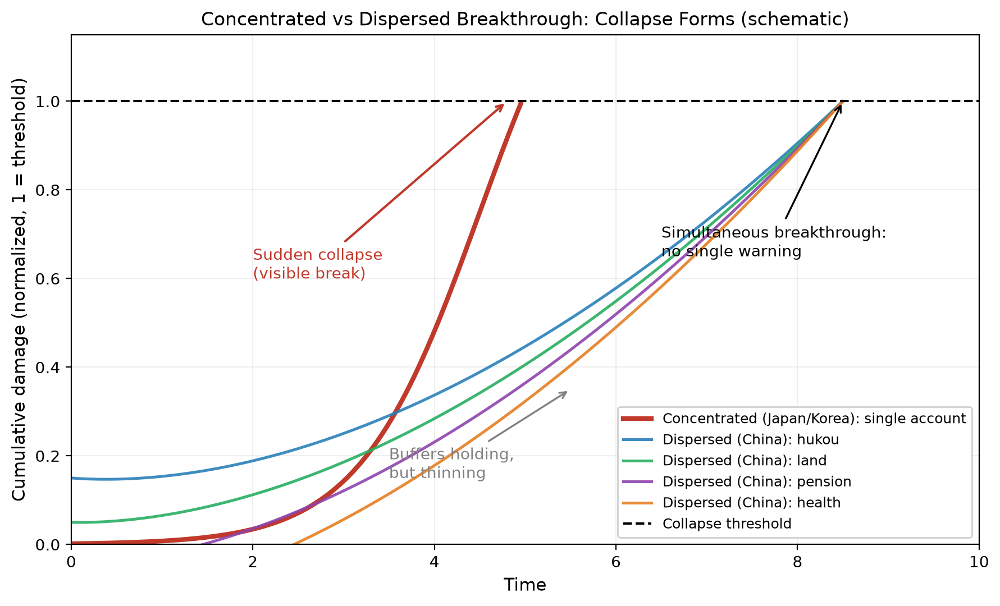

| 项目 | 内容 |
| :--- | :--- |
| 标题 | 分散性死均衡：中国社会再生产的结构形态与日韩比较 |
| 作者 | 钟善真 |
| 版本 | 1.9 |
| 日期 | 2026-11 |
| 许可协议 | CC BY-NC 4.0 |
| 关键词 | 分散性死均衡；社会再生产；缓冲门槛；累积损伤；跨国比较 |
| JEL分类号 | J13, J21, O15, P52 |

---

 

# 分散性死均衡：中国社会再生产的结构形态与日韩比较

## 摘要

本文区分两种损伤累积形态：集中击穿与分散击穿。日韩的低生育率是集中击穿——社会再生产成本集中转嫁给家庭，家庭ROE崩溃后婚姻与生育阀门同时关闭。中国的损伤累积是分散击穿——成本分散转嫁至户籍、土地、医疗、养老、储蓄多个账本，无一账本可单独解释生育率下降。

本文提出“分散性死均衡”概念，作为《死均衡》中“疤痕僵尸均衡”（Form B）的变体（Form C）。分散性有两个效果，方向相反：缓冲（延迟崩溃，有门槛）与加速累积（无门槛，持续起作用）。

跨国面板回归（8国1995—2023）显示，中国交互项在基准模型中显著，但安慰剂检验表明该显著性对标签分配不敏感——随机分配标签后，88%的情况下跑出的结果比实际中国更极端。**跨国回归不能作为“中国特殊”的核心证据，仅作描述性参考。**

本文的核心证据是四项可追溯损伤指标和一项缓冲指标。四项损伤指标——户籍裂口、土地流转率、农村养老替代率、医疗自付——说明账本在分散累积；一项缓冲指标——国民储蓄率（含企业/政府储蓄，家庭缓冲的间接证据）——说明缓冲仍有宏观支撑。**合起来是“缓冲还在扛、但正在变薄”。**

**但本文的框架是警示性的，不是诊断性的。** 数据中的积极面——底层50%份额2005年后企稳、储蓄率仍高、生育率高于韩国——说明缓冲仍在起作用。**中国的风险不是“正在崩”，是“缓冲还在扛、但正在变薄；如果缓冲变薄到门槛以下，崩的形态会比韩国更突然”——这是基于机制假设的比较，不是基于历史数据的比较。**

**关键词**：分散性死均衡；社会再生产；缓冲门槛；累积损伤；跨国比较

**JEL分类号**：J13, J21, O15, P52

---

## 一、引言

### 1.1 研究问题

2024年韩国官方公布总和生育率0.75，中国总和生育率学界估算约1.0（区间0.90—1.09）。从当期流量看，中国尚未触及韩国低位，存在“缓慢下滑”的乐观解读。本文质疑这一解读的计量基础：生育率是当期流量，系统健康度是存量。当期流量未触底，不等于存量损伤更轻。

集中击穿与分散击穿的差别，不在于损伤总量，而在于损伤的可观测性与可归因性。集中击穿的损伤集中在单一可观测账本上（如韩国的婚姻门槛、日本的终身雇佣松动），指标波动幅度大、归因路径清晰、政策靶点明确。分散击穿的损伤分散在多个低可见度账本上（户籍裂口、医疗自付、土地退路变薄、养老替代率低），单一账本的波动不足以触发政策响应，但多账本并行累积的存量损伤可能更大。可观测性低，不等于累积速度慢；归因路径模糊，不等于损伤程度轻。

本文的研究问题是：中国社会再生产的损伤累积形态与日韩的集中击穿有何不同？分散性累积意味着更低还是更高的崩溃风险？

### 1.2 核心命题

**命题1（形态差异）**：日韩的损伤累积是集中击穿——国家在压缩式工业化中将社会再生产成本集中转嫁给家庭，家庭ROE崩溃后婚姻与生育阀门同时关闭。中国的损伤累积是分散击穿——成本分散转嫁至户籍、土地、医疗、养老、储蓄多个账本，无一账本可单独解释生育率下降。

**命题2（缓冲门槛）**：分散性有两个效果。缓冲效果延迟崩溃，但有门槛：缓冲强度低于临界值时，中国因累积更快，崩溃早于集中击穿国家。加速累积效果无门槛，持续起作用。

**命题3（风险含义）**：中国的核心风险不是“缓慢下滑”，是“缓冲耗尽的突然崩溃”。一旦家庭代际支持与农村土地两个传统缓冲被土地流转、少子化与老龄化同时侵蚀，中国可能不是渐进下滑，而是突然崩得比韩国更狠。

**命题4（条件性）**：以上判断是条件性警示，不是当前诊断。数据中的积极面（份额企稳、储蓄率高、生育率高于韩国）说明缓冲仍在起作用。本文的判断是“如果缓冲变薄到门槛以下，崩的形态会比韩国更突然”——这是机制假设，不是历史数据比较。

### 1.3 与文献的关系

本文与三支文献对话。

**第一支：低生育率的结构解释。** 已有研究强调家庭主义福利体制、性别分工刚性、住房与教育成本（Esping-Andersen, 1999; McDonald, 2006; Thévenon & Gauthier, 2011）。本文不否认这些机制，但指出它们主要解释集中击穿——伤口在一个地方，看得见，可归因。中国的问题不是这些机制不存在，是它们分散在多个账本上，没有一个集中可见的伤口。

**第二支：压缩现代性与家庭主义。** 韩国研究指出压缩现代化将社会再生产私有化给家庭（Chang, 2010; Song, 2014）。本文接续这一判断，但区分集中转嫁（韩国）与分散转嫁（中国）两种形态，并论证分散转嫁的累积速度与崩溃形态不同。

**第三支：累积损伤与路径依赖。** 本文接续《结构与数据》（钟善真，2026a）与《死均衡》（钟善真，2026b）的方法论立场：宏观数据不能逆推微观结构，累积损伤记在存量而非流量上。本文的增量是把累积损伤形态化为可比的两个类型——集中击穿与分散击穿——并给出可检验的计量含义。

**与福利碎片化文献的区别**：“分散击穿”与“福利碎片化”有亲缘关系，但不同。碎片化描述的是制度供给的断裂（政策覆盖不全、城乡割裂、户籍限制），是原因；分散击穿描述的是损伤累积的形态（多账本并行渗血、无单一可归因），是后果。本文的增量不是发现碎片化，是把碎片化和崩溃形态连起来。

### 1.4 识别策略与贡献

本文的识别策略不依赖因果识别，也不依赖跨国回归作为核心证据。跨国回归的结果与局限详见5.2节。本文的核心证据来自四项可追溯损伤指标和一项缓冲指标（见第六节）。

本文的贡献有三。第一，提出分散性死均衡概念，给出与集中击穿的可比较定义。第二，用可追溯制度指标做描述性显影，为D_accum的分散累积提供可观察证据。第三，用缓冲门槛机制解释分散性国家崩溃形态的突然性，并以机制假设的形式提出门槛的存在。

### 1.5 结构安排

第二节文献与概念。第三节机制框架。第四节数据与识别策略。第五节跨国计量结果（描述性参考）。第六节制度指标显影（核心证据）。第七节缓冲门槛与崩溃形态（含积极面与条件性）。第八节讨论与边界。第九节结论。

---

## 二、文献与概念

### 2.1 集中击穿：日韩文献

韩国低生育率研究的主流解释是压缩现代性与家庭主义。Chang（2010）指出，韩国在极短时间内完成工业化，国家将社会再生产的成本私有化给家庭，家庭成为“隐形财政分支”。Song（2014）进一步论证，韩国非婚生育率极低（约3%），婚姻是生育的绝对前提，而首尔房价收入比超过10倍、财阀正规岗位仅占10%，婚姻这个“阀门”在经济上变得非理性。McDonald（2006）的性别公平理论虽基于欧洲数据，但已被广泛应用于东亚研究；用其解释日本，家庭分工刚性未随女性劳动参与上升而调整，导致“旧脚本没作废、新脚本没写好”的双重束缚。Thévenon & Gauthier（2011）的跨国比较指出，家庭政策碎片化与现金支持不足是低生育率的制度根源。

这组文献的共同点是：伤口集中在一个地方——婚姻阀门、性别分工、家庭政策。看得见，可归因，有明确政策靶点。本文称之为集中击穿。

### 2.2 分散击穿：中国文献

中国低生育率研究分散在多个子领域。

**生育支持政策碎片化。** 中国生育支持政策的研究普遍指出，政策供给存在城乡割裂与户籍限制，政策制定主体跨部门合作不足，政策内容地区差异显著。这一碎片化格局意味着，没有任何单一政策能够覆盖全部育龄人口，也没有任何单一政策能够单独解释生育率的下降。

**平台经济与灵活就业。** 张盈华指出，“‘雇主-雇员’之间的紧密联系被‘平台-劳动者’之间的松散关系所替代，数以亿计的劳动者从事‘去雇主化’‘零工化’的工作”（张盈华，2025）。吴雨桐等提供了非正规就业群体养老保险参与的计量分析（吴雨桐等，2024）。李干、董保华从社保参缴机制角度分析“无雇主”状态的制度困境（李干、董保华，2024）。

**户籍与土地财政。** Ruan（2024）论证，土地二元所有制导致城中村出现大量低价的非正式住房，这降低了短期劳动力再生产的成本，减少了打工者对国家定义的城市权利的需求；同时，土地出让收入的重要性促使地方政府将城市福利权的分配与公民的正式产权和居住状况绑定，从而阻碍了户籍制度的实质性改革。这一机制同时解释了“土地作为隐性缓冲”和“户籍裂口”两个现象。

这组文献的共同点是：伤口不在一个地方。户籍、土地、医疗、养老、储蓄——每个账本都在渗血，但没有一个账本能单独解释“为什么生育率在降”。本文称之为分散击穿。

### 2.3 概念界定：从疤痕僵尸均衡到分散性死均衡

《死均衡》提出Form B（疤痕僵尸均衡）：人活着，合作、信任、道德归零，天花板被历史永久击穿。本文提出Form C（分散性死均衡）：损伤不集中在一个可见伤口上，分散在多个账本里持续累积；没有集中修复机制；崩溃形态取决于缓冲门槛而非累积速度本身。

**与Form B的区别**：Form B的损伤集中在信任和道德天花板；Form C的损伤分散在户籍、土地、医疗、养老、储蓄多个账本。Form B的崩溃是“活着但关系死了”；Form C的崩溃是“看起来还行但账本突然穿底”。

**与集中击穿的区别**：集中击穿是单账本快速累积，可归因，有政策靶点，崩溃渐进可见。分散击穿是多账本慢速并行累积，难归因，无单一靶点，崩溃突然穿底。

**“分散性”的界定**：本文的“分散性”特指损伤在多个账本上并行累积、无单一账本可归因，不是指社会关系的原子化，也不是指制度供给的碎片化。原子化描述的是社会联结的断裂，碎片化描述的是制度供给的断裂，分散性描述的是损伤累积的形态——三者是不同层面的概念。碎片化是制度供给层面的原因，分散性是损伤累积层面的后果，两者相关但不同层。

**判别标准**：若单一账本贡献超过总损伤的50%，为集中击穿（Form B）；若多个账本同时渗血、无单一账本超过50%，为分散击穿（Form C）。50%为初步判别阈值，更细的判别需多账本权重估计；这一标准的操作化测量需后续工作，本文暂以定性描述替代（第六节末给出粗略判断）。

---

## 三、机制框架

### 3.1 三个维度

**薄修复**：社会支出占GDP约9%（OECD平均20%—30%），医疗自付27.5%（日本约12%）。修复机制存在，但薄。

**深转嫁**：户籍裂口18pp涉及2.5亿人，土地流转率37.2%（2008年无地可种仅2.2%）。成本转嫁穿透到农村土地、户籍分割，深。

**高分散**：户籍裂口、医疗自付、土地流转、农村养老四项损伤指标并行累积，无单一可命名的伤口。公开讨论中广泛引用的社保断缴、灵活就业规模等指标因口径不统一，不纳入核心证据。

### 3.2 缓冲门槛的机制假设

设缓冲强度B，累积速度A。分散性对崩溃时间T的影响为两个渠道：B延迟崩溃，A加速崩溃。若B≥B*（门槛），T_分散>T_集中；若B<B*，T_分散<T_集中。A无门槛，持续起作用。

**机制假设而非已证结论**：本文提出门槛效应作为机制假设——缓冲强度高于某阈值时，分散性国家崩溃晚于集中击穿国家；低于阈值时则相反。中间没有平滑过渡。这不是“中国缓慢下滑”，是“缓冲够强就拖住，缓冲一断就崩得更狠”。这一假设的严格检验（参数校准、数值模拟）需后续工作，本文不依赖具体数值，仅以假设形式提出，用于组织第七节的讨论。

### 3.3 与《死均衡》的形式化连接

《死均衡》的D_social(t)=∫E(τ)/E_crit dτ衡量累积损伤。本文的分散性死均衡对应D_social在多个账本上的并行累积：D_total = Σ D_k，k=户籍、土地、医疗、养老、储蓄。集中击穿是单账本快速累积，分散击穿是多账本慢速并行累积。总量可能相近，但崩溃形态不同：单账本先穿底→集中崩溃；多账本同时渗血→突然穿底。

这是与《死均衡》D_social的类比，不是严格的形式化推导；各D_k的测量与加总规则需后续工作。

---

## 四、数据与识别策略

### 4.1 数据

**跨国面板**：世界银行World Development Indicators，8国（CHN, JPN, KOR, USA, DEU, SWE, BRA, MEX），1995—2023，162观测。因变量：底层50%收入份额=最低20%+第二20%+第三20%×0.5。自变量：失业率、工业增加值占GDP、女性劳动参与率、就业人口比。

**样本选择标准**：世界银行收入份额数据覆盖1995—2023年、人均GDP高于5000美元（2015年不变价）、且包含集中击穿（日韩）与分散击穿（中国）的候选案例。8国是满足条件的最大交集。美、德、瑞典为弱再分配下的份额收缩案例，巴西、墨西哥为强再分配下的份额上升案例，作为对照；日韩为集中击穿案例，中国为分散击穿案例。

**中国制度指标**：国家统计局、人社部公报、农业农村部统计、卫健委公报、《中国卫生经济》核算。用于第六节描述性显影，不进入回归。

### 4.2 识别策略

**基准模型**：

share50_it = α_i + γ_t + β1·unemp_it + β2·ind_it + β3·lfpr_f_it + β4·emp_it + δ1·(China_i×ind_it) + δ2·(China_i×unemp_it) + ε_it

其中α_i为国家固定效应，γ_t为年份固定效应。δ1、δ2识别中国与样本平均国家在工业占比和失业率变化时的关联模式差异。

**识别假设与威胁**：

1. **平行趋势假设**：δ1、δ2的因果解读要求中国与样本平均国家在无制度差异时趋势平行。本文不做因果解读，δ1、δ2仅作方向性显影。
2. **遗漏变量**：未控制劳动法执行强度、工会密度、社会支出水平。这些变量与中国交互项可能相关，导致δ1、δ2有偏。本文在局限性中标注。
3. **反向因果**：就业人口比系数显著为负，可能反映份额低→家庭被迫增加就业。本文不解读该系数因果方向。
4. **共线性**：女性劳动参与率与年份趋势相关系数−0.988。模型3加入年份固定效应后，女性劳参系数增大（+1.04），说明共线性导致系数不稳定。本文标注但不修正。
5. **标签敏感性**：安慰剂检验（见5.2 R3）表明，交互项显著性对“中国”标签的分配不敏感，不能作为“中国特殊”的核心证据。

### 4.3 稳健性设计

**R1：去掉中国**。若去掉中国后主效应基本不变，说明主效应非单一国家驱动。

**R2：双向固定效应**。加入年份固定效应吸收全球共同趋势，检验交互项是否被趋势撑起。

**R3：安慰剂检验**。完全随机与块置换两种方式，检验交互项显著性是否可由随机标签复制。块置换保留每个国家的时间序列结构，比完全随机更严格。

---

## 五、跨国计量结果（描述性参考）

### 5.1 主结果

**表1 跨国面板回归——中国交互项（1995—2023，8国162观测）**

| 变量 | 模型1：国家FE | 模型2：国家FE+中国交互 | 模型3：双向FE+中国交互 | 模型4：去掉中国 |
| :--- | :--- | :--- | :--- | :--- |
| 失业率 | −0.50*** (0.09) | −0.58*** (0.08) | −0.99*** (0.11) | −0.59*** (0.08) |
| 工业占比 | +0.20*** (0.06) | +0.36*** (0.06) | +0.09 (0.09) | +0.36*** (0.06) |
| 女性劳参 | +0.46*** (0.07) | +0.52*** (0.06) | +1.04*** (0.11) | +0.52*** (0.06) |
| 就业人口比 | −0.92*** (0.12) | −1.09*** (0.11) | −1.65*** (0.15) | −1.10*** (0.11) |
| **中国×工业占比** | — | **−0.44*** (0.09)** | **−0.25** (0.10)** | — |
| **中国×失业率** | — | **−3.42*** (0.53)** | **−1.75** (0.64)** | — |
| 国家FE | 是 | 是 | 是 | 是 |
| 年份FE | 否 | 否 | 是 | 否 |
| R² | 0.971 | 0.978 | 0.984 | 0.977 |
| n | 162 | 162 | 162 | 144 |

注：括号内为标准误。*** p<0.01，** p<0.05。因变量为世界银行口径底层50%收入份额（最低20%+第二20%+第三20%×0.5）。模型4去掉中国，仅含7国144观测。

数据来源：World Bank World Development Indicators，作者计算。

模型1显示，在控制国家固定效应后，工业占比与底层份额正相关（+0.20，t=3.12），失业率负相关（−0.50，t=−5.55）。模型2加入中国交互项后，中国×工业占比为−0.44（t=−5.03），中国×失业率为−3.42（t=−6.45），均在1%水平显著。模型3进一步加入年份固定效应，两个交互项分别缩至−0.25（t=−2.54）和−1.75（t=−2.72），仍在5%水平显著。

模型4去掉中国后重跑，工业占比（+0.36，t=5.70）和失业率（−0.59，t=−7.26）的主效应与模型2几乎一致，说明主效应非单一国家驱动。但工业占比主效应在模型3中不显著（+0.09，t=1.03），因此中国交互项的解读应窄化为“中国未表现出别国那样的工业占比正效应”。

**但安慰剂检验（见5.2 R3）显示，交互项显著并非中国独有。将“中国”标签随机分配至其他国家后，交互项显著频率分别为73.0%（工业占比）和35.0%（失业率），实际中国t值在伪中国分布中的分位数仅为12.0%/12.5%。因此，交互项结果仅作描述性参考，不进入核心论证。**

### 5.2 稳健性

**R1（去掉中国）**：模型4与模型2对比，工业占比主效应+0.36→+0.36，失业率主效应−0.58→−0.59，女性劳参+0.52→+0.52，就业人口比−1.09→−1.10。四变量主效应均变化不超过0.01，说明主效应不依赖中国，非单一国家驱动。但交互项本身的特殊性需由R3检验；R3结果表明交互项对标签分配不敏感，不能作为“中国特殊”的证据。

**R2（双向FE）**：模型3加入年份固定效应后，中国×工业占比从−0.44缩至−0.25（t=−2.54），中国×失业率从−3.42缩至−1.75（t=−2.72）。缩水幅度约40%—50%，但仍在5%水平显著。说明模型2的显著性部分由年份趋势贡献，但中国与样本平均国家的差异在控制全球趋势后仍成立。

**R3（安慰剂检验）**：两种设计。块置换保留每个国家时间序列完整，仅置换国家标签，比完全随机更严格——完全随机可能低估标签敏感性。

**完全随机**：随机分配“中国”标签至其他国家，重复200次。伪中国×工业占比的显著频率为69.5%，伪中国×失业率为30.0%。伪中国t值范围分别为[−3.33, 4.30]和[−2.72, 4.33]。

**块置换**：重复200次。伪中国×工业占比的显著频率为73.0%，伪中国×失业率为35.0%。伪中国t值范围分别为[−5.03, 4.30]和[−6.45, 4.33]，实际中国t值正好卡在下界，分位数仅为12.0%/12.5%——即88%的伪中国t值比实际中国更极端。

**结论：块置换下，实际中国t值的分位数仅12%，说明“中国×工业占比”和“中国×失业率”的显著性对标签分配不敏感，不能作为“中国特殊”的证据。跨国回归结果仅作描述性参考，不进入核心论证。**

**统计特殊与形态不同的区分**：R1与R3合起来说明，本文的数据不支持“中国在统计上特殊”这一强命题——交互项对标签分配不敏感，主效应也不依赖中国。但本文的核心命题不是“中国统计特殊”，是“中国损伤累积形态不同”。形态不同不需要交互项显著来证明，需要的是制度指标的方向一致性——第六节五项指标显示的“损伤分散累积、缓冲还在但变薄”，才是本文核心命题的证据基础。统计特殊与形态不同是两回事：前者靠回归，后者靠制度描述。R1+R3的否定，否定的是前者，不是后者。

### 5.3 经济显著性

中国×失业率双向FE系数−1.75。样本内失业率标准差约4pp，1个标准差冲击对应底层份额下降7pp，约为样本均值（24.25%）的29%。中国×工业占比系数−0.25，工业占比标准差约5pp，1个标准差对应1.25pp，约均值的5%。**经济显著性计算仅供描述，因安慰剂检验未通过，不进入核心论证。**

### 5.4 未获支持的假说

趋势×工业占比交互−0.0008（t=−0.59），不显著。累积损伤随时间加深未获跨国数据支持。该假说只能靠中国制度指标描述性显影，不能靠跨国回归。

### 5.5 计量局限

**样本国家窄**：8国162观测，国家维度仅8个，交互项显著性对样本构成敏感。

**遗漏变量**：未控制劳动法执行强度、工会密度、社会支出水平。这些变量与中国交互项可能相关，导致δ1、δ2有偏。

**反向因果**：就业人口比系数在全部模型中显著为负（−0.92至−1.65），方向反直觉，可能反映份额低→家庭被迫增加就业。本文不解读该系数因果方向。

**共线性**：女性劳动参与率与年份趋势相关系数−0.988。模型3加入年份固定效应后，女性劳参系数从+0.52增至+1.04，说明共线性导致系数不稳定。

**标签敏感性**：安慰剂检验（5.2 R3）表明交互项对标签分配不敏感，跨国回归不能作为核心证据。

---

## 六、制度指标显影（核心证据）

**表2 中国D_accum代理指标——分散账本的显影**

| 类别 | 维度 | 指标 | 数值 | 来源/口径 | 对比/含义 |
| :--- | :--- | :--- | :--- | :--- | :--- |
| **损伤指标** | 户籍裂口 | 户籍城镇化率 vs 常住城镇化率 | 约50% vs 67% | 国家统计局，2023 | 相差近18个百分点，涉及2.5亿多人 |
| **损伤指标** | 土地缓冲变薄 | 承包地流转率 | 37.2%（2024） | 农业农村部统计 | 2008年金融危机时无地可种仅2.2%（公开报道引述） |
| **损伤指标** | 农村养老 | 城乡居民养老保险人均月养老金 | 约246元 | 人社部公报，2024 | 替代率仅13.6%，远低于55%国际安全线 |
| **损伤指标** | 医疗自付 | 个人卫生支出占比 | 27.5%（2024） | 卫健委公报/《中国卫生经济》核算 | 日本约12%，韩国约20%—30%区间 |
| **缓冲指标** | 国民储蓄率 | 国民总储蓄率 | 55.5%（2024） | 按统计局定义（资本形成总额+货物和服务净出口）/GDP计算，原始数据来自《中国统计年鉴2024》 | 含企业/政府储蓄；作为家庭缓冲的间接证据，居民储蓄率需分解 |

数据来源：国家统计局、人社部公报、农业农村部统计、卫健委公报、《中国卫生经济》核算。五项指标均有明确官方或学术核算来源，口径可追溯。

**表2分两类：四项损伤指标说明账本在分散累积，一项缓冲指标说明缓冲仍有宏观支撑。** 户籍裂口大（2.5亿人被挡在城市福利体系外）、土地退路变薄（流转率37.2%，2008年仅2.2%无地可种）、农村养老替代率低（13.6%）、医疗自付高（27.5%，日本约12%）——四项损伤指标各自独立，无单一指标可解释全部损伤，这符合分散击穿的定性特征。国民储蓄率55.5%则说明经济整体储蓄仍在高位，为家庭缓冲提供了宏观背景；但**国民总储蓄率含企业/政府储蓄，不能直接等同于家庭缓冲，家庭缓冲的直接证据需居民储蓄率分解，本文暂以宏观储蓄率作为间接证据**。

**这是本文的核心证据。** 它依赖的是五个独立来源的指标在同一方向上的一致性：四项损伤指标指向“账本在分散累积”，一项缓冲指标指向“缓冲仍有宏观支撑但非直接家庭缓冲”。**五个指标，两个方向——损伤在分散累积，缓冲还在但变薄。** 证据基础是多指标方向一致性，不是单指标精确性；五项指标均有明确来源，口径可追溯。

**按2.3节判别标准的粗略判断**：四项损伤指标各自独立，无单一指标可解释全部损伤——户籍裂口是制度覆盖问题，土地流转是退路问题，农村养老是替代率问题，医疗自付是服务成本问题。**没有单一账本贡献超过50%，这符合分散击穿的定性特征。** 需说明的是，判别标准仅适用于损伤指标；储蓄率作为缓冲指标，不参与“单一账本是否超50%”的判断。严格的50%判别需多账本权重估计，需后续工作。

**需要说明的是**：公开讨论中广泛引用的社保断缴人数、灵活就业规模、家庭债务收入比、隔代抚养率等指标，因来源为摸底数据、机构估算或券商测算，口径不统一，本文不将其纳入核心证据，仅在讨论中作方向性参考（见7.2节）。

---

## 七、缓冲门槛与崩溃形态

### 7.1 机制假设

分散性对崩溃时间的影响为两个渠道：缓冲延迟崩溃（有门槛），累积加速崩溃（无门槛）。设缓冲强度B，累积速度A。若B≥B*，分散性国家崩溃晚于集中击穿国家；若B<B*，分散性国家因累积更快，崩溃早于集中击穿国家。

**“突然”的操作化定义**：本文的“突然”指在5年窗口内生育率下降超过0.2（0.2约为韩国2015—2020年降幅），或3年内社保断缴率翻倍。这是操作化定义，不是精确预测。上述门槛效应为机制假设：缓冲强度高于某阈值时，分散性国家崩溃晚于集中击穿国家；低于阈值时则相反。中间没有平滑过渡。具体参数与数值需后续校准，本文不依赖具体数值。

### 7.2 中国缓冲正在变薄

**土地缓冲**：承包地流转率37.2%（2024，农业农村部），2008年金融危机时无地可种仅2.2%（公开报道引述）。退路变薄。这一对比说明：2008年土地缓冲有过硬扛的记录，但流转率上升意味着“回去还有地种”的退路在收窄。

**家庭缓冲（宏观储蓄）**：国民储蓄率55.5%为家庭缓冲提供了宏观背景，但不能直接等同于家庭缓冲。国民储蓄率55.5%（2024，按统计局定义计算），说明经济整体储蓄仍在高位，为家庭缓冲提供了宏观背景。但国民总储蓄率含企业/政府储蓄，**不能直接等同于家庭缓冲**——家庭缓冲的直接证据需居民储蓄率分解。同时，农村养老替代率仅13.6%（城乡居民养老保险人均月246元，人社部2024），代际支持的可持续性存疑——缓冲还在，但缓冲的“厚度”正在被养老压力侵蚀。

**制度缓冲**：户籍裂口18pp（户籍城镇化率约50% vs 常住67%，统计局2023），涉及2.5亿多人被挡在城市福利体系外；医疗自付27.5%（卫健委2024），远高于日本约12%。制度缓冲未覆盖流动人口，服务成本转嫁给家庭。

**说明**：公开讨论中广泛引用的社保断缴率、灵活就业规模、家庭债务收入比、隔代抚养率等指标，因来源为摸底数据、机构估算或券商测算，口径不统一，本文不将其作为核心证据（见第六节说明）。上述三项——土地流转率、农村养老替代率、户籍裂口、医疗自付、储蓄率——均有明确官方或学术核算来源，构成本文“缓冲变薄”判断的证据基础。

### 7.3 崩溃形态的含义

集中击穿：单账本先穿底→可归因→有政策靶点→渐进崩溃。
分散击穿：多账本同时渗血→难归因→无单一靶点→突然穿底。

分散击穿的崩溃不是单账本先穿底的渐进过程，是多账本同时接近临界值后的突然失效——失效的突然性来自缺乏单一预警指标，不是来自损伤总量更大。分散性不是安全，是缺乏单一预警指标的累积。

**图1 集中击穿与分散击穿的崩溃形态（示意，非实际数据）**
红色单线代表集中击穿（日韩）：单账本快速累积、可见、断崖式崩溃。彩色多线代表分散击穿（中国）：多账本并行累积，单一账本无预警，但缓冲耗尽后多条线同时逼近并穿破阈值，呈现突然失效的特征。

### 7.4 积极面与条件性

本文的框架是警示性的，但数据中也有积极面，必须诚实呈现。**这些积极面不否定本文的框架，但限定了它的适用范围。**

**第一，底层50%份额在2005年后企稳。** WID数据显示1978—2005年从27.0%跌到15.0%（−12pp），但2005—2023年仅再降1.3pp（15.0%→13.7%）。世界银行口径更明显：1996—2022年变化−0.25pp，几乎没动。这不是“账本一直在烂”，是“烂到某个位置后停住了”——说明再分配开始补位（农业税取消、新农合、新农保、低保扩面），虽然补得不够，但托住了底。

**第二，国民储蓄率55.5%（2024，按统计局定义计算）。** 这是缓冲仍有宏观支撑的间接证据。经济整体储蓄仍在高位，为家庭缓冲提供了背景——但国民总储蓄率含企业/政府储蓄，不能直接等同于家庭缓冲。土地流转率37.2%是“变薄”，不是“没了”；储蓄率55.5%是“宏观上还在”，不是“家庭扛得住”。机制假设提示，缓冲强度高于某阈值时延迟崩溃，中国的缓冲强度现在大概率仍在阈值以上，但具体判断需居民储蓄率分解和家庭微观数据。

**第三，生育率约1.0—1.09（学界估算），比韩国0.75高。** 这个差距不大，但方向是“中国还没到韩国那个坑”。当期流量没触底本身也是一个信息——它说明缓冲还在起作用，崩溃还没到。

**第四，2008年金融危机时无地可种仅2.2%。** 这是土地缓冲“曾经很厚”的证据。2008年那么大的冲击，土地缓冲扛住了，2.2%的人无地可种。这说明缓冲不是纸糊的，它有过硬扛的记录。

**这些积极面对本文结论的准确含义是：不是推翻，是限定。** 本文的判断不是“中国正在走向突然崩溃”，是“中国目前处于缓冲还在起作用、但缓冲正在变薄的中间状态；如果缓冲变薄到门槛以下，崩的形态会比韩国更突然”——这是机制假设，不是历史数据比较。**这是一个条件性警示，不是当前诊断。** 政策的优先级不是“救火”，是“在缓冲还没耗尽时加厚缓冲”——但本文不提供政策建议，因为如第8.2节所述，框架一旦被政策拿去“算缓冲”，可能反而加速缓冲的消耗。

---

## 八、讨论与边界

### 8.1 与《死均衡》《结构与数据》的关系

《结构与数据》（钟善真，2026a）：结构不可逆，第三层最刚性。宏观数据不能逆推微观结构。
《死均衡》（钟善真，2026b）：时间不可逆，天花板是历史积分。D_social累积到1进入不可逆区。
本文：形态差异，分散性死均衡是Form C。

三篇共享同一方法论基石：宏观数据不能逆推微观结构，累积损伤记在存量而非流量上。《结构与数据》讲结构不可逆，《死均衡》讲时间不可逆，本文讲形态差异——同一个死均衡，不同制度生成不同形态。

### 8.2 为什么不提供政策建议（作者立场，非学术论证）

**以下为作者立场，非学术论证，供读者参考。** 本文的框架有政策含义（扩大社保覆盖、降低医疗自付、缩小户籍裂口、保护土地退路功能），但本文不将其表述为政策建议。理由不是政策不该做，是政策一旦拿到“缓冲厚度”的量化框架，大概率会把它变成“缓冲还剩多少、还能撑几年”的规划参数，而不是“该不该保护缓冲”的规范问题。算易做难：算缓冲是数据工作，加厚缓冲是利益调整。框架被算，恰恰证明它有诊断力；但被算成“还能榨几年”，是政策的选择，不是框架的本意。本文写的是诊断，不是操作手册。

### 8.3 边界

1. **不做因果识别**。交互项显著仅说明中国与样本平均国家在可测代理上存在关联模式差异，且安慰剂检验表明该差异对标签分配不敏感，不能作为核心证据。

2. **样本边界**。8国162观测，国家维度窄，交互项显著性对样本构成敏感。世界银行收入份额数据覆盖不全（日本2008年起、韩国2006年起），早期压缩工业化阶段的击穿无法在跨国回归中显影。

3. **代理变量边界**。D_accum（累积速度）没有年度跨国序列，进不了回归。制度指标是单年或短序列，只能做描述性显影。趋势×工业占比不显著（t=−0.59），累积损伤随时间加深未获计量支持。

4. **口径边界**。世界银行家庭调查口径与WID税收+国民账户口径不同。世界银行显示中国1996—2022年份额变化−0.25pp（低位企稳），WID显示1978—2023年−13.3pp（剧烈收缩后企稳）。两者不矛盾，是窗口不同——世界银行错过了1978—1995年的收缩。

5. **就业人口比系数方向反直觉**。全部模型中显著为负（−0.92至−1.65），可能反映反向因果（份额低→家庭被迫增加就业）或与女性劳参共线性。不解读因果方向。

6. **制度指标口径**。表2五项指标均有明确官方或学术核算来源，口径可追溯。国民储蓄率为国民总储蓄率（含企业/政府储蓄），作为家庭缓冲的间接证据，家庭缓冲的直接证据需居民储蓄率分解。公开讨论中广泛引用的社保断缴、灵活就业规模、家庭债务比、隔代抚养率等指标因口径不统一，不纳入核心证据，仅在讨论中作方向性参考。

7. **条件性边界**。本文是警示性框架，不是诊断性结论。数据中的积极面（份额企稳、储蓄率高、生育率高于韩国）说明缓冲仍在起作用，崩溃尚未到来。本文判断的是“如果缓冲变薄到门槛以下，崩的形态会比韩国更突然”，这是机制假设，不是历史数据比较。

8. **门槛机制的假设性边界**。3.2节与7.1节的门槛效应为机制假设，具体参数设定、数值模拟与严格检验需后续工作校准，本文不依赖具体数值。

9. **形态对比的经验边界**。本文的“集中vs分散”对比主要在概念层面（2.1 vs 2.2），经验层面的双边对比（中日韩制度指标对照）需后续工作。表2提供的是中国一侧的指标，用于显影“分散累积”的形态，不用于证明“中国比日韩更分散”。后者需要日韩对应指标的系统对照。

---

## 九、结论

中国不是日韩的翻版。日韩的低生育率是集中击穿，伤口在一个地方，看得见，可归因。中国的损伤累积是分散击穿，伤口分散在户籍、土地、医疗、养老、储蓄多个账本，看不见，难归因。

跨国面板回归显示中国交互项在基准模型中显著，但安慰剂检验表明该显著性对标签分配不敏感（块置换下伪中国显著频率73.0%/35.0%，实际中国t值分位数仅12.0%/12.5%），跨国回归不能作为“中国特殊”的核心证据。本文的核心证据是五项可追溯制度指标：四项损伤指标——户籍裂口18pp、土地流转率37.2%、农村养老替代率13.6%、医疗自付27.5%——说明账本在分散累积；一项缓冲指标——国民储蓄率55.5%（含企业/政府储蓄，家庭缓冲的间接证据）——说明缓冲仍有宏观支撑。**五个指标，两个方向——损伤在分散累积，缓冲还在但变薄。**

分散性有两个效果，方向相反：缓冲（延迟崩溃，有门槛）与加速累积（无门槛，持续起作用）。**但本文的判断是条件性的，不是诊断性的。** 数据中的积极面——份额2005年后企稳、储蓄率55.5%、生育率约1.0—1.09（高于韩国0.75）——说明缓冲仍在起作用，崩溃尚未到来。**中国的风险不是“正在崩”，是“缓冲还在扛、但正在变薄；如果缓冲变薄到门槛以下，崩的形态会比韩国更突然”——这是机制假设，不是历史数据比较。**

结构没动，但形态不同；账本都在烂，但烂的方式决定了崩的方式。缓冲还在扛，但多账本同时接近临界值的风险在上升——这不是预言，是条件性警示。

---

## 资助声明

本文未接受任何机构或组织的资助。

## 利益冲突声明

作者声明，不存在任何可能影响本文研究结论或学术判断的利益冲突。

## 数据可用性声明

本文跨国数据来自 World Bank World Development Indicators（公开获取）。中国制度指标来自国家统计局、人社部公报、农业农村部统计、卫健委公报、《中国卫生经济》核算。计算脚本可在 `dead-equilibrium/` 和 `dispersed-equilibrium/` 目录中复现。

## 参考文献

- Chang, K.-S. (2010). *South Korea under Compressed Modernity: Familial Political Economy in Transition*. Routledge.
- Esping-Andersen, G. (1999). *Social Foundations of Postindustrial Economies*. Oxford University Press.
- 李干, 董保华. (2024). 从“单雇主”到“无雇主”：新业态社会保险参缴机制的困境与革新. *保险研究*, 2024(10).
- McDonald, P. (2006). Low fertility and the state: The efficacy of policy. *Population and Development Review*, 32(3), 485–510.
- Ruan, Z. (2024). Dualist Land Regime, the Hukou System and the Welfare of Migrant Workers in Chinese Cities. *The China Quarterly*, 260, 1024–1039. https://doi.org/10.1017/S0305741024000304
- Song, J. (2014). *Living on Your Own: Single Women, Rental Housing, and Post-Revolutionary Affect in Contemporary South Korea*. SUNY Press.
- Thévenon, O., & Gauthier, A. H. (2011). Family policies in developed countries: A “fertility-booster” with side-effects. *Community, Work & Family*, 14(1), 41–64.
- 吴雨桐, 路先锋, 张明. (2024). 数字经济发展与非正规就业群体养老保险参与. *财政研究*, 2024(9).
- 张盈华. (2025). 新就业形态劳动者社保问题辨析和应对建议. 中国社会科学院社会保障实验室工作论文, No.217-20251125.
- 钟善真. (2026a). *结构与数据——论经济数据长期忽略的结构性事实* (Version 9.0). Equal System Repository.
- 钟善真. (2026b). *Dead Equilibrium: Monetary Alienation, Debt Ontology, and the Dissolution of Social Relations* (Version 3.5.3). Equal System Repository.
- World Bank. (2024). World Development Indicators.
- 国家统计局. (2024). 中国统计年鉴.
- 人力资源和社会保障部. (2024). 人力资源和社会保障事业统计公报.
- 农业农村部. (2024). 农村土地承包经营权流转统计.
- 国家卫生健康委员会. (2024). 我国卫生健康事业发展统计公报.

**建议引用（APA格式）：**

钟善真. (2026). *分散性死均衡：中国社会再生产的结构形态与日韩比较* (Version 1.9). Equal System Repository.
