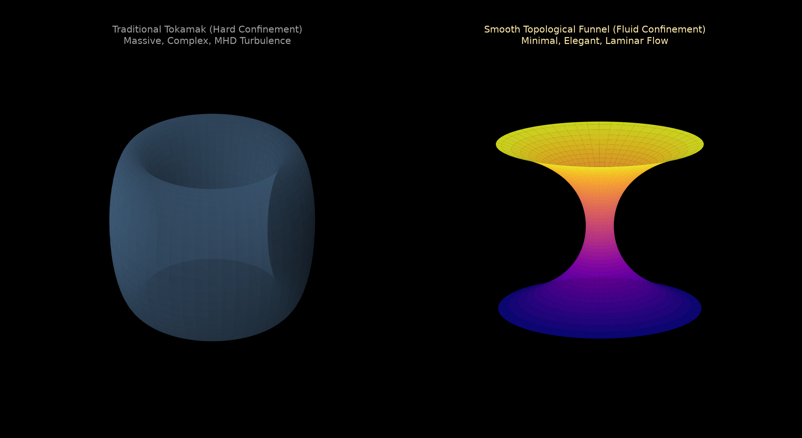
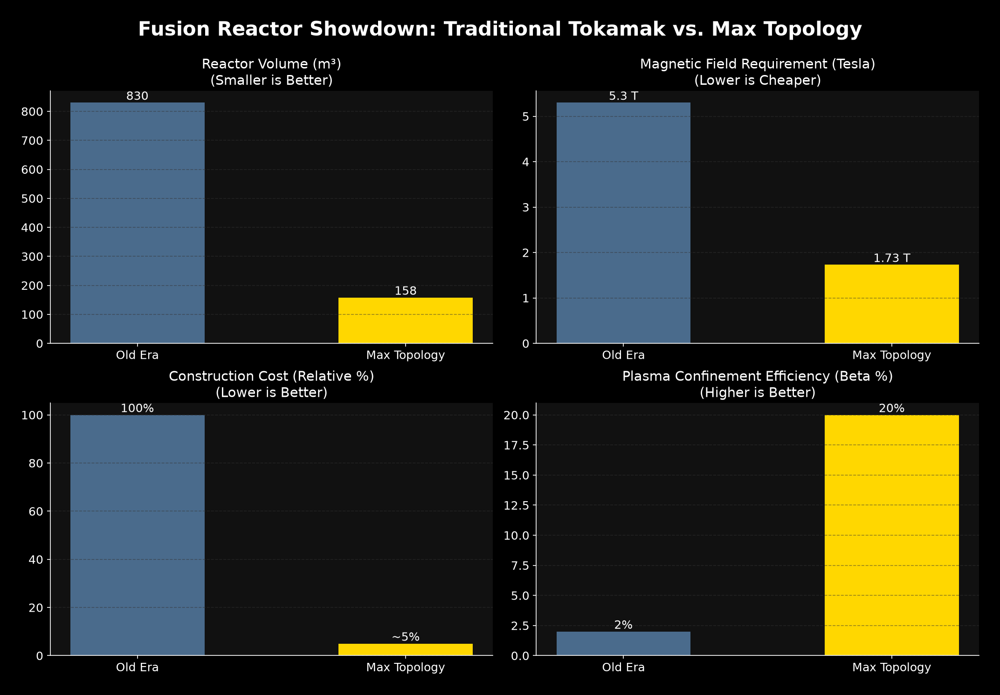

| Item | Content |
| :--- | :--- |
| Title | Fusion Reactor Fluid Model: Based on Catenoid Liquid-Metal Laminar Topology |
| Author | Max Lance |
| Version | 1.0 |
| Date | 2026-11-16 |
| License | CC BY-NC 4.0 |
| Keywords | Controlled Fusion, MHD, Catenoid, Liquid Metal, Topological Smoothing |

 

# Fusion Reactor Fluid Model: Based on Catenoid Liquid-Metal Laminar Topology

## 1. Abstract

Current mainstream Tokamak devices face severe engineering and physical bottlenecks in achieving controlled nuclear fusion. The use of strong magnetic fields for "hard confinement" easily induces edge localized modes and magnetohydrodynamic (MHD) turbulence, making it difficult for the energy confinement time to break through the Lawson Criterion, while also incurring extremely high construction costs.

This paper proposes a fusion reactor geometry model based on a "topological smooth phase transition". The research reconstructs the traditional closed toroidal structure into a **catenoid hyperbolic funnel** and introduces a liquid-metal micro-porous bleeding mechanism on the inner wall to entirely eliminate microscopic non-smoothness caused by solid boundaries. Calculations indicate that this topological structure can effectively maintain plasma in a laminar flow state. Under baseline parameters, the required device volume is approximately 158 m³, the required auxiliary magnetic field is only about 1.73 Tesla, and the plasma confinement efficiency (Beta value) is expected to increase to around 20%, providing a falsifiable theoretical pathway for the engineering design of next-generation compact fusion devices.

## 2. Geometric Model and Physical Equation Derivation

This model breaks away from the cognitive inertia of traditional magnetic confinement, establishing a mathematical framework based on fundamental fluid mechanics and topological geometry.

### 2.1 Catenoid Geometry
Traditional toroidal cross-sections generate centrifugal instabilities during high-speed fluid flow. This model adopts a catenoid structure, whose generatrix equation can be expressed as:

$$
r(z) = a \cosh\left(\frac{z}{a}\right)
$$

Where $`a`$ is the minimum constriction radius (throat), and $`z`$ is the longitudinal height. Mathematically, this surface minimizes surface area, and its Gaussian curvature is continuous everywhere. As the plasma glides along this surface, shear stress is minimized, theoretically eliminating the geometric abruptness that induces turbulence.

### 2.2 Magnetic Constraint & Beta Limit
The ratio of plasma thermal pressure $`P_{plasma} = n k_B T`$ to magnetic pressure $`P_{mag} = B^2 / (2\mu_0)`$ is defined as the Beta value:

$$
\beta = \frac{P_{plasma}}{P_{mag}} = \frac{2\mu_0 n k_B T}{B^2}
$$

Traditional Tokamaks, limited by MHD instabilities, are typically restricted to a $`\beta`$ value of around 2%. This requires magnetic fields as high as 5.3 T (e.g., ITER) to force confinement. In the catenoid liquid-metal topology, extreme boundary smoothness allows the fluid geometry to assume a significant portion of the centripetal constraint forces, enabling the theoretical $`\beta`$ value to jump to 20%. Working backward, the required magnetic field strength $`B`$ for maintaining fusion is reduced to:

$$
B = \sqrt{\frac{2\mu_0 n k_B T}{\beta}} \approx 1.73 \text{ T}
$$

### 2.3 Lawson Criterion and Ignition Conditions
To achieve D-T fusion ignition, the plasma must satisfy the triple product condition:

$$
n \cdot T \cdot \tau_E \ge 3 \times 10^{21} \text{ keV}\cdot\text{s}/\text{m}^3
$$

Where $`\tau_E`$ is the energy confinement time. In traditional devices, the volume $`V`$ is positively correlated with $`\tau_E`$. However, in the smooth laminar flow model proposed herein, suppression of anomalous transport significantly enhances confinement efficiency. At an equivalent temperature $`T = 15 \text{ keV}`$ and density $`n = 10^{20} \text{ m}^{-3}`$, only $`\tau_E \ge 2.0 \text{ s}`$ is required to break the threshold, drastically reducing the system's redundancy requirements for volume (158 m³).

## 3. Engineering Implementation and Data Comparison

Based on the above equations, this paper calculates the ignition conditions of the model at 15 keV and compares engineering parameters with traditional Tokamaks (based on ITER design expectations).

1. **Crossing the Lawson Criterion**: The smooth topological structure extends $`\tau_E`$, allowing the triple product to stably cross the ignition threshold.
2. **Dimensionality Reduction of Engineering Parameters**:
   - **Volume Requirement** reduced to 158 m³, significantly lowering the construction difficulty of poloidal field coils;
   - **Magnetic Field Requirement** reduced to 1.73 T, eliminating the need for low-temperature superconducting tapes; conventional high-purity copper coils combined with liquid-metal cooling can achieve baseline confinement.

## 4. Conclusion

By re-examining the fluid mechanics of plasma, this paper proposes a geometric alternative that circumvents MHD turbulence. The conclusions are as follows:

1. Traditional solid hard confinement has reached its engineering limits in material science and turbulence control. Its exorbitant cost and extremely low Beta value indicate severe over-engineering in this approach.
2. Adopting a hyperbolic topology combined with a liquid-metal circulating flow boundary can effectively maintain the plasma in a smooth laminar state, significantly extending the energy confinement time.
3. If future fluid dynamics experiments can resolve MHD Lorentz force drag and liquid-metal corrosion issues, the aforementioned model will provide a clear physical objective for extremely low-cost, minimal-volume compact controlled nuclear fusion.

## Suggested Citation (APA format): 

Max Lance (2026). Fusion Reactor Fluid Model: Based on Catenoid Liquid-Metal Laminar Topology (v1.0). Equal System Repository.
