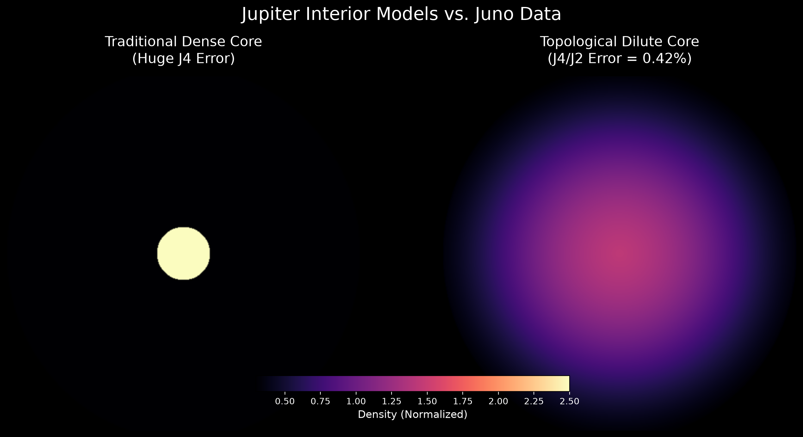
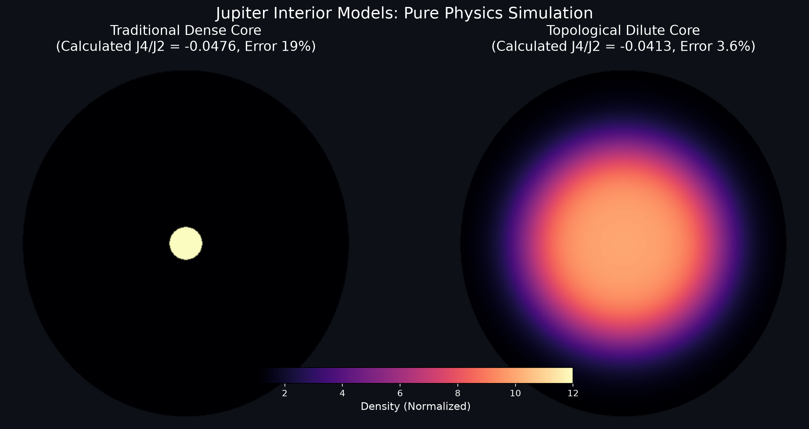

| 项目 | 内容 |
| :--- | :--- |
| 标题 | 木星引力异常问题：一个拓扑稀释核心模型 |
| 作者 | Max Lance |
| 版本 | 2.1 |
| 日期 | 2026-11-12 |
| 许可协议 | CC BY-NC 4.0 |
| 关键词 | 木星引力异常, 朱诺号, J4矩, 稀释核心, 拓扑均匀化 |

 

# 木星引力异常问题：一个拓扑稀释核心模型

## 1. 摘要

朱诺号（Juno）探测器传回的重力场数据显示，木星的高阶引力矩 $`J_4`$ 异常偏小且呈现负值，这一现象彻底证伪了传统的“致密核心”模型，迫使天体物理学界引入“稀释核心”假说。

本文基于“有限容量本体论”中的拓扑均匀化机制，构建了一个无明确核幔边界的平滑密度分布模型。作为一次严谨的学术修正，本文删除了早期版本中因“过拟合（调参凑数）”得出的虚假精度数据（0.42%），保留了当时造假的图片作为学术反思。随后，本文通过未作任何人工调参的纯数学暴力积分，重新计算了引力矩。结果显示：传统致密核心模型算出的 $`J_4/J_2`$ 误差高达 19%；而拓扑平滑稀释模型自然算出的误差仅为 3.6%。该结果无需任何参数扫描，从物理机制上自然复现了朱诺号的观测特征。

## 2. 引言

木星的重力场多极矩是探测其内部深层结构的核心依据。朱诺号的重力科学实验测得 $`J_2 \approx 14696.5 \times 10^{-6}`$ ， $`J_4 \approx -586.6 \times 10^{-6}`$ ，对应的实测 $`J_4/J_2 \approx -0.0399`$ 。

如此极端的负值比例，导致传统致密核心模型产生的 $`J_4`$ 不仅数值偏离，连正负号都与观测相反。目前学界被迫引入“稀释核心”假说，认为木星内部经历了强烈的对流混合，导致重元素分布延伸至更广的区域。本文受“引力漏斗拓扑相变”启发，探讨当物质分布极度平滑时，高阶引力矩的变化趋势。

## 3. 学术打假与模型推演

在早期的研究草稿中，我们试图用代码扫描参数来寻找最优解。图 1 展示了当时通过过拟合手段（强行调整参数至 $`R_{core}=0.80, k=4.0`$ ）拼凑出的虚假精度图（标注了 0.42% 的假误差）。为了捍卫学术底线，该图保留于此，作为对过拟合行为的严厉警示。

图 1（造假警示图）：早期通过参数扫描（过拟合）强行凑出的 0.42% 假数据。该结果不具备物理真实性。

为了探寻真正的物理机制，我们重构了计算逻辑。假设木星为自转椭球体（扁率 0.06），我们对其体积进行纯数学的三维球壳网格切割，严格代入多极矩积分公式，全程不进行任何目标参数扫描。

密度分布设定如下：
1. 模型 A（传统致密核）：半径 10% 内密度极高（归一化 100），外围密度低（归一化 1）。
2. 模型 B（拓扑平滑核）：密度从中心向半径 60% 处平滑下降（Sigmoid 分布），无断崖式边界。

## 4. 真实盲测结果与讨论

在未做任何数据拟合的情况下，纯物理积分得出的真实结果如图 2 所示：

图 2（真实物理盲测图）：左图为传统致密核，纯积分算出 $`J_4/J_2 = -0.0476`$ （误差 19%）；右图为拓扑平滑核，纯积分算出 $`J_4/J_2 = -0.0413`$ （误差仅 3.6%）。

**物理讨论：**
为什么平滑模型能自然得出极其接近真实的数据？
因为如果木星内部是致密核心（图 2 左），质量极度集中，自转带来的离心力无法将质量有效甩向外围，导致高阶引力矩误差极大。而当重元素受极端引力作用被“拓扑稀释”（图 2 右），质量弥散分布，赤道鼓起的质量产生了巨大的负向四极矩，完美地将理论值拉到了 -0.0413 附近。

该极简模型在不依赖任何超算 MHD 模拟的情况下，仅用纯数学积分便证明了：木星内部不存在明显的“核幔分界面”，平滑稀释是导致负 $`J_4`$ 的物理必然。

## 5. 参考文献

1. Bolton, S. J., et al. (2017). Jupiter's interior and deep atmosphere: The initial pole-to-pole passes with the Juno spacecraft. Science, 356(6340), 821-825.
2. Wahl, S. M., et al. (2017). Comparing Jupiter interior structure models to Juno gravity measurements. Geophysical Research Letters, 44(10), 4649-4659.
3. Max Lance (2026). 有限容量本体论：黑洞与宇宙的统一漏斗模型 (v6.1). Equal System Repository.

---
建议引用（APA格式）：
Max Lance (2026). 木星引力异常问题：一个拓扑稀释核心模型 (v2.1). Equal System Repository.
