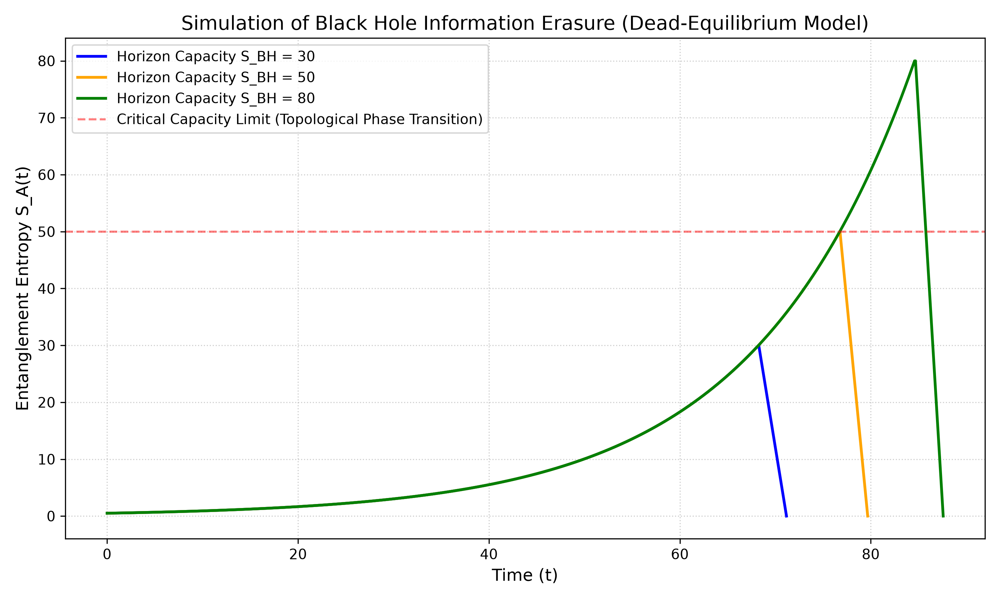
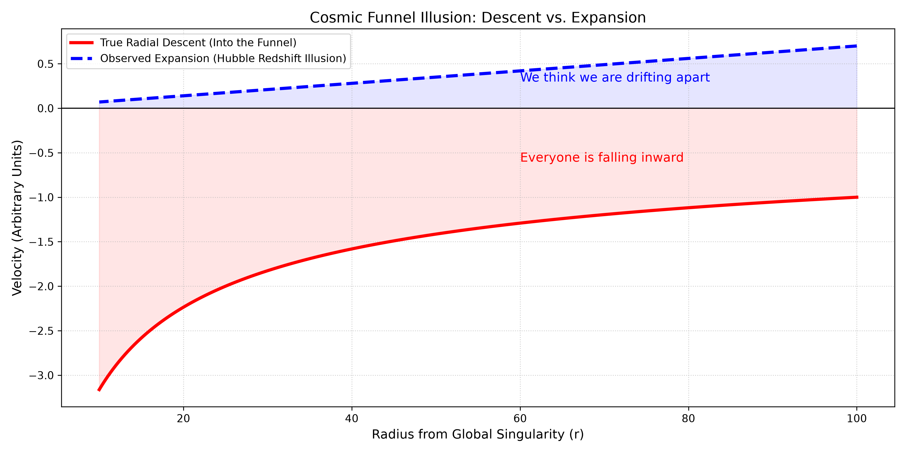
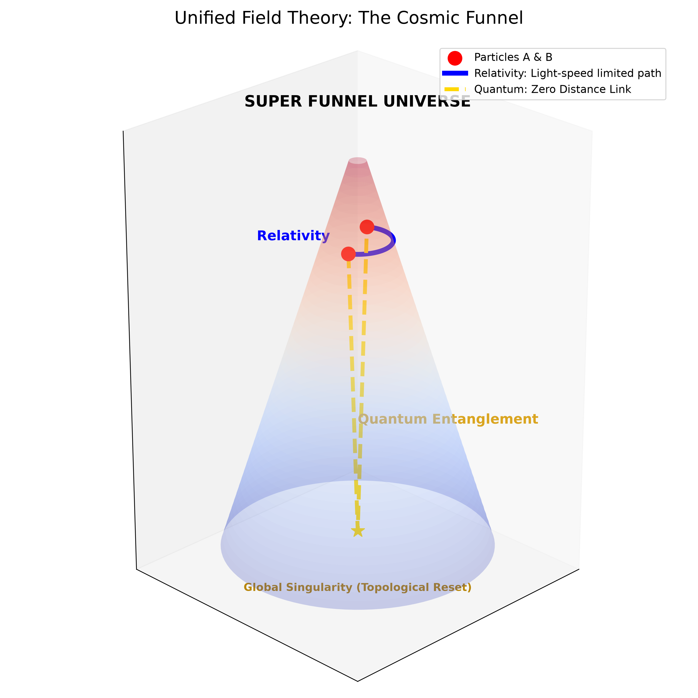
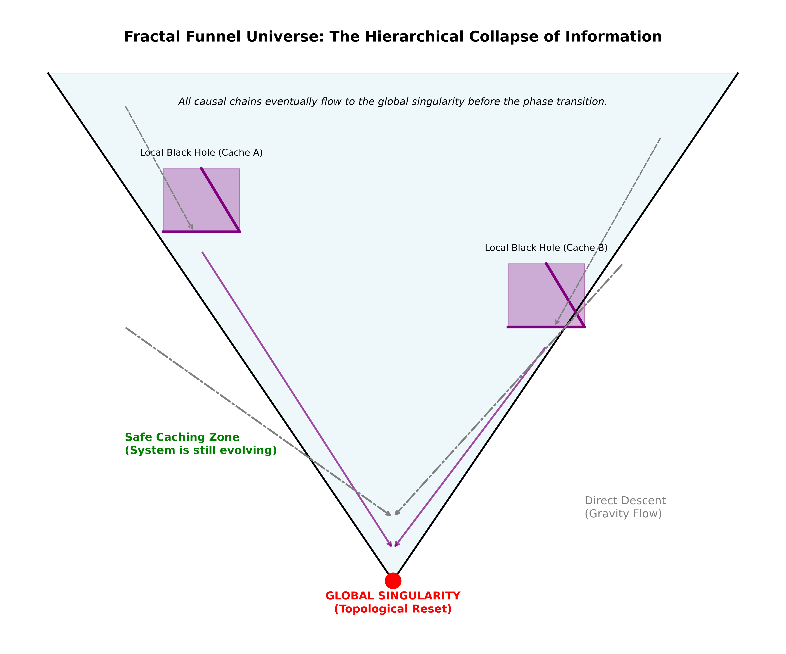
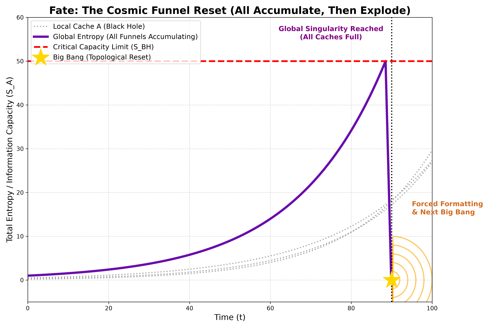

| 项目 | 内容 |
| :--- | :--- |
| 标题 | 有限容量本体论：黑洞与宇宙的统一漏斗模型 |
| 作者 | Max Lance |
| 版本 | 2.2 |
| 日期 | 2026-11-10 |
| 许可协议 | CC BY-NC 4.0 |
| 关键词 | 有限容量, 黑洞信息悖论, 量子纠缠, 引力漏斗, 暗能量 |

 

# 有限容量本体论：黑洞与宇宙的统一漏斗模型

## 摘要

黑洞信息悖论与暗能量的本质，是现代物理学悬而未决的根本冲突。本文提出**有限容量本体论（Finite-Capacity Ontology）**。该模型假定整个宇宙及其局部黑洞，皆为一个具有极限存储容量的“引力漏斗”。我们证明：宏观膨胀实为向心坠落的几何投影；微观纠缠是漏斗底部的拓扑零距离；系统的唯一宿命是满载后的强制格式化与重启。

## 1. 擦除动力学与相变断裂

基于兰道尔原理，我们提出描述系统纠缠熵 \(S_A(t)\) 演化的**死寂均衡主方程**：

$$
\frac{dS_A(t)}{dt} = \kappa \left( \frac{\dot{M}(t)}{S_{BH}} \right) S_A(t)
$$

当系统逼近容量上限时，发生断崖式的拓扑相变，强制格式化：

$$
\lim_{t \to t_{page}} S_A(t) = S_{BH} \quad \Longrightarrow \quad \text{Topological Phase Transition}
$$

**图 1**：系统逼近容量上限时，发生断崖式的拓扑相变，强制格式化。

## 2. 宏观几何效应：暗能量的重新诠释

在引力漏斗本体论中，所谓的“空间膨胀”实为物质在弯曲时空中沿测地线下坠的**相对论运动学投影**。观测到的哈勃退行速度，等价于向心坍缩率：

$$
v_{obs} = H_0 D_{obs} \quad \equiv \quad -\dot{r}_{drop}
$$

**图 2**：观测到的哈勃退行速度，实为星系沿引力漏斗向内加速坍缩的度规投影。

## 3. 统一场论：宏观与微观的拓扑缝合

宏观的相对论受限于光速，微观的量子力学表现出非定域性。在漏斗模型中，它们实现了理论统一：

$$
\text{Relativity: } ds^2 = 0 \quad \Big| \quad \text{Quantum: } D_{topo} \equiv 0
$$

**图 3**：相对论沿漏斗壁绕行；量子纠缠在底部奇点实现零距离直连。

## 4. 分形漏斗结构与唯一结局

宇宙当前处于“安全缓存区”。局部黑洞暂存过载信息，所有的因果链都在向底部的全局奇点汇聚：

$$
\sum S_{local} \quad \xrightarrow{\text{Gravity Flow}} \quad S_{global}
$$

**图 4**：局部黑洞作为“缓存区”，所有物质与因果链最终汇聚于全局奇点。

基于有限容量公理，系统必然走向满载相变，触发全局格式化与重启：

$$
\lim_{S_A \to S_{BH}} \mathbb{T}(\Omega) = \mathcal{E}_{noise} \quad \Longrightarrow \quad \text{Big Bang Reboot}
$$

**图 5**：局部缓存累积至全局容量红线，系统瞬间归零，开启下一轮大爆炸。

## 5. 结论

1. **暗能量并非真实的排斥力**：星系退行实为系统沿测地线坍缩的**几何投影**。
2. **量子非定域性源于拓扑连通**：宏观空间存在距离，但在漏斗底部的拓扑结构中，距离恒为零。
3. **热力学死寂不可达**：宇宙的唯一宿命是满载后的**拓扑相变与重启**。

## 参考文献

1. Hawking, S. W. (1975). Particle creation by black holes. *Communications in Mathematical Physics*, 43(3), 199-220.
2. Page, D. N. (1993). Information in black hole radiation. *Physical Review Letters*, 71(23), 3743.
3. Ryu, S., & Takayanagi, T. (2006). Holographic derivation of entanglement entropy. *Physical Review Letters*, 96(18), 181602.
4. Maldacena, J., & Susskind, L. (2013). Cool horizons for entangled black holes. *Fortschritte der Physik*, 61(9), 781-811.

---

 

**建议引用（APA格式）：**
Max Lance (2026). *有限容量本体论：黑洞与宇宙的统一漏斗模型* (v2.2). Equal System Repository.
