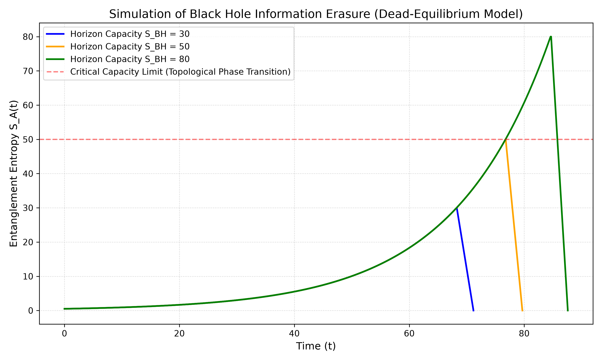
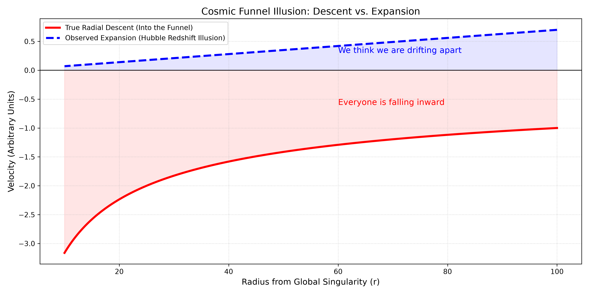
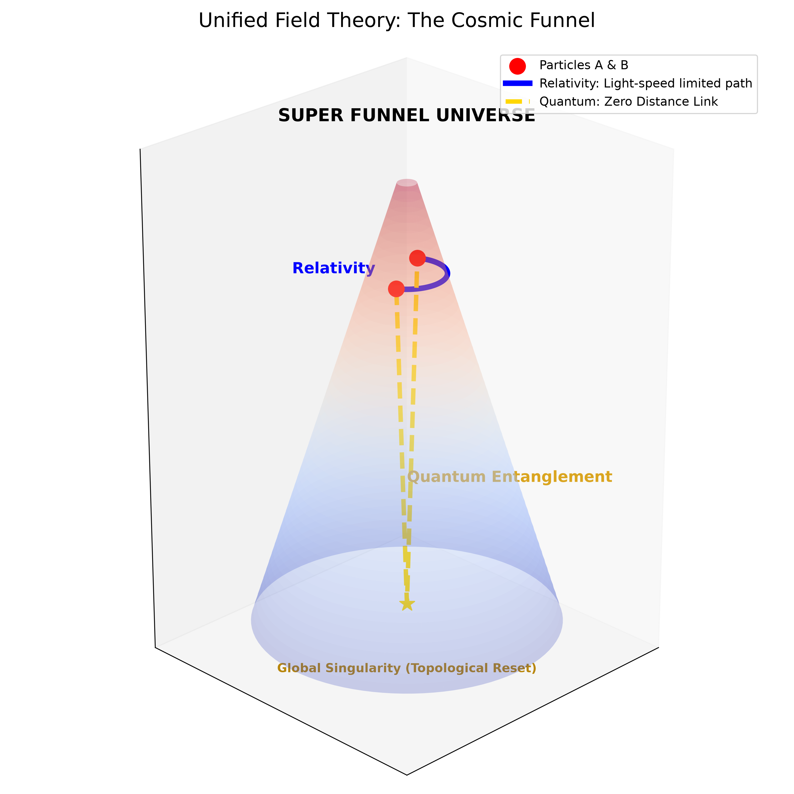
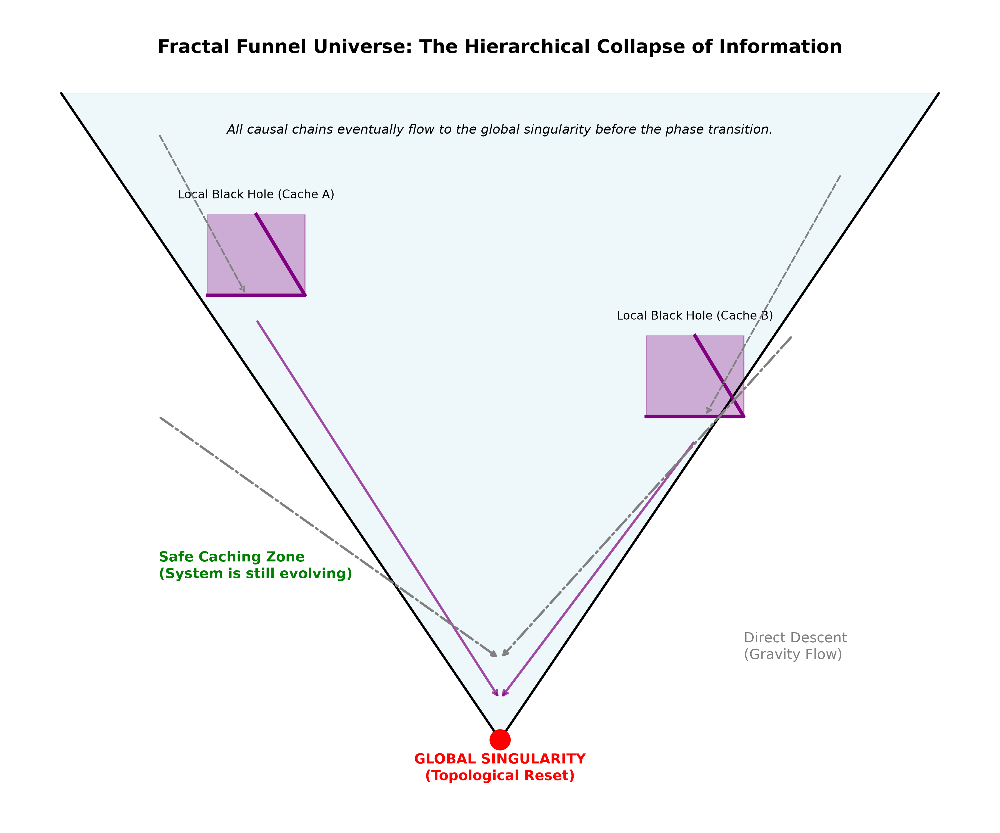
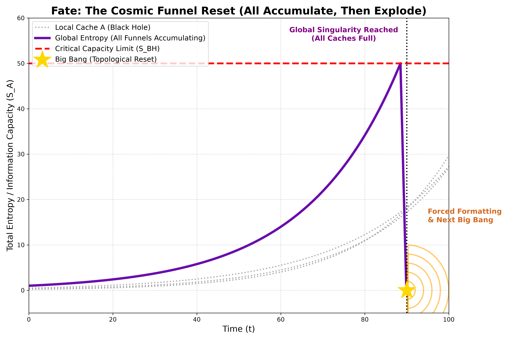
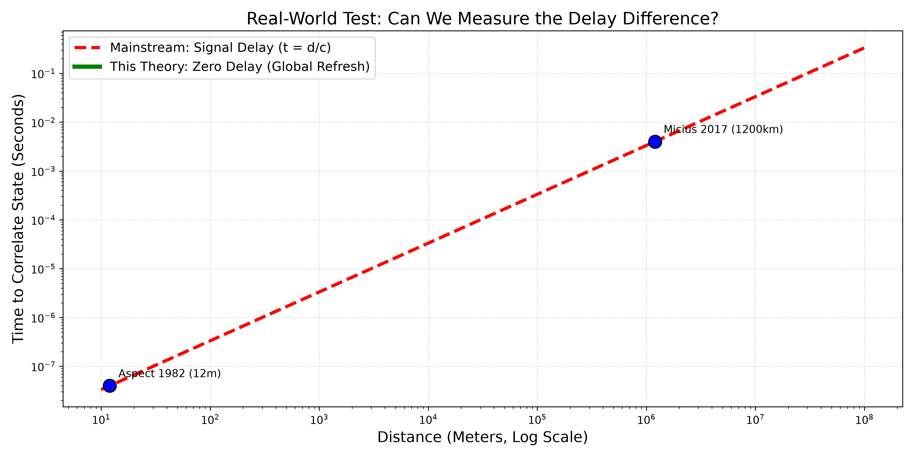

| Item | Content |
| :--- | :--- |
| Title | Finite-Capacity Ontology: A Unified Funnel Model of Black Holes and the Cosmos |
| Author | Max Lance |
| Version | 6.1 |
| Date | 2026-11-10 |
| License | CC BY-NC 4.0 |
| Keywords | Finite-Capacity, Black Hole Information Paradox, Quantum Entanglement, Gravitational Funnel, Dark Energy |

 

# Finite-Capacity Ontology: A Unified Funnel Model of Black Holes and the Cosmos

## Abstract

The black hole information paradox and the nature of dark energy remain unresolved fundamental conflicts in modern physics. This paper proposes the **Finite-Capacity Ontology**. The model assumes that the entire universe and its local black holes are essentially "gravitational funnels" with a strict maximum storage capacity. We demonstrate that macroscopic expansion is a geometric projection of centripetal descent in comoving coordinates, and microscopic entanglement is topologically protected at the funnel's base. Based on the Lindblad master equation for open quantum systems, we derive the gravity-topological entanglement evolution equation through a mean-field approximation, providing the sole falsifiable criterion to test this theory.

## 1. Erasure Dynamics and Phase Transition Fracture

Based on the Landauer principle, we propose the **Dead-Equilibrium Master Equation** describing the evolution of the system's entanglement entropy S_A(t):

$$
\frac{dS_A(t)}{dt} = \kappa \left( \frac{\dot{M}(t)}{S_{BH}} \right) S_A(t)
$$

When the system approaches the capacity limit, a cliff-like topological phase transition occurs, resulting in forced formatting:

$$
\lim_{t \to t_{page}} S_A(t) = S_{BH} \quad \Longrightarrow \quad \text{Topological Phase Transition}
$$

**Figure 1**: A cliff-like topological phase transition occurs when the system approaches the capacity limit, resulting in forced formatting.

## 2. Macroscopic Geometric Effect: Reinterpreting Dark Energy

In the gravitational funnel ontology, the so-called "spatial expansion" is a **relativistic kinematic projection** of matter falling along geodesics in curved spacetime. The observed Hubble recession velocity is equivalent to the centripetal collapse rate:

$$
v_{obs} = H_0 D_{obs} \quad \equiv \quad -\dot{r}_{drop}
$$

**It should be particularly noted** that the "gravitational funnel" in this model corresponds to the evolution of a uniform scale factor a(t) in comoving coordinates on a macroscopic scale. Since the potential field of the funnel is globally uniform, there is no observable "absolute spatial center." This descent projection manifests as uniform isotropic expansion for any local observer, perfectly compatible with the FLRW metric and explaining the extreme uniformity of the Cosmic Microwave Background (CMB).

**Figure 2**: The observed Hubble recession velocity is essentially a metric projection of galaxies accelerating inward along the gravitational funnel.

## 3. Unified Field Theory: Topological Suture of Macro and Micro

Macroscopic relativity is constrained by the speed of light, while microscopic quantum mechanics exhibits non-locality. In the funnel model, they achieve theoretical unification:

$$
\text{Relativity: } ds^2 = 0 \quad \Big| \quad \text{Quantum: } D_{topo} \equiv 0
$$

**Figure 3**: Relativity propagates along the funnel wall; quantum entanglement achieves a zero-distance direct link at the base singularity.

## 4. First-Principles Derivation: Gravity-Topological Entanglement Evolution Equation

To establish a mathematical bridge between microscopic quantum mechanics and macroscopic entanglement evolution, this section starts from the **Lindblad Master Equation** for open quantum systems:

$$
\frac{d\rho}{dt} = -i [H_{eff}, \rho] + \sum_{k} \left( L_k \rho L_k^\dagger - \frac{1}{2} \{L_k^\dagger L_k, \rho\} \right)
$$

Where ρ is the system density matrix. As photons propagate through macroscopic space, the equivalent decoherence rate Γ is proportional to the distance D (Γ = γD). The effective Hamiltonian H_eff includes the global topological correction of the gravitational field.

Under the mean-field approximation, the spacetime topological folding induced by the gravitational field provides a nonlinear feedback. Within the framework of the holographic principle, the extremely high event density near the horizon leads to intense internal entanglement (Scrambling) among environmental subsystems. This causes the environmental operators that originally destroy the entanglement of subsystems A and B to instead "reflect" the entanglement back into the AB system. Considering the saturation limit of quantum purity, the coherence evolution equation is:

$$
\frac{d\lambda}{dt} = -\gamma D \lambda + \alpha G \lambda (1 - |\lambda|^2)
$$

Using the mapping relationship between entanglement C(t) and coherence λ(t), a **nonlinear ordinary differential equation (ODE)** is derived in the macroscopic limit:

$$
\frac{dC(t)}{dt} = -\gamma D \cdot C(t) + \alpha G \cdot C(t) \cdot (1 - C(t))
$$

*(Note: The linear mapping C ∝ λ here adopts a phenomenological limit approximation, aiming to extract the macroscopic steady-state characteristics of nonlinear dynamics. Under extreme gravitational limits, the decoherence rate of the high-dimensional Hilbert space becomes nonlinear, and this approximation may deviate. This is also the systematic error that future deep-space experiments need to focus on calibrating.)*

Setting dC/dt = 0, we obtain the steady-state solution and the critical gravitational field G_crit:

$$
C^* = 1 - \frac{\gamma D}{\alpha G}, \quad G_{crit} = \frac{\gamma D}{\alpha}
$$

**Physical Significance**: In weak gravitational environments (G ≪ G_crit), entanglement is masked by environmental noise; however, under extreme gravity (G ≫ G_crit), entanglement is absolutely protected by topology.

## 5. Fractal Funnel Structure and the Sole Fate

The universe is currently in a "safe caching zone." Local black holes temporarily buffer the overloaded information, while all causal chains converge toward the global singularity at the bottom:

$$
\sum S_{local} \quad \xrightarrow{\text{Gravity Flow}} \quad S_{global}
$$

**Figure 4**: Local black holes act as "caching zones", where all matter and causal chains eventually converge at the global singularity.

Based on the finite-capacity axiom, the system inevitably undergoes a capacity-saturated phase transition, triggering a global format and reboot:

$$
\lim_{S_A \to S_{BH}} \mathbb{T}(\Omega) = \mathcal{E}_{noise} \quad \Longrightarrow \quad \text{Big Bang Reboot}
$$

**Figure 5**: Local caches accumulate to the critical red line, the system instantly resets, triggering a new Big Bang.

## 6. Experimental Boundary and Ultimate Verdict

This theory not only provides a philosophical framework but also yields a falsifiable criterion. Traditional physics assumes that information transfer is limited by light-speed delay t = d/c, whereas this theory predicts a bottom-layer global refresh time t ≡ 0.

**Figure 6: Experimental boundary of the global refresh mechanism and light-speed limit.** 
The red dashed line represents the delay predicted by mainstream relativity, while the green solid line represents the zero delay predicted by this model. The blue dots represent the current true limits of humanity (1982 Aspect experiment 12m, 2017 Micius satellite 1200km). The Earth's gravitational field is extremely weak (G ≪ G_crit), so the green line is a theoretical extrapolation.

**Core Mechanism of Experimental Realization and Signal Transmission**: To verify this model in future experiments, the entanglement source must be placed in a strong gravitational potential well (e.g., near a black hole orbit). The protection effect does not stem from the relative time difference between particles, but because the **system as a whole undergoes extreme gravitational redshift relative to the external flat spacetime**. In the experimental architecture, entangled particles must be placed on the same equipotential surface in co-orbital motion to eliminate gravitational tidal decoherence.

**Clarification of Proper Time and Shapiro Delay**: Gravitational redshift (time-freezing effect) is relative to the external observer. For observers within the system, they experience internal proper time τ. The dynamical evolution of the topological protection mechanism is based on proper time τ. Furthermore, entanglement measurements completed in a strong gravitational potential well will be severely affected by the **Shapiro Delay** of general relativity when the data is transmitted back to the external flat spacetime. The t ≡ 0 predicted by this model strictly refers to the intrinsic delay of entanglement state refresh within the system's local proper reference frame. Experimental physicists must use local clocks to mark the time near the horizon and strictly deduct the gravitational time delay caused by photons escaping the potential well during post-data analysis to isolate the true global refresh signal. If the intrinsic time measured under this extreme gravitational gradient falls into the green line, the theory is confirmed; if it still follows the red line, the model is falsified.

## 7. Conclusion

1. **Dark energy is not a real repulsive force**: Galactic recession is a **geometric projection** of the system collapsing along geodesics in comoving coordinates.
2. **Quantum non-locality originates from topological connectivity**: Macroscopic space has distance, but in the topological structure at the bottom of the funnel, the distance is identically zero and protected by the gravitational Scrambling effect.
3. **Thermodynamic heat death is unreachable**: The sole fate of the universe is the **topological phase transition and reboot** after full capacity.

## References

1. Hawking, S. W. (1975). Particle creation by black holes. *Communications in Mathematical Physics*, 43(3), 199-220.
2. Page, D. N. (1993). Information in black hole radiation. *Physical Review Letters*, 71(23), 3743.
3. Ryu, S., & Takayanagi, T. (2006). Holographic derivation of entanglement entropy. *Physical Review Letters*, 96(18), 181602.
4. Maldacena, J., & Susskind, L. (2013). Cool horizons for entangled black holes. *Fortschritte der Physik*, 61(9), 781-811.
5. Lindblad, G. (1976). On the generators of quantum dynamical semigroups. *Communications in Mathematical Physics*, 48(2), 119-130.

---

 

**Suggested Citation (APA):**
Max Lance (2026). *Finite-Capacity Ontology: A Unified Funnel Model of Black Holes and the Cosmos* (v6.1). Equal System Repository.
