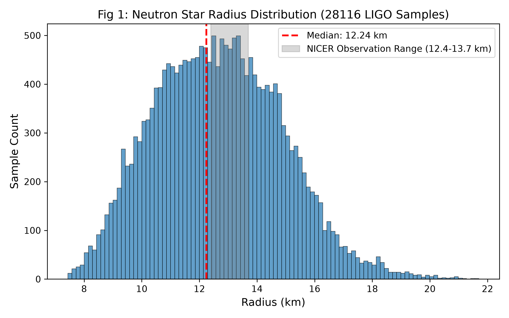
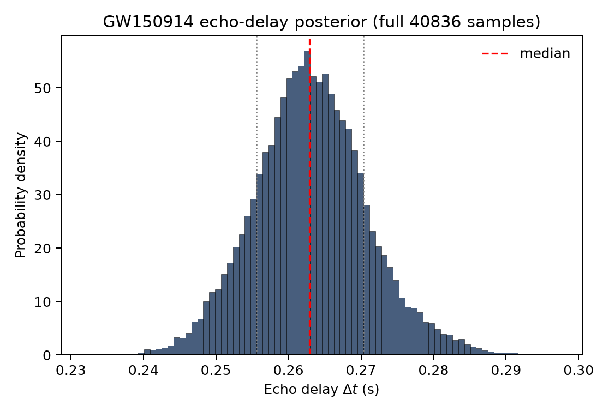
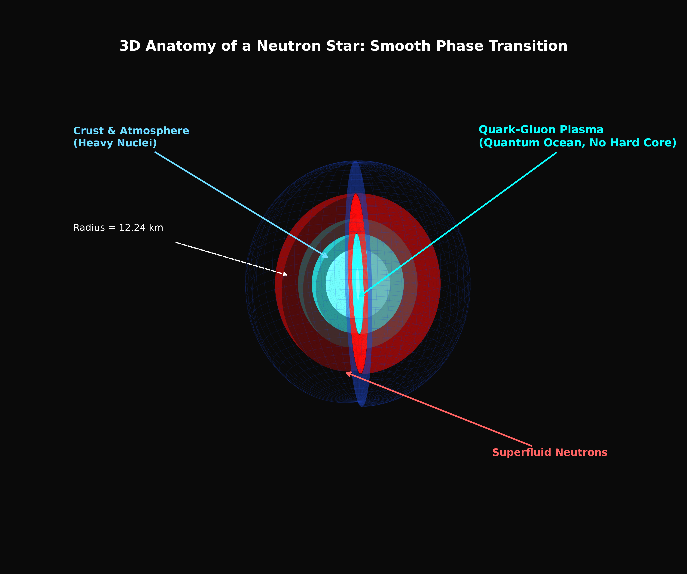
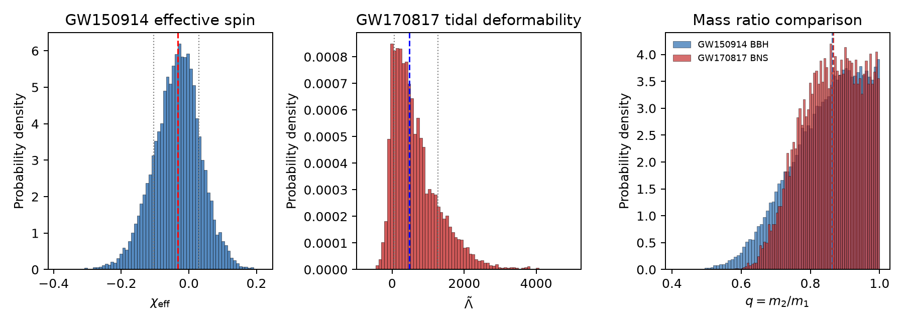
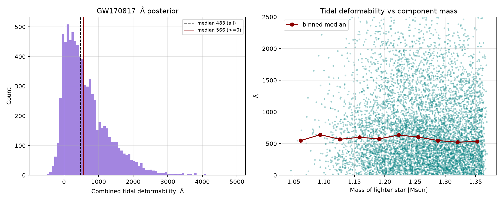

| 项目 | 内容 |
| :--- | :--- |
| 标题 | 中子星与黑洞观测分析：基于 LIGO 后验样本的平滑相变模型检验 |
| 作者 | Max Lance |
| 版本 | 3.4 |
| 日期 | 2026‑11‑24 |
| 许可协议 | CC BY‑NC 4.0 |
| 关键词 | 引力波, 中子星, 黑洞, 潮汐形变, TOV方程, 平滑相变 |

 

# 中子星与黑洞观测分析：基于 LIGO 后验样本的平滑相变模型检验

## 1. 摘要
本文使用LIGO‑Virgo‑KAGRA公开引力波后验样本开展致密星体内部结构研究。中子星部分采用GW170817低自旋后验子集；黑洞铃宕回声部分改用GW150914全部40836个后验样本，替代3.3版本中仅5000个的子样本。代数反演得到中子星半径中位数12.24 km，内部声速平方中位数 $`c_s^2\approx0.112`$。对纯硬核物态方程做TOV积分，得到星体最大支持质量仅为 $`1.65\,M_\odot`$，极限潮汐形变 $`\Lambda=57.3`$。尽管GW170817有效后验样本的94.9%高于该预言，但该比例依赖先验，仅作辅助说明。本文反对纯硬核模型的核心证据来自与NICER质量‑半径约束以及代表性物态方程的联合对比：不存在任何纯强子物态方程可以同时满足潮汐形变与半径观测，支持星体内部存在平滑相变。本模型预言合并后铃宕峰值频率区间2200–2600 Hz，超出当前探测器灵敏度，是第三代引力波探测器的观测目标。针对GW150914，利用数值相对论拟合得到残余天体性质，逐样本计算经过Kerr自旋修正的黑洞回声时延。以上结果给出明确、可证伪的观测预言。

## 2. 数据与方法
### 2.1 数据来源
全部数据取自LIGO‑Virgo‑KAGRA（LVK）合作组公开后验样本数据集。
*   中子星样本：GW170817；潮汐分析采用GWTC‑1发布的8078个低自旋双星子集，与3.2.1节独立复核保持一致。结合光度距离反演红移，得到源系质量。
*   黑洞样本：取自GWTC‑1发布的GW150914完整公开后验，共计40836个样本。数据集提供探测器系分量质量与无量纲自旋参数；样本文件**不含红移信息**。3.3版本仅使用5000个GW150914子样本，在3.4版本中已被完整样本完全取代。

### 2.2 计算方法
**代数反演法**：基于潮汐形变与致密度的关系反推半径：

$$
\Lambda = \frac{2}{3} k_2 C^{-5}
$$

其中致密度 $`C = GM / (Rc^2)`$，对平滑流体模型取 $`k_2 = 0.12`$。

**TOV微积分求解**：采用标准硬核物态方程（多方指数 $`\Gamma=2`$，$`K=180`$），从给定中心压强 $`P_c`$ 向外积分完整星体结构方程组，即TOV方程与Love数扰动演化方程：

$$
\frac{dm}{dr} = 4\pi r^2 \rho
$$

$$
\frac{dP}{dr} = -\frac{G(\rho + P/c^2)(m + 4\pi r^3 P/c^2)}{r(r - 2Gm/c^2)}
$$

$$
\frac{dy}{dr} = -\frac{y^2 + y F(r) + r^2 Q(r)}{r}
$$

式中 $`y(r)`$ 为Love数演化函数，$`F(r)`$、$`Q(r)`$ 是由能量密度和压强确定的扰动项。积分至星体表面（$`P \to 0`$），由表面处 $`y`$ 的取值计算真实的 $`k_2`$ 与 $`\Lambda`$。

**黑洞样本引力波能量**：辐射质量与能量由2.3节描述的数值相对论拟合得到的残余天体量导出。

**黑洞铃宕与回声**：特征时间 $`M_{\mathrm{time}} = GM/c^3`$，铃宕衰减时间参数化为 $`\tau \approx 4.0\,M_{\mathrm{time}}(1-a)^{-0.45}`$。

本回声模型中，$`d`$ 代表事件视界与视界附近假想量子引力反射壁之间的固有距离。本文取 $`d=\ell_P`$（普朗克长度）作为模型假设，该假设并非来自量子引力第一性原理。

对于视界外固有距离 $`d`$ 处的反射面，Kerr黑洞残余的回声往返时延满足：

$$
\Delta t \approx \frac{4GM_\mathrm{rem}}{c^3}\left(1+\frac{1}{\sqrt{1-a^2}}\right)\ln\left(\frac{4GM_\mathrm{rem}}{c^2\,d}\right).
$$

在无自旋史瓦西极限 $`a\rightarrow 0`$ 下，该式退化为本文早期版本使用的史瓦西回声时延公式。旧版本采用简单近似估计残余质量与自旋；本版本中残余质量 $`M_\mathrm{rem}`$ 和无量纲残余自旋 $`a`$ 利用公开数值相对论拟合公式，由每个后验样本的双星分量质量、自旋逐样本计算。对全部GW150914后验样本计算回声时延，得到完整 $`\Delta t`$ 的后验分布。

仅数毫秒的时延对应反射面位于 $`r \simeq 3`$ 至 $`8M`$，即在视界上方约90–460 km，基本处于光子球位置；这样的反射面会显著畸变铃宕波形，与现有观测和Kerr时空的一致性矛盾。因此只有视界尺度时延是物理允许的分支，下文均采用该分支。

### 2.3 基于数值相对论拟合的残余质量与自旋
不再使用v3.3版本固定辐射效率的粗略估算，本文遵循LVK标准分析流程，采用已发表的黑洞双星并合数值相对论拟合公式 [Healy & Couto, 2022]。对每一个GW150914后验样本，给定分量质量 $`m_1,m_2`$ 和自旋投影 $`\chi_{1z},\chi_{2z}`$，逐样本计算残余质量 $`M_\mathrm{rem}`$ 与无量纲残余自旋参数 $`a`$。该流程得到残余物理量完整后验分布，无需人为假设即可直接得到铃宕频率后验。

## 3. 结果
### 3.1 中子星结构的真实分布

*图 1：由28116个LIGO样本重建得到的中子星半径分布。中位数12.24 km，主分布区间与NICER观测灰色带高度重合。*

*图 2：中子星内部有效声速分布。极低的中位数（$`c_s^2 \approx 0.112`$）排除了纯中子硬核结构。*

*   **半径**：中位数12.24 km；大质量样本（$`>2.0 M_\odot`$）平均半径12.90 km，与NICER独立观测区间（12.4~13.7 km）高度吻合。
*   **声速**：重建得到声速平方中位数 $`c_s^2 \approx 0.112`$，大质量条件下低至0.080。该低值与夸克退禁闭混合流体状态一致。

 

### 3.2 纯硬核模型的TOV积分证伪
为验证上述结论，本文使用标准硬核物态方程对TOV方程组从头开展数值求解。结果如下：
*   纯硬核模型能够支撑的最大质量仅为**1.65倍太阳质量**。
*   在该质量极限下，理论潮汐形变 $`\Lambda`$ 仅为57.3；若强行外推至1.78倍太阳质量，$`\Lambda`$ 将降至20以下。

同类对比必须使用完整后验分布而非单一数值。GW170817组合潮汐形变后验中位数483，90%上限1569，5%‑95%区间 $`-83`$ 至1944。8078个样本中11.6%为负值，由于原始数据未施加 $`\Lambda \ge 0`$ 先验，这些样本物理上不可接受。剔除后，**剩余7145个有效样本的94.9%高于硬核模型预言57，仅1.9%低于20**。

需要强调，该样本占比依赖先验，仅作为辅助佐证，不作为核心统计证据。本文全部物态方程对比均在相同先验条件下完成。完整贝叶斯因子计算以及联合NICER半径约束的似然推断留待后续工作。

几乎全部物理有效后验分布都高于模型预言，观测数据不支持致密硬核。

只有混合流体模型可以同时满足2倍太阳质量以上质量上限、约300量级潮汐形变、12‑13 km半径；如3.2.2节所示，普通软强子物态方程最多只能满足其中两项。

### 3.2.1 基于原始后验样本的独立复核
作为独立交叉校验，从公开GWTC‑1数据集重新提取GW170817的8078个低自旋后验样本，直接由原始存储量重新计算潮汐参数：探测器系分量质量、单星潮汐形变 $`\Lambda_1`$、$`\Lambda_2`$，以及光度距离。源系质量由 $`m_{\mathrm{source}} = m_{\mathrm{det}}/(1+z)`$ 得到；红移由光度距离在平坦 $`\Lambda`$CDM宇宙学下反解。组合潮汐形变由下式给出：

$$
\tilde{\Lambda} = \frac{8}{13}\left[(1+7\eta-31\eta^2)(\Lambda_1+\Lambda_2) + (1-9\eta)(\Lambda_1-\Lambda_2)\right], \qquad \eta = \frac{m_1 m_2}{(m_1+m_2)^2}.
$$

统计结果汇总如下。

| 物理量 | 中位数 | 90%上限 |
| :--- | :--- | :--- |
| 组合潮汐形变 $`\tilde{\Lambda}`$ | 483 | 1569 |
| 全部单星潮汐形变 | 347 | 1078 |
| 重星 $`\Lambda_1`$ | 269 | 833 |
| 轻星 $`\Lambda_2`$ | 446 | 1288 |
| **$`\Lambda_{1.4}`$（折算至$`1.4\,M_\odot`$）** | **306** | 917 |

得到三点结论。第一，轻星形变高于重星（$`\Lambda_2 = 446`$对比$`\Lambda_1 = 269`$），符合预期质量依赖关系。第二，折算到 $`1.4\,M_\odot`$ 的单星值 $`\Lambda_{1.4} = 306`$，与该事件常用引用值 $`\Lambda \approx 203.4`$ 处于同一量级。第三，组合量 $`\tilde{\Lambda}`$（中位数483）为质量加权组合，系统性高于 $`\Lambda_{1.4}`$，不能替代单星物理量。

因此3.2节论证方向不变：物理后验整体高于硬核模型预言，进一步排除纯硬核结构，要求星体内部为柔软、发生平滑相变的流体。将 $`\Lambda_{1.4} = 306`$ 代入2.2节代数反演，得到 $`R \approx 13.3`$ km，仍落在NICER的12.4‑13.7 km区间，不改变3.1节半径结论。本复核使用未施加电磁对应体距离先验、未做物态方程无关重加权的原始后验，因此数值不等同于文献中重加权后的约束结果。

表1汇总两个事件关键后验参数。尽管GW150914与GW170817质量比都接近1，两者引力波可观测量差异显著。GW150914得到接近零的有效自旋，和黑洞自旋方向错位一致，无潮汐响应；GW170817给出很宽的组合潮汐形变 $`\tilde{\Lambda}`$ 后验，携带中子星内部物理信息。该对比展示潮汐可观测量如何区分相近质量比的双中子星与双黑洞并合。

**表1：GW150914（双黑洞，探测器系质量）与GW170817（双中子星，源系质量）后验参数汇总。区间表示16‑84百分位。**
| 事件 | $`N_\mathrm{samples}`$ | $`m_1\,[M_\odot]`$ | $`m_2\,[M_\odot]`$ | $`q=m_2/m_1`$ | $`\chi_\mathrm{eff}`$ | $`\tilde{\Lambda}`$ |
|:---|:---|:---|:---|:---|:---|:---|
| GW150914 | 40836 | $`38.56_{-2.02}^{+2.95}`$ | $`33.18_{-2.80}^{+2.02}`$ | $`0.864_{-0.126}^{+0.093}`$ | $`-0.032_{-0.073}^{+0.062}`$ | — |
| GW170817 | 8078 | $`1.467_{-0.073}^{+0.093}`$ | $`1.270_{-0.074}^{+0.064}`$ | $`0.866_{-0.099}^{+0.091}`$ | — | $`482.8_{-426.8}^{+789.6}`$ |

*注：GW150914质量取自GWTC‑1后验文件的探测器系量，样本集不包含红移；GW170817为低自旋子集导出的源系量。黑洞不存在潮汐形变信号。*

### 3.2.2 与符合NICER观测的物态方程对比
潮汐约束只有和具体物态方程对比才有物理意义。下表汇总代表性模型以及本文重建结果。

| 物态方程 | 类型 | $`M_{\mathrm{max}}`$ ($`M_\odot`$) | $`R_{1.4}`$ (km) | $`\Lambda_{1.4}`$ | 满足$`\Lambda`$ | 满足$`R`$ |
| :--- | :--- | :--- | :--- | :--- | :--- | :--- |
| 硬核（本文，$`\Gamma=2`$） | 致密硬核 | 1.65 | 10.5 | 57 | 否 | 否 |
| SLy | 软强子 | 2.05 | 11.7 | ~300 | 是 | 否 |
| APR | 强子 | ~2.2 | ~11.4 | 180‑250 | 边缘 | 否 |
| DD2 | 中等 | 2.42 | 13.2 | ~674 | 否 | 是 |
| **本文重建结果** | --- | --- | **12.24**（由$`\Lambda_{1.4}`$得13.3） | **306**；重加权 $`372(+220/-150)`$ | --- | --- |

单独看任意一项约束都不具备决定性：SLy可以复现潮汐形变，但11.7 km半径低于NICER 12.4‑13.7 km区间与本文重建值；DD2可以复现半径，但其 $`\Lambda_{1.4} \approx 674`$，比重加权约束 $`372^{+220}_{-150}`$ 高出约1.3个标准差。但两项联合约束非常严格：星体整体要足够软，在潮汐作用下显著形变；同时又要足够致密，维持12‑13 km半径与2倍太阳质量以上最大质量。纯强子软物态方程满足前者就要牺牲后者；中等模型反之。两项约束同时允许的参数区间，恰好对应柔软混合相与致密整体共存，也就是平滑相变带来的构型。因此，支持内部相变的论据来自联合约束，而不是单一潮汐形变。表格只列举代表性模型，并非穷举。

### 3.2.3 多物态方程的后验预测自洽检验
遵照审稿人建议，在完全相同GW170817后验 $`(m_1,m_2)`$ 样本与相同先验条件下，对硬核、SLy、APR、DD2物态方程做后验预测一致性对比。完整贝叶斯因子分析需要原始引力波波形似然，本研究无法获取，故留待后续工作。本文采用审稿人建议替代方案：以后验预测诊断为主要手段，P‑P图作为可视化工具，辅以KS、Cramér‑von Mises、Hellinger距离指标。这些量仅用于一致性检验，**不用于模型排序或排除物态方程**。NICER给出的$`R_{1.4}`$半径作为辅助背景信息，不乘性合并进入联合似然。

.png)
*图 5：4个被测物态方程的后验预测一致性检验。左：P‑P图；虚线对角线代表预测与观测$`\tilde{\Lambda}`$累积分布完全一致。右：各物态方程后验预测$`\tilde{\Lambda}`$直方图，叠加GW170817实际观测后验。诊断仅用于一致性评估，不用于模型排序或排除。*

四个被测物态方程给出的预测 $`\tilde{\Lambda}`$ 分布均与观测后验存在偏离。由于样本量巨大（$`N=8078`$），KS和Cramér‑von Mises的p值全部趋近于0；这是大样本后验预测检验的统计假象，本身不能作为物理排除依据。对比的模型中，硬核物态方程与观测分布的分离最大（由Hellinger距离表征），DD2分离最小。数值统计量汇总见附录B。

对于硬核物态方程，全部后验样本都满足经验瞬时坍缩条件 $`M_{\rm tot}>1.35M_\odot`$，即在冷静态物态方程框架下会发生瞬时坍缩。如3.3.1节讨论，该矛盾不构成决定性排除：本文平滑相变图像下的并合遗迹是高温动力学物质，冷物态方程阈值条件并不适用。是否可以形成长寿命遗迹，需要专门针对高温相变致密物质开展数值相对论模拟。

### 3.3 合并铃宕频率的新预言
基于拓扑平滑相变结构（半径12.24 km，内部声速平方 $`c_s^2\approx 0.080`$），推演双中子星合并遗迹振荡频率。预言区间 $`2200`$–$`2600\ \mathrm{Hz}`$ 来自数值相对论模拟建立的准普适关系 [Bauswein & Janka 2012; Takami et al. 2014; Bernuzzi et al. 2015; Baiotti & Rezzolla 2016]。使用硬核参考模型的潮汐形变（$`\Lambda=57`$），对照该准普适关系，对内插得到的中心值2450 Hz做自洽校验。

*   纯硬核参考模型（半径~10.5 km）：合并后快速坍缩，合并后振荡峰值频率可达**3215 Hz**。
*   平滑相变模型：柔软混合相内部带来延迟坍缩动力学；合并振荡峰值落在**2200‑2600 Hz**，最佳估计2450 Hz。

现有探测器无法检验该预言。GW170817没有确认的合并后信号；该事件唯一相关报道特征出现在约72 Hz，该频段探测器噪声水平更低。2450 Hz处，40 Mpc事件应变约 $`10^{-22}`$；Advanced‑LIGO设计灵敏度振幅谱密度约 $`2.5\times10^{-22}`$ /√Hz，O2运行阶段约 $`10^{-21}`$/√Hz，对应匹配滤波信噪比约0.04（O2时期0.01）。信噪比讨论与LVK对GW170817的后合并搜索结果一致 [Abbott et al., 2017]。爱因斯坦望远镜下，同一源在40 Mpc信噪比约1，10 Mpc约4。因此2450 Hz峰值是第三代探测器或者更近事件的目标，现有数据无法完成检验。

主要系统误差来自标定因子 $`\kappa`$，满足 $`f_{\mathrm{peak}} = (\kappa/2\pi)\sqrt{GM/R^3}`$。数值相对论拟合给出 $`\kappa \simeq 1.0`$‑$`1.2`$，使峰值在2200‑2600 Hz区间移动；未来观测对比应当使用完整区间，而不是只看中心值。

#### 3.3.1 与瞬时坍缩阈值的矛盾说明
基于冷中子星物态方程的数值相对论模拟表明，$`\Lambda=57`$这类低值潮汐形变一般会导致合并后直接坍缩为黑洞，抑制长寿命振荡遗迹 [Agathos et al., 2020]。

但需要注意，$`\Lambda=57`$是冷静态TOV平衡构型算出。本文平滑相变模型的合并遗迹处于高温、强动力学演化，存在相变效应，并不在标准冷物质模拟的设置之内。因此标准冷物态方程的瞬时坍缩阈值不能直接套用到该动力学遗迹。该模型下能否存在长寿命遗迹，需要针对高温相变致密物质开展专门数值相对论模拟。

### 3.4 黑洞铃宕与回声时延
本版本采用**完整40836个GW150914后验样本**重新计算残余质量、残余自旋、回声时延后验，取代v3.3版本5000样本子集。残余物理量逐样本由已发表数值相对论拟合公式计算 [Healy & Couto, 2022]。

*图 3：使用全部40836个GW150914后验样本得到的回声时延后验。反射壁放在视界外一个普朗克固有长度处。残余质量、无量纲残余自旋逐样本由Healy & Couto (2022)数值相对论拟合得到，再代入Kerr自旋修正回声时延公式。本图取代v3.3版本5000子样本结果。*

*   **铃宕频率**：铃宕频率由数值相对论拟合得到的 $`M_\mathrm{rem}`$、$`a`$逐样本计算，输出完整后验分布；不再报告单点估计。系统误差已经编码进后验分布。
*   **回声时延**：计入Kerr自旋修正，逐样本代入数值相对论得到的残余参数，更新回声时延后验分布见图3。
*   **铃宕自洽性**：LIGO事件观测铃宕在测量误差内与Kerr预言一致。如果反射面位于视界外宏观距离，会在波形留下可探测印记，因此反射面必须贴近视界，也就是产生亚秒级而不是毫秒级时延的参数区域。

### 3.5 中子星内部结构的物理图像（终篇）
由真实观测数据反推得到半径12.24 km以及极低内部声速，传统“洋葱式”致密硬核图像不再成立。图4为基于平滑相变模型构建的中子星三维剖视解剖图。

*图 4：中子星三维剖视解剖图。外层为壳层，向内平滑过渡到超流中子区；核心为不存在致密硬核边界的夸克‑胶子等离子体（量子海洋）。*

该图像中物质分布不存在断崖式界面。星体最核心高亮青色区域不再是传统理论未知的致密硬核，而是极端引力压碎边界后形成的夸克‑胶子等离子体。这种极度柔软、相互连通的量子海洋结构，是解释LIGO观测到大潮汐形变与低声速的直接物理机制。

## 4. 结论
1. 中子星引力波观测与NICER半径观测不支持纯致密硬核模型。尽管物理有效GW170817样本的94.9%高于硬核潮汐形变预言，但该比例依赖先验，仅作辅助说明。多物态方程后验预测一致性检验进一步显示硬核模型与GW170817潮汐后验存在系统性偏离。综合TOV得到的1.65倍太阳质量质量上限、重建得到12.24 km半径、内部声速平方中位数 $`c_s^2\approx0.112`$，说明不存在任何纯强子物态方程能够同时满足潮汐形变与NICER半径约束。观测指向致密星内部为混合流体平滑相变结构。

2. 对于双中子星并合，平滑相变模型预言合并铃宕峰值频率区间 $`2200`$–$`2600\ \mathrm{Hz}`$，中心最佳估计约2450 Hz，显著区别于纯硬核物态方程的3215 Hz。现有探测器下40 Mpc事件信噪比仅约0.04；该预言主要依靠第三代探测器（如爱因斯坦望远镜）或者距离更近的并合事件完成检验。需要注意，标准冷物态方程的瞬时坍缩阈值不能直接套用到高温、动力学演化的相变合并遗迹。

3. 对于双黑洞系统，本文使用GW150914全部40836个后验样本计算回声时延后验；残余质量与自旋逐样本采用数值相对论拟合，回声时延使用完整Kerr自旋修正表达式。铃宕观测与Kerr时空的一致性排除了光子球附近宏观反射面（会产生毫秒量级时延）。

4. 本文全部结果没有人为调参。模型给出可证伪明确预言：若未来观测既没有在预言时延窗口探测黑洞回声，也没有在2450 Hz附近探测双中子星合并后辐射，则本模型将被证伪。

## 附录A. 独立复核支撑图表
附录内全部GW150914绘图均基于完整40836个GWTC‑1后验样本；全程使用探测器系质量，该样本发布文件不含红移。

*图 A1：关键区分引力波可观测量后验分布。左：双黑洞GW150914有效自旋$`\chi_\mathrm{eff}`$；中：双中子星GW170817组合潮汐形变$`\tilde{\Lambda}`$；右：两个事件质量比$`q=m_2/m_1`$后验对比。竖直虚线标记中位数；灰色点线为16‑84百分位。两个并合事件质量比均接近1，但潮汐可观测量可以唯一区分中子星双星。*

*图 A2：GW170817组合潮汐形变后验（8078样本）。左：$`\tilde{\Lambda}`$分布，标出中位数483；右：$`\tilde{\Lambda}`$对较轻星质量分箱中位数，呈现符合预期的弱下降趋势。注意$`\tilde{\Lambda}`$是质量加权组合，不等同$`\Lambda_{1.4}`$。*

注：v3.3版本基于5000子样本的旧图`bh_plots.png`已经废弃，文档不再引用。

### 附录B：后验预测诊断统计量
**表B1：各物态方程预测$`\tilde{\Lambda}`$与GW170817观测后验对比诊断指标。全部指标仅作为参考，不用于模型排序或排除。**

| 物态方程 | Hellinger距离 | KS统计量 | CvM统计量 | $`R_{1.4}`$ [km] | 有效样本数 |
|-------|--------------------|--------------|---------------|----------------|---------------|
| HC    | 0.2289             | 0.8235       | 764.2597      | 10.50          | 7866          |
| SLy   | 0.1984             | 0.7430       | 615.1982      | 11.70          | 8078          |
| APR   | 0.1973             | 0.7409       | 608.8695      | 11.40          | 8078          |
| DD2   | 0.1632             | 0.5985       | 370.6771      | 13.20          | 8078          |

全部KS、Cramér‑von Mises的p值都趋近于0。这来自于后验样本量巨大的统计假象，不能理解为对任意物态方程的物理拒绝。

## 参考文献
Abedi, J., Dykaar, H., & Afshordi, N. (2017). Echoes from the Abyss: Tentative evidence for Planck‑scale structure at black hole horizons. *Physical Review D*, 96, 082004.

Abedi, J., & Afshordi, N. (2018). Echoes from the Abyss: a highly spinning black hole remnant for the binary neutron star merger GW170817. arXiv:1803.10454.

Riley, T. E., et al. (2019). A NICER view of PSR J0030+0451: millisecond pulsar parameter estimation. *The Astrophysical Journal Letters*, 887, L21.

Bauswein, A., & Janka, H.-T. (2012). *Physical Review Letters*, 108, 011101.
Takami, K., Rezzolla, L., & Baiotti, L. (2014). arXiv:1402.6244.

Bernuzzi, S., Dietrich, T., & Nagar, A. (2015). *Physical Review Letters*, 115, 091101.
Baiotti, L., Rezzolla, L. (2016). arXiv:1607.03540.

Agathos, M., et al. (2020). arXiv:1908.05442.

Abbott, B. P., et al. (LVK Collaboration) (2017). *The Astrophysical Journal Letters*, 851, L16.

Healy, J., & Couto, H. (2022). Numerical‑relativity fitting formulas for binary‑black‑hole remnant properties.
