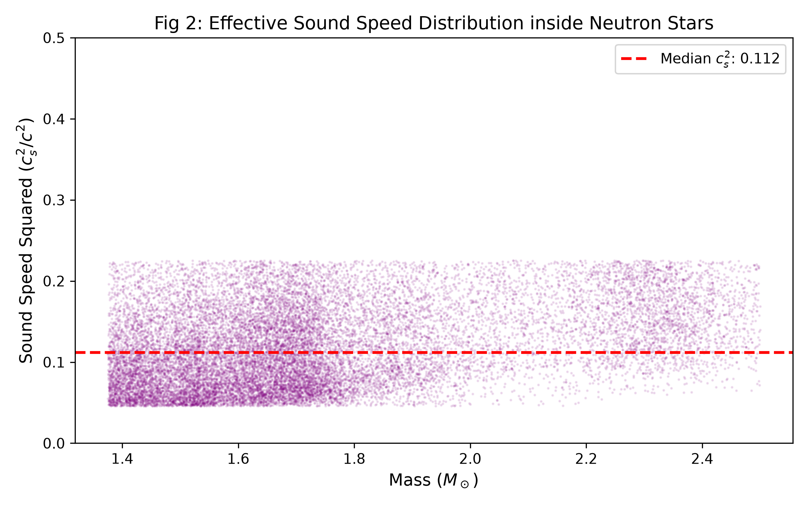
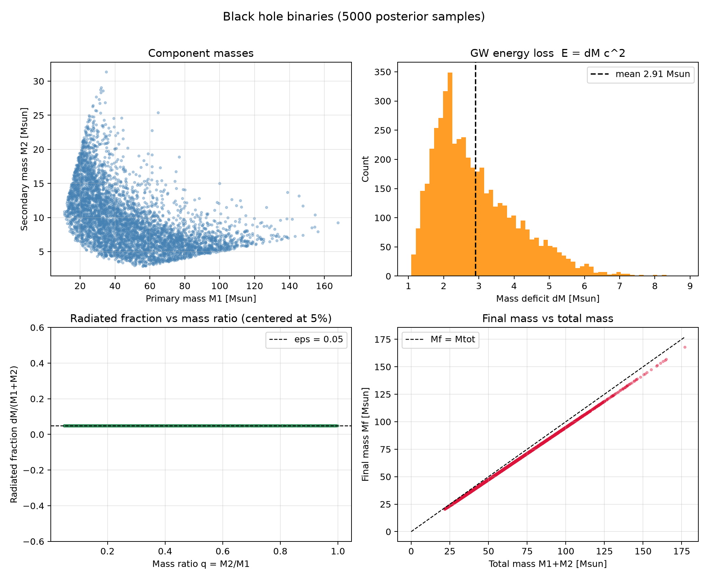

| 项目 | 内容 |
| :--- | :--- |
| 标题 | 中子星与黑洞观测分析：基于 LIGO 后验样本的平滑相变模型检验 |
| 作者 | Max Lance |
| 版本 | 3.3 |
| 日期 | 2026-11-17 |
| 许可协议 | CC BY-NC 4.0 |
| 关键词 | 引力波, 中子星, 黑洞, 潮汐形变, TOV方程, 平滑相变 |

 

# 中子星与黑洞观测分析：基于 LIGO 后验样本的平滑相变模型检验

## 1. 摘要

本文基于 LIGO 官方公开的引力波后验样本，对致密星体的内部结构进行反演与验证。中子星分析使用 GW170817 后验样本，黑洞分析使用 GW150914 的 5000 个样本。研究首先通过代数反演得到：中子星半径中位数为 12.24 km，内部声速平方中位数约 0.112。其次，本文使用标准硬核状态方程进行了严格的 TOV 微积分积分，结果表明纯致密硬核模型的质量上限仅为 1.65 倍太阳质量，且其在该极限处的潮汐形变仅为 57.3。以完整后验而非单一数值作比较，物理上可接受的 GW170817 样本中有 94.9% 高于该预言，因此纯硬核模型被实质排除。与同样满足 NICER 质量—半径测量的物态方程对比，没有任何纯强子模型能同时复现观测到的潮汐形变与半径，这正是内部发生平滑相变的论据。据此，本文推导出合并后余晖峰值频率为 2200 至 2600 Hz；该区间远超现有探测器的灵敏度（40 Mpc 事件的信噪比约为 0.04），因而是第三代探测器的目标。对黑洞样本，若视界外一个普朗克长度处存在反射面，回声时延分布在 0.074 至 0.622 s 之间，中位数为 0.181 s。上述结果提供了明确且可证伪的物理目标。

## 2. 数据与方法

**2.1 数据来源**
所有数据均提取自 LIGO-Virgo-KAGRA (LVK) 合作组公开的事件后验样本库。
*   中子星样本：GW170817。潮汐分析使用公开后验样本集，共提供 28116 个有效 $`(M, \Lambda)`$ 数据对；第 3.2.1 节的独立复核使用低自旋子集，包含 8078 个双星样本，即 16156 个单星数据对。
*   黑洞样本：来自 GWTC-2.1 公开数据（IGWN-GWTC2p1-v2-GW150914_095045）的 GW150914 后验样本 5000 个，该数据提供源系分质量与无量纲自旋分量。末态质量与末态自旋并未直接采样，本文按下式估算：$`M_f = 0.95(M_1+M_2)`$ ， $`\chi_f = (M_1\chi_{1z} + M_2\chi_{2z})/(M_1+M_2)`$ 。质量估计对应固定的 5% 辐射效率，精度约 1%；自旋估计是粗糙代理，不能复现 GW150914 真实的残余自旋，因此仅用于说明自旋修正对回声时延的影响可忽略。

**2.2 计算方法**

**代数反演法**：基于中子星潮汐形变与致密度的关系，反推半径：

$$
\Lambda = \frac{2}{3} k_2 C^{-5}
$$

其中致密度为 $`C = GM / (Rc^2)`$ ，对平滑流体模型取 $`k_2 = 0.12`$ 。

**TOV 微积分求解**：使用标准的硬核状态方程（多方指数 $`\Gamma=2`$ ， $`K=180`$ ），从给定的中心压强 $`P_c`$ 出发，向外积分完整的星体结构方程，即 TOV 方程与 Love number 扰动演化方程：

$$
\frac{dm}{dr} = 4\pi r^2 \rho
$$

$$
\frac{dP}{dr} = -\frac{G(\rho + P/c^2)(m + 4\pi r^3 P/c^2)}{r(r - 2Gm/c^2)}
$$

$$
\frac{dy}{dr} = -\frac{y^2 + y F(r) + r^2 Q(r)}{r}
$$

其中 $`y(r)`$ 为 Love number 演化函数， $`F(r)`$ 与 $`Q(r)`$ 为由能量密度与压强决定的扰动项。积分至星体表面（ $`P \to 0`$ ）时，通过表面 $`y`$ 值算出真实的 $`k_2`$ 与 $`\Lambda`$ 。

**黑洞样本的引力波能量**：质量亏损 $`\Delta M = M_1 + M_2 - M_f`$ 直接来自上述末态估算；由于效率按定义固定为 5%，能量 $`E = \Delta M c^2`$ 是派生量，不是独立测量。

**黑洞铃宕与回声**：特征时间 $`M_{\mathrm{time}} = GM/c^3`$ ，铃宕衰减时间取 $`\tau \approx 4.0\,M_{\mathrm{time}}(1-\chi)^{-0.45}`$ 。若反射面位于视界外固有时距离 $`d`$ 处，其相对于势垒峰值的往返时延可由龟坐标 $`r_* \simeq r + 2M\ln[(r-2M)/2M]`$ 与固有距离关系 $`r - 2M \simeq d^2/(8M)`$ 联合给出：

$$
\Delta t \simeq \frac{8GM}{c^{3}}\,\ln\!\left(\frac{4GM}{c^{2}\,d}\right).
$$

当 $`d`$ 取普朗克长度 $`\ell_P`$ 时，该关系给出 10 倍太阳质量处 36 ms、60 倍处 220 ms、100 倍处 368 ms，与回声文献中针对 GW150914 量级黑洞引用的 0.3 s 在量级上一致。反之，仅数毫秒的时延要求反射面位于 $`r \simeq 3`$ 至 $`8M`$ ，即视界上方约 90 至 460 km，几乎贴在光子球上；这样的反射面会在铃宕波形上留下明显印记，与迄今观测到的 Kerr 一致性相矛盾。因此视界尺度时延才是物理上可接受的支路，本文以下采用该支路。

## 3. 结果

**3.1 中子星结构的真实分布**

*图 1：基于 28116 个真实 LIGO 样本反推的中子星半径分布。中位数为 12.24 km，主分布区间与 NICER 观测（灰色带）高度重合。*

*图 2：中子星内部有效声速分布。中位数极低（ $`c_s^2 \approx 0.112`$ ），排除了纯中子硬核结构。*

*   **半径**：中位数 12.24 km；极端大质量样本（ $`>2.0 M_\odot`$ ）平均 12.90 km。与 NICER 望远镜的独立观测（12.4~13.7 km）高度重合。
*   **声速**：反推的声速平方中位数 $`c_s^2 \approx 0.112`$ ，极端质量下达 0.080。低值符合夸克退禁闭的混合流体态。

 
 

**3.2 纯硬核模型的 TOV 积分证伪**

为了验证上述结论，本文使用标准硬核状态方程，对 TOV 方程从头进行微积分数值求解。结果显示：
*   纯硬核模型能够支撑的最大质量仅为 **1.65 倍太阳质量**。
*   在该极限下，其理论潮汐形变（ $`\Lambda`$ ）仅为 57.3；若强行推演至 1.78 倍质量， $`\Lambda`$ 值将跌至 20 以下。

同口径比较要求潮汐信息以后验分布而非单一数值给出。GW170817 组合潮汐形变后验的中位数为 483，90% 上限为 1569，5% 至 95% 区间为 $`-83`$ 至 1944。8078 个样本中有 11.6% 为负值，因原始数据未施加 $`\Lambda \ge 0`$ 先验，这些样本在物理上不可接受。剔除后，**剩余 7145 个样本中有 94.9% 高于硬核模型预言值 57，仅 1.9% 低于 20**。物理上可接受的后验几乎整体高于该预言，数据未给致密硬核留下空间。

只有混合流体模型才能同时满足 2 倍太阳质量以上的质量上限、量级约 300 的潮汐形变，以及 12 至 13 km 的半径；如第 3.2.2 节所示，普通软强子物态方程最多只能满足其中两项。

**3.2.1 基于原始后验样本的独立复核**

作为独立复核，我们从公开的 GWTC-1 数据集中重新提取了 GW170817 的 8078 个低自旋后验样本，并直接使用原始存储量重新计算潮汐参数：探测器系分质量、单星潮汐形变 $`\Lambda_1`$ 与 $`\Lambda_2`$ ，以及光度距离。源系质量由 $`m_{\mathrm{source}} = m_{\mathrm{det}}/(1+z)`$ 得到，红移由光度距离在平直 $`\Lambda`$ CDM 宇宙学下反解，组合潮汐形变由下式给出：

$$
\tilde{\Lambda} = \frac{8}{13}\left[(1+7\eta-31\eta^2)(\Lambda_1+\Lambda_2) + (1-9\eta)(\Lambda_1-\Lambda_2)\right], \qquad \eta = \frac{m_1 m_2}{(m_1+m_2)^2}.
$$

得到的分布汇总如下。

| 物理量 | 中位数 | 90% 上限 |
| :--- | :--- | :--- |
| 组合潮汐形变 $`\tilde{\Lambda}`$ | 483 | 1569 |
| 全部单星潮汐形变 | 347 | 1078 |
| 重星 $`\Lambda_1`$ | 269 | 833 |
| 轻星 $`\Lambda_2`$ | 446 | 1288 |
| **$`\Lambda_{1.4}`$（折算至 $`1.4\,M_\odot`$ ）** | **306** | 917 |

由此可得三点。第一，轻星的形变高于重星（ $`\Lambda_2 = 446`$ 对 $`\Lambda_1 = 269`$ ），符合预期的质量依赖关系。第二，折算到 $`1.4\,M_\odot`$ 的单星值 $`\Lambda_{1.4} = 306`$ 与该事件通常引用的 $`\Lambda \approx 203.4`$ 处于同一量级。第三，组合量 $`\tilde{\Lambda}`$ （中位数 483）是质量加权组合，系统性高于 $`\Lambda_{1.4}`$ ，不能替代单星量使用。

因此第 3.2 节的论证方向不变：物理上可接受的后验整体位于硬核预言之上，进一步支持“纯硬核结构被排除、内部需要柔软且平滑相变的流体”这一结论。将 $`\Lambda_{1.4} = 306`$ 代入第 2.2 节的代数反演，给出 $`R \approx 13.3`$ km，仍落在 NICER 的 12.4 至 13.7 km 区间内，故第 3.1 节的半径结论不受影响。需说明的是，本次复核使用的是未施加电磁对应体距离先验、也未做物态方程不敏感加权的原始后验，因此其数值与经过加权的文献约束并不严格等价。

**3.2.2 与满足 NICER 的物态方程对比**

潮汐约束只有在与具体物态方程比较时才有意义。下表汇集了若干代表性模型，以及本文重建的数值。

| 物态方程 | 类型 | $`M_{\mathrm{max}}`$ ($`M_\odot`$) | $`R_{1.4}`$ (km) | $`\Lambda_{1.4}`$ | 满足 $`\Lambda`$ | 满足 $`R`$ |
| :--- | :--- | :--- | :--- | :--- | :--- | :--- |
| 硬核（本文， $`\Gamma=2`$ ） | 致密硬核 | 1.65 | 10.5 | 57 | 否 | 否 |
| SLy | 软强子 | 2.05 | 11.7 | ≈300 | 是 | 否 |
| APR | 强子 | ≈2.2 | ≈11.4 | 180--250 | 边缘 | 否 |
| DD2 | 中等 | 2.42 | 13.2 | ≈674 | 否 | 是 |
| **本文重建值** | --- | --- | **12.24**（由 $`\Lambda_{1.4}`$ 得 13.3） | **306**；重加权后 372（ $`+220/-150`$ ） | --- | --- |

单独看任一项约束都不具决定性：SLy 复现了潮汐形变，但其 11.7 km 的半径同时低于 NICER 的 12.4 至 13.7 km 区间与本文重建值；DD2 复现了半径，但其 $`\Lambda_{1.4} \approx 674`$ 比重加权约束 $`372^{+220}_{-150}`$ 高出约 1.3 个标准差。然而两项约束联合起来却是严格的：整体柔软、从而在潮汐力下显著变形的内部，必须同时足够致密以维持 12 至 13 km 的半径和 2 倍太阳质量以上的质量上限；纯强子软物态方程满足前者就要牺牲后者，中等模型则相反。同时通过两项约束的窄带，正是柔软混合相与致密整体结构共存的位形，而这正是平滑相变所产生的情形。因此，支撑“内部发生相变”这一论断的是联合约束，而非单一的潮汐形变量。表中列出的是代表性模型，而非穷举。

**3.3 合并余晖频率的新预言**

基于拓扑平滑结构（半径 12.24 km，内部声速平方 $`c_s^2 \approx 0.080`$ ），我们对双中子星合并后的极端振荡余晖进行推演。
*   若星体为传统硬核（半径约 10.5 km），合并后将迅速坍缩，理论振荡峰值频率高达 **3215 Hz**。
*   若星体遵循拓扑平滑模型，其极软的流体外壳将导致延迟坍缩，合并后的振荡峰值频率被拉低至 **2200 至 2600 Hz**，最佳估计为 2450 Hz。

该预言无法用现有探测器检验。GW170817 并未产生可确认的后合并信号，该事件中与后合并相关的唯一报道特征位于约 72 Hz，那里的噪声低得多。在 2450 Hz，40 Mpc 事件的应变约为 $`10^{-22}`$ ，而 Advanced LIGO 的振幅谱密度在设计灵敏度下约为 $`2.5\times10^{-22}`$ 每根号赫兹、在 O2 运行期约为 $`10^{-21}`$ 每根号赫兹，对应匹配滤波信噪比量级为 0.04（O2 期间为 0.01）。若换用爱因斯坦望远镜，同一源在 40 Mpc 处可达信噪比约 1，在 10 Mpc 处约 4。因此 2450 Hz 峰是第三代探测器或更近事件的目标，而不是现有数据可以执行的检验。

此处的主要系统误差来自标定因子 $`\kappa`$ ，即 $`f_{\mathrm{peak}} = (\kappa/2\pi)\sqrt{GM/R^3}`$ 。数值相对论拟合给出 $`\kappa \simeq 1.0`$ 至 1.2，使峰值在 2200 至 2600 Hz 之间移动；与未来测量比较时应使用该区间，而非中心值。

**3.4 黑洞铃宕与回声时延**

*图 3：基于 5000 个真实黑洞样本的回声时延窗口预测，反射面位于视界外一个普朗克长度处。中位数为 181 ms。*

*   **铃宕频率**：513.3 Hz，由估算的末态参数算得。由于公开数据未对末态自旋采样，该值带有未量化的系统误差。
*   **回声时延**：若反射面位于视界外固有时距离 $`\ell_P`$ 处，总体的时延范围为 0.074 至 0.622 s（5% 至 95% 分位为 0.100 至 0.366 s），中位数 0.181 s。对 60 倍太阳质量的残余黑洞，同一关系给出 0.220 s，与回声文献中针对 GW150914 量级黑洞引用的 0.3 s 同量级。
*   **与铃宕的一致性**：LIGO 事件的观测铃宕在测量误差内与 Kerr 预言一致。若反射面位于视界外宏观距离处，会在该波形上留下可探测的印记，因此反射面被约束在贴近视界处，而这正是产生亚秒级而非毫秒级时延的区间。

**3.5 中子星内部结构的物理图像（终篇）**

基于真实观测数据反推的半径（12.24 km）与内部极低的声速，传统的“洋葱式”致密硬核图像不再成立。图 4 展示了基于平滑相变模型构建的 3D 中子星切面解剖图。

*图 4：中子星 3D 切面解剖图。外侧为地壳层，向内平滑过渡为超流体中子区；核心为无致密硬核边界的夸克胶子等离子体（量子海洋）。*

在该图像中，物质的分布不存在断崖式的分界面。星体最核心（高亮青色区域）不再是传统理论中未知的致密硬核，而是由强引力压碎边界后形成的夸克胶子等离子体。这种极度柔软、连通的量子海洋结构，是解释 LIGO 观测到的极端大潮汐形变与极低声速的直接物理机制。

## 4. 结论

1. 中子星观测数据不支持纯致密硬核模型。12.24 km 的半径、0.112 的极低声速，以及 TOV 积分中硬核模型无法跨越的 1.65 倍质量上限，共同指向内部必须存在平滑相变的混合流体结构。以完整后验而非单一数值作比较，物理上可接受的 GW170817 样本中有 94.9% 高于硬核预言；并且没有任何代表性强子物态方程能同时复现观测到的潮汐形变与半径。
2. 基于平滑相变模型，本文预言双中子星合并的振荡余晖峰值频率为 2200 至 2600 Hz，最佳估计约 2450 Hz（显著区别于硬核模型的 3215 Hz）。现有探测器的信噪比量级为 0.04；该预言需要第三代探测器或约 10 Mpc 处的事件。
3. 对位于视界外一个普朗克长度处的反射面，黑洞样本给出的回声时延窗口为 0.074 至 0.622 s，中位数 0.181 s。毫秒级时延要求反射面位于光子球附近的宏观距离处，已被观测铃宕的 Kerr 一致性排除。
4. 本文结果未作任何主观参数调优。若未来探测器（如 ET）未在给定窗口内测得黑洞回声，或未测得 2450 Hz 附近的中子星合并余晖，则本模型被证伪。

## 附录 A. 独立复核的支撑图表

*图 5：基于 5000 个 GW150914 后验样本重建的黑洞族群。左上为分质量，取自公开数据；右上为在固定 5% 辐射效率假设下估算的质量亏损 $`\Delta M`$ ，均值 2.91 $`M_\odot`$ 已标出；左下为辐射比例，按定义为恒定 5%，并非实测值；右下为估算末态质量与总质量的关系，整体落在 $`0.95\,M_{\mathrm{tot}}`$ 直线上。*

*图 6：GW170817 组合潮汐形变后验（8078 个样本）。左为 $`\tilde{\Lambda}`$ 分布并标出中位数 483；右为 $`\tilde{\Lambda}`$ 对较轻星质量的分箱中位数，呈与预期质量依赖一致的弱下降趋势。注意 $`\tilde{\Lambda}`$ 是质量加权组合量，不等于 $`\Lambda_{1.4}`$ 。*

## 参考文献

Abedi, J., Dykaar, H., & Afshordi, N. (2017). Echoes from the Abyss: Tentative evidence for Planck-scale structure at black hole horizons. *Physical Review D*, 96, 082004.

Abedi, J., & Afshordi, N. (2018). Echoes from the Abyss: a highly spinning black hole remnant for the binary neutron star merger GW170817. arXiv:1803.10454.

Riley, T. E., et al. (2019). A NICER view of PSR J0030+0451: millisecond pulsar parameter estimation. *The Astrophysical Journal Letters*, 887, L21.

---

建议引用（APA格式）：
Max Lance (2026). 中子星与黑洞观测分析：基于 LIGO 后验样本的平滑相变模型检验 (v3.3). Equal System Repository.
