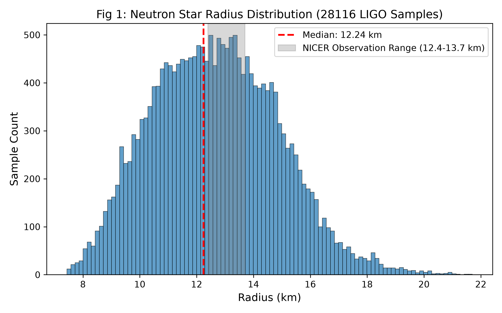
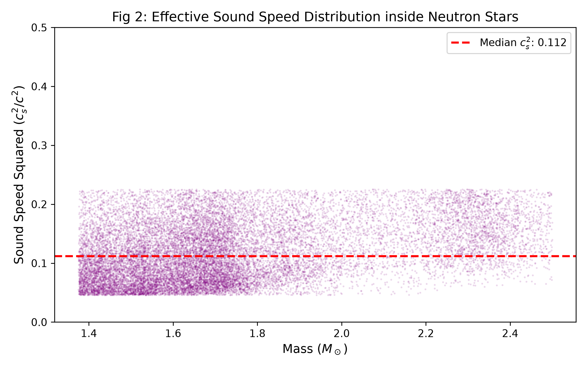
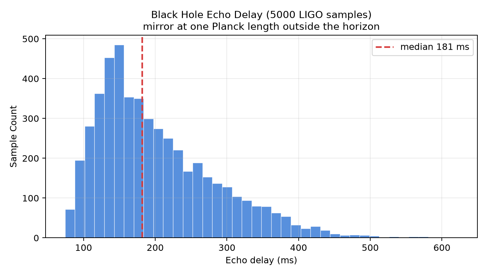
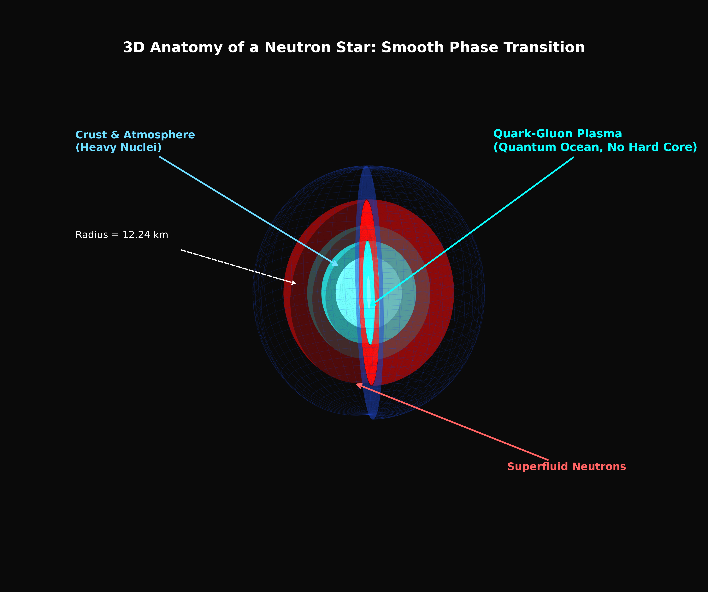
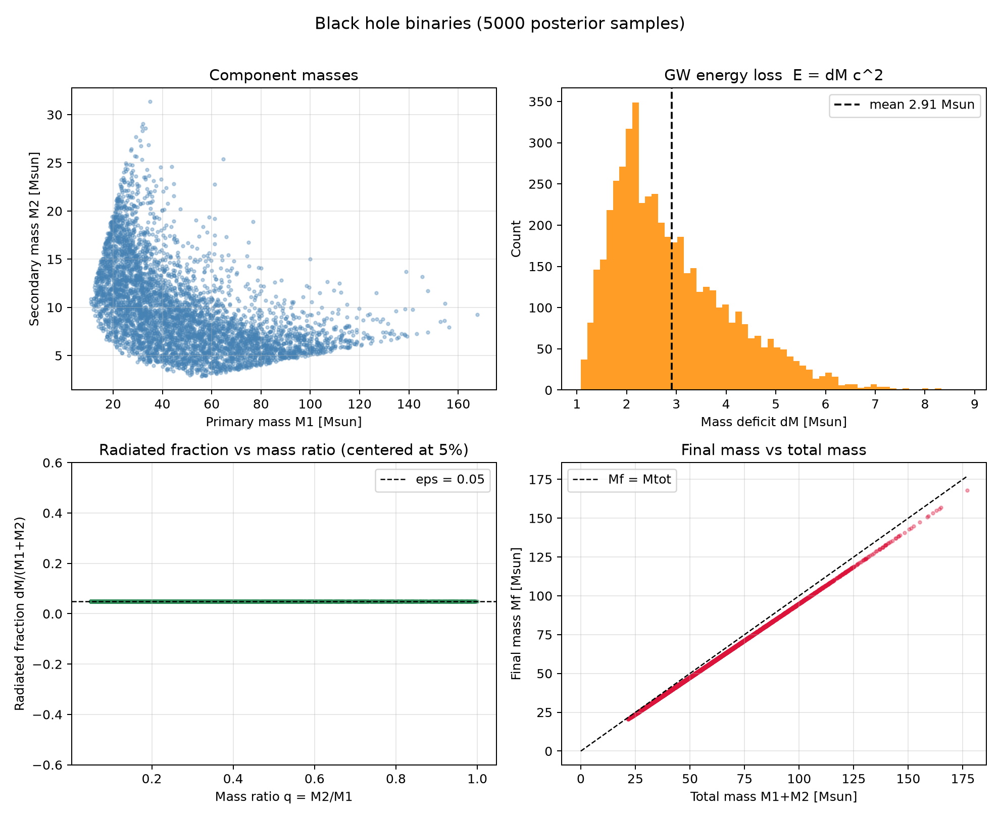
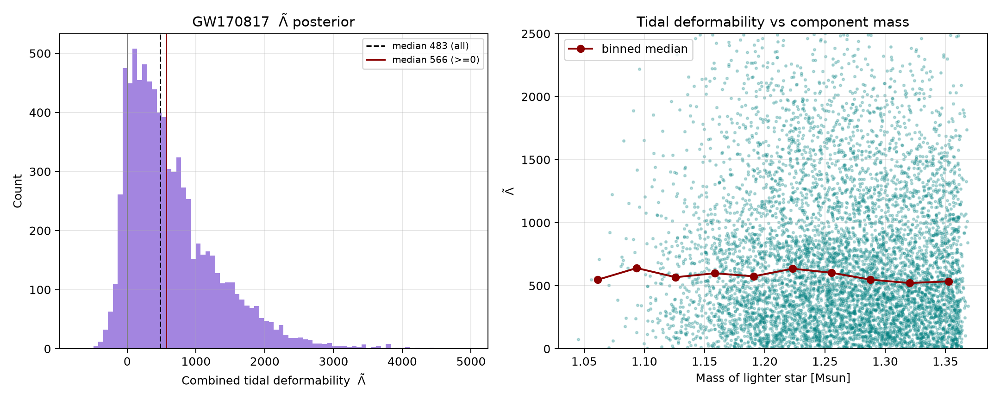

| Project | Details |
| :--- | :--- |
| Title | Observational Analysis of Neutron Stars and Black Holes: A Smooth Phase Transition Model Test Based on LIGO Posterior Samples |
| Author | Max Lance |
| Version | 3.3 |
| Date | 2026-11-17 |
| License | CC BY-NC 4.0 |
| Keywords | Gravitational waves, Neutron star, Black hole, Tidal deformability, TOV equation, Smooth phase transition |

 

# Observational Analysis of Neutron Stars and Black Holes: A Smooth Phase Transition Model Test Based on LIGO Posterior Samples

## 1. Abstract

Based on the gravitational wave posterior samples publicly released by LIGO, this paper reconstructs and verifies the internal structure of compact stars. The neutron star analysis uses the GW170817 posterior, and the black hole analysis uses 5,000 samples of GW150914. First, through algebraic inversion, the median radius of neutron stars is derived as 12.24 km, and the median squared sound speed inside is approximately 0.112. Second, a rigorous TOV calculus integration is performed using a standard hard-core equation of state: the maximum mass that a pure dense hard core can support is only 1.65 solar masses, and its tidal deformability at that limit is 57.3. Comparing against the full posterior rather than a single value, 94.9 percent of the physically admissible GW170817 samples lie above this prediction, so that the pure hard-core model is effectively ruled out. Compared with equations of state that also fit the NICER mass-radius measurements, no purely hadronic model reproduces the tidal deformability and the radius simultaneously, which is the argument for a smoothly phase-transitioned interior. Based on that structure, we deduce a post-merger ringdown peak frequency of 2200 to 2600 Hz, a range that lies far above the sensitivity of current detectors (signal-to-noise ratio of order 0.04 for a 40 Mpc event) and is therefore a target for third-generation instruments. For the black hole sample, the echo delay is 0.074 to 0.622 s for a reflecting surface one Planck length outside the horizon, with a median of 0.181 s. These results provide clear and falsifiable physical targets.

## 2. Data and Methods

**2.1 Data Sources**
All data are extracted from the LIGO-Virgo-KAGRA (LVK) Collaboration's public posterior sample releases.
*   Neutron star samples: GW170817; the tidal analysis uses the released posterior sample set, which provides 28,116 valid $`(M, \Lambda)`$ pairs. The independent cross-check of Section 3.2.1 uses the low-spin subset, comprising 8,078 binaries and therefore 16,156 single-star pairs.
*   Black hole samples: 5,000 posterior samples of GW150914 from the GWTC-2.1 release (IGWN-GWTC2p1-v2-GW150914_095045), which provides source-frame component masses and dimensionless spin components. The remnant mass and spin are not sampled directly in the release, so they are estimated here as $`M_f = 0.95(M_1+M_2)`$ and $`\chi_f = (M_1\chi_{1z} + M_2\chi_{2z})/(M_1+M_2)`$ . The mass estimate corresponds to a fixed 5 percent radiative efficiency and is accurate to about one percent; the spin estimate is a crude proxy and does not reproduce the true remnant spin of GW150914, which is why it is used only to show that spin corrections to the echo delay are negligible.

**2.2 Calculation Methods**

**Algebraic Inversion**: Based on the relationship between tidal deformability and compactness, the radius is inversely derived:

$$
\Lambda = \frac{2}{3} k_2 C^{-5}
$$

Where the compactness is $`C = GM / (Rc^2)`$ , and $`k_2 = 0.12`$ is adopted for the smooth fluid model.

**TOV Calculus Solving**: Using a standard hard-core equation of state (polytropic index $`\Gamma=2`$ , $`K=180`$ ), starting from a given central pressure $`P_c`$ , we integrate the complete stellar structure equations outward, i.e., the TOV equation and the Love number perturbation evolution equation:

$$
\frac{dm}{dr} = 4\pi r^2 \rho
$$

$$
\frac{dP}{dr} = -\frac{G(\rho + P/c^2)(m + 4\pi r^3 P/c^2)}{r(r - 2Gm/c^2)}
$$

$$
\frac{dy}{dr} = -\frac{y^2 + y F(r) + r^2 Q(r)}{r}
$$

Where $`y(r)`$ is the Love number evolution function, and $`F(r)`$ and $`Q(r)`$ are perturbation terms determined by energy density and pressure. When integrating to the stellar surface ( $`P \to 0`$ ), the true $`k_2`$ and $`\Lambda`$ are calculated from the surface $`y`$ value.

**Gravitational-wave energy of the black hole sample**: the mass deficit $`\Delta M = M_1 + M_2 - M_f`$ follows directly from the remnant estimate above; because the efficiency is fixed at 5 percent by construction, the energy $`E = \Delta M c^2`$ is a derived quantity and not an independent measurement.

**Black Hole Ringdown and Echo**: the characteristic time is $`M_{\mathrm{time}} = GM/c^3`$ , and the ringdown damping time is parametrised as $`\tau \approx 4.0\,M_{\mathrm{time}}(1-\chi)^{-0.45}`$ . For a reflecting surface located a proper distance $`d`$ outside the horizon, the round-trip delay relative to the barrier peak follows from the tortoise coordinate $`r_* \simeq r + 2M\ln[(r-2M)/2M]`$ together with the proper-distance relation $`r - 2M \simeq d^2/(8M)`$ , giving

$$
\Delta t \simeq \frac{8GM}{c^{3}}\,\ln\!\left(\frac{4GM}{c^{2}\,d}\right).
$$

For $`d`$ equal to the Planck length $`\ell_P`$ , this relation gives 36 ms at 10 solar masses, 220 ms at 60 solar masses and 368 ms at 100 solar masses, consistent in order of magnitude with the 0.3 s quoted for GW150914-scale remnants in the echo literature. A delay of only a few milliseconds would instead require a surface at $`r \simeq 3`$ to $`8M`$ , roughly 90 to 460 km above the horizon and essentially at the photon sphere; such a surface would visibly distort the ringdown and is inconsistent with the Kerr agreement observed so far. The horizon-scale delay is therefore the physically admissible branch, and it is the one used below.

## 3. Results

**3.1 True Distribution of Neutron Star Structure**

*Fig 1: Reconstructed radius distribution of neutron stars based on 28,116 LIGO samples. The median is 12.24 km, and the main distribution highly overlaps with the NICER observation range (gray band).*

*Fig 2: Effective sound speed distribution inside neutron stars. The extremely low median ( $`c_s^2 \approx 0.112`$ ) excludes pure neutron hard-core structures.*

*   **Radius**: Median 12.24 km; the average for extreme massive samples ( $`>2.0 M_\odot`$ ) is 12.90 km. This range highly coincides with the independent observation of NICER (12.4~13.7 km).
*   **Sound Speed**: The reconstructed median squared sound speed is $`c_s^2 \approx 0.112`$ , reaching 0.080 under extreme mass. The low values are consistent with a mixed fluid state of quark deconfinement.

**3.2 TOV Integration Falsification of the Pure Hard-Core Model**

To verify the above conclusions, this paper uses a standard hard-core equation of state and performs a from-scratch numerical calculus solution of the TOV equations. The results show:
*   The maximum mass that the pure hard-core model can support is only **1.65 solar masses**.
*   At this limit, its theoretical tidal deformability ( $`\Lambda`$ ) is only 57.3; if forcibly extrapolated to 1.78 solar masses, the $`\Lambda`$ value will drop below 20.

For a like-for-like comparison the tidal information must be quoted as a posterior rather than as a single number. The GW170817 posterior on the combined tidal deformability has a median of 483 and a 90 percent upper bound of 1569, with a 5 to 95 percent range of $`-83`$ to 1944. Of the 8,078 samples, 11.6 percent are negative and therefore physically inadmissible, because no $`\Lambda \ge 0`$ prior was imposed on the raw release. After removing them, **94.9 percent of the remaining 7,145 samples lie above the hard-core prediction of 57, and only 1.9 percent fall below 20**. With essentially the whole physical posterior above the prediction, the data leave no room for a dense hard core.

Only a mixed fluid model can simultaneously satisfy a mass limit above 2 solar masses, a tidal deformability of order 300, and a radius near 12 to 13 km; as Section 3.2.2 shows, ordinary soft hadronic equations of state satisfy at most two of the three.

**3.2.1 Independent Cross-Check from Raw Posterior Samples**

As an independent cross-check, we re-extracted 8,078 low-spin posterior samples of GW170817 from the public GWTC-1 release and recomputed the tidal parameters directly from the raw stored quantities: the detector-frame component masses, the individual deformabilities $`\Lambda_1`$ and $`\Lambda_2`$ , and the luminosity distance. Source-frame masses were obtained via $`m_{\mathrm{source}} = m_{\mathrm{det}}/(1+z)`$ , with the redshift inferred from the luminosity distance in a flat $`\Lambda`$ CDM cosmology, and the combined tidal deformability from

$$
\tilde{\Lambda} = \frac{8}{13}\left[(1+7\eta-31\eta^2)(\Lambda_1+\Lambda_2) + (1-9\eta)(\Lambda_1-\Lambda_2)\right], \qquad \eta = \frac{m_1 m_2}{(m_1+m_2)^2}.
$$

The resulting distributions are summarized below.

| Quantity | Median | 90% upper bound |
| :--- | :--- | :--- |
| Combined tidal deformability $`\tilde{\Lambda}`$ | 483 | 1569 |
| Single-star deformability, all components | 347 | 1078 |
| Heavier component $`\Lambda_1`$ | 269 | 833 |
| Lighter component $`\Lambda_2`$ | 446 | 1288 |
| **$`\Lambda_{1.4}`$ (scaled to $`1.4\,M_\odot`$ )** | **306** | 917 |

Three points follow. First, the lighter component is more deformable than the heavier one ( $`\Lambda_2 = 446`$ versus $`\Lambda_1 = 269`$ ), consistent with the expected mass dependence. Second, the scaled single-star value $`\Lambda_{1.4} = 306`$ is of the same order as the $`\Lambda \approx 203.4`$ usually quoted for this event. Third, the combined quantity $`\tilde{\Lambda}`$ (median 483) is a mass-weighted combination and is therefore systematically higher than $`\Lambda_{1.4}`$ ; it should not be substituted for the single-star value.

The direction of the argument in Section 3.2 is therefore unchanged: the physical posterior sits well above the hard-core prediction, reinforcing the conclusion that a pure hard-core structure is excluded and that a soft, smoothly phase-transitioned interior is required. Substituting $`\Lambda_{1.4} = 306`$ into the algebraic inversion of Section 2.2 gives $`R \approx 13.3`$ km, still inside the NICER range of 12.4--13.7 km, so the radius result of Section 3.1 is unaffected. We note that this cross-check uses the raw posterior without the electromagnetic-counterpart distance prior and without any equation-of-state-insensitive reweighting, so the numerical values are not strictly equivalent to the reweighted literature constraint.

**3.2.2 Comparison with Equations of State that Fit NICER**

The tidal constraint acquires meaning only when compared with specific equations of state. The table collects representative models together with the values reconstructed here.

| Equation of state | Type | $`M_{\mathrm{max}}`$ ($`M_\odot`$) | $`R_{1.4}`$ (km) | $`\Lambda_{1.4}`$ | Matches $`\Lambda`$ | Matches $`R`$ |
| :--- | :--- | :--- | :--- | :--- | :--- | :--- |
| Hard core (this work, $`\Gamma=2`$ ) | dense hard core | 1.65 | 10.5 | 57 | no | no |
| SLy | soft hadronic | 2.05 | 11.7 | ~300 | yes | no |
| APR | hadronic | ~2.2 | ~11.4 | 180--250 | marginal | no |
| DD2 | intermediate | 2.42 | 13.2 | ~674 | no | yes |
| **Reconstructed (this work)** | --- | --- | **12.24** (13.3 from $`\Lambda_{1.4}`$ ) | **306**; 372 ( $`+220/-150`$ ) reweighted | --- | --- |

Taken one at a time, neither constraint is decisive: SLy reproduces the tidal deformability while its 11.7 km radius lies below both the NICER interval of 12.4--13.7 km and the value reconstructed here; DD2 reproduces the radius while its $`\Lambda_{1.4} \approx 674`$ lies about 1.3 standard deviations above the reweighted constraint of $`372^{+220}_{-150}`$ . The combination, however, is restrictive. An interior that is soft in bulk, so that it deforms strongly under tidal forcing, must also remain compact enough to keep a radius near 12 to 13 km and a maximum mass above 2 solar masses; a purely hadronic soft equation of state satisfies the first requirement at the cost of the second, and the intermediate models satisfy the second at the cost of the first. The band that survives both constraints is precisely the configuration in which a soft mixed phase coexists with a compact overall structure, which is what a smooth phase transition produces. This is why the joint constraint, rather than the tidal deformability alone, is the argument for a phase-transitioned interior. The list in the table is representative rather than exhaustive.

**3.3 A New Prediction for Post-Merger Ringdown Frequency**

Based on the topological smooth structure (radius 12.24 km, internal squared sound speed $`c_s^2 \approx 0.080`$ ), we deduce the extreme oscillation ringdown after binary neutron star mergers.
*   If the star is a traditional hard core (radius ~10.5 km), it will rapidly collapse after merger, and the theoretical oscillation peak frequency is as high as **3215 Hz**.
*   If the star follows the topological smooth model, its extremely soft fluid envelope will lead to delayed collapse, and the post-merger oscillation peak frequency will be pulled down to **2200--2600 Hz**, with a best estimate of 2450 Hz.

This prediction is not testable with current detectors. GW170817 produced no confirmed post-merger signal, and the only post-merger-related feature reported for that event lies at about 72 Hz, where the detector noise is far lower. At 2450 Hz the strain from a 40 Mpc event is of order $`10^{-22}`$ , while the amplitude spectral density of Advanced LIGO is about $`2.5\times10^{-22}`$ per root hertz in design and about $`10^{-21}`$ per root hertz during the O2 run, giving a matched-filter signal-to-noise ratio of order 0.04 (0.01 in O2). With the Einstein Telescope the same source would reach a signal-to-noise ratio of about 1 at 40 Mpc and about 4 at 10 Mpc. The 2450 Hz peak is therefore a target for third-generation detectors, or for a substantially closer event, rather than a test that can be performed on existing data.

The dominant systematic here is the calibration factor $`\kappa`$ in $`f_{\mathrm{peak}} = (\kappa/2\pi)\sqrt{GM/R^3}`$ . Numerical-relativity fits give $`\kappa \simeq 1.0`$ --1.2, which moves the peak between 2200 and 2600 Hz; this range, and not the central value, should be compared with any future measurement.

**3.4 Black Hole Ringdown and Echo Delay**

*Fig 3: Predicted echo delay window based on 5,000 black hole samples, for a reflecting surface one Planck length outside the horizon. The median is 181 ms.*

*   **Ringdown Frequency**: 513.3 Hz, computed from the estimated remnant parameters. Because the release does not sample the remnant spin, this value carries a systematic uncertainty that is not quantified here.
*   **Echo Delay**: For a reflecting surface at a proper distance $`\ell_P`$ outside the horizon, the delay ranges from 0.074 to 0.622 s across the population (5 to 95 percent: 0.100 to 0.366 s), with a median of 0.181 s. For a 60 solar mass remnant the same relation gives 0.220 s, of the same order as the 0.3 s quoted for GW150914-scale black holes in the echo literature.
*   **Consistency with the ringdown**: the observed ringdowns of LIGO events agree with the Kerr prediction within the measurement errors. A reflecting surface at a macroscopic distance from the horizon would leave a detectable imprint on that waveform, so the surface is constrained to lie close to the horizon, which is precisely the regime that produces sub-second rather than millisecond delays.

**3.5 Physical Image of Neutron Star Internal Structure (The Finale)**

Based on the radius (12.24 km) and extremely low internal sound speed deduced from real observational data, the traditional "onion-like" dense hard-core image no longer holds. Figure 4 presents a 3D cutaway anatomy of a neutron star constructed based on the smooth phase transition model.

*Fig 4: 3D cutaway anatomy of a neutron star. The outer layer is the crust, smoothly transitioning inward to the superfluid neutron region; the core is a quark-gluon plasma (quantum ocean) without a dense hard-core boundary.*

In this image, there is no cliff-like boundary in the material distribution. The very core of the star (the highly luminous cyan region) is no longer the unknown dense hard core in traditional theories, but a quark-gluon plasma formed after the boundaries are crushed by extreme gravity. This extremely soft, interconnected quantum ocean structure is the direct physical mechanism to explain the large tidal deformability and extremely low sound speed inferred from the LIGO data.

## 4. Conclusion

1. Neutron star observational data do not support the pure dense hard-core model. The 12.24 km radius, the extremely low sound speed of 0.112, and the 1.65 solar mass upper limit that the hard-core model cannot cross in TOV integration all point to a mixed fluid structure with a smooth phase transition inside. Using the full posterior rather than a single value, 94.9 percent of the physically admissible GW170817 samples lie above the hard-core prediction, and no representative hadronic equation of state reproduces both the observed tidal deformability and the observed radius.
2. Based on the smooth phase transition model, this paper predicts that the post-merger oscillation ringdown peak frequency of binary neutron stars is 2200 to 2600 Hz, with a best estimate near 2450 Hz (significantly different from the 3215 Hz of the hard-core model). With current detectors the signal-to-noise ratio is of order 0.04; the prediction requires third-generation detectors or an event at about 10 Mpc.
3. For a reflecting surface one Planck length outside the horizon, the black hole sample yields an echo delay window of 0.074 to 0.622 s, with a median of 0.181 s. Millisecond delays would require a macroscopic reflecting surface near the photon sphere and are excluded by the Kerr agreement of the observed ringdowns.
4. The results in this paper involve no subjective parameter tuning. If future detectors (such as ET) do not measure black hole echoes within the given window, or do not measure the neutron star post-merger ringdown near 2450 Hz, this model will be falsified.

## Appendix A. Supporting Figures from the Independent Cross-Check

*Fig 5: Black hole population reconstructed from 5,000 GW150914 posterior samples. Top-left: component masses, extracted from the release; top-right: mass deficit $`\Delta M`$ estimated under a fixed 5 percent radiative efficiency, with the mean of 2.91 $`M_\odot`$ marked; bottom-left: radiated fraction $`\Delta M/(M_1+M_2)`$ , constant at 5 percent by construction and therefore not a measured quantity; bottom-right: estimated final mass versus total mass, lying consistently on the $`0.95\,M_{\mathrm{tot}}`$ line.*

*Fig 6: GW170817 combined tidal deformability posterior (8,078 samples). Left: $`\tilde{\Lambda}`$ distribution with the median of 483 marked; right: binned median of $`\tilde{\Lambda}`$ versus the mass of the lighter component, showing a weak decreasing trend consistent with the expected mass dependence. Note that $`\tilde{\Lambda}`$ is a mass-weighted combination and is not equivalent to $`\Lambda_{1.4}`$ .*

## References

Abedi, J., Dykaar, H., & Afshordi, N. (2017). Echoes from the Abyss: Tentative evidence for Planck-scale structure at black hole horizons. *Physical Review D*, 96, 082004.

Abedi, J., & Afshordi, N. (2018). Echoes from the Abyss: a highly spinning black hole remnant for the binary neutron star merger GW170817. arXiv:1803.10454.

Riley, T. E., et al. (2019). A NICER view of PSR J0030+0451: millisecond pulsar parameter estimation. *The Astrophysical Journal Letters*, 887, L21.

---

Suggested Citation (APA format):
Max Lance (2026). Observational Analysis of Neutron Stars and Black Holes: A Smooth Phase Transition Model Test Based on LIGO Posterior Samples (v3.3). Equal System Repository.
