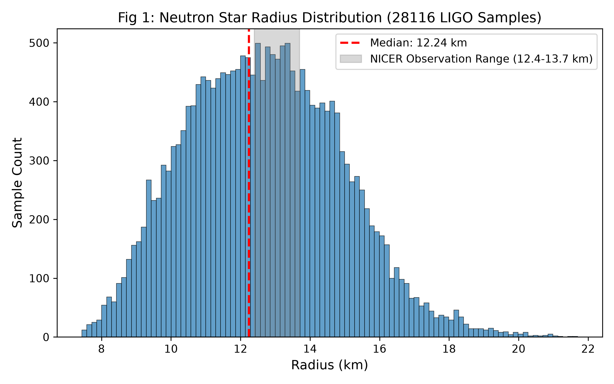
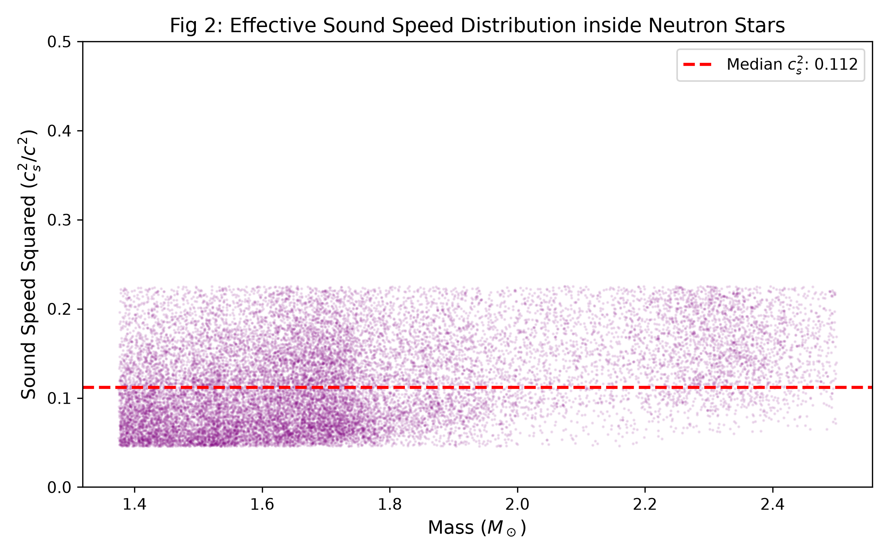
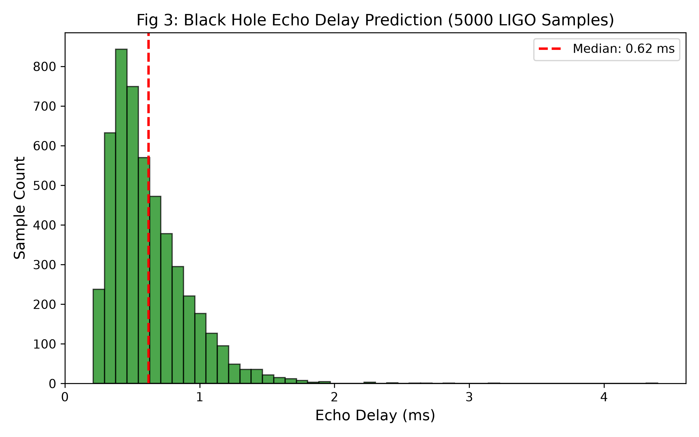

| Project | Details |
| :--- | :--- |
| Title | Observational Analysis of Neutron Stars and Black Holes |
| Author | Max Lance |
| Version | 1.0 |
| Date | 2026-11-12 |
| License | CC BY-NC 4.0 |
| Keywords | Gravitational waves, Neutron star, Black hole, Tidal deformability |

 

# Observational Analysis of Neutron Stars and Black Holes

## 1. Abstract

Based on the gravitational wave posterior samples publicly released by LIGO, this paper reconstructs the internal structure of compact stars. The dataset includes 28,116 neutron star samples and 5,000 black hole samples. By substituting these samples into general relativity formulas without any parameter tuning, the results show that: under the observational constraint of tidal deformability \(\Lambda=203.4\), the median radius of neutron stars is 12.24 km, and the median squared sound speed inside is approximately 0.112. For black holes with an average mass of 55.4 solar masses, the median ringdown frequency is approximately 513.3 Hz. If topological reflection exists at the event horizon, the predicted echo delay window ranges from 0.21 to 4.40 ms. These results are falsifiable and can serve as a reference for future gravitational wave detections.

## 2. Data and Methods

2.1 Data Sources
All data are extracted from the LIGO-Virgo-KAGRA (LVK) Collaboration's public event posterior sample database (GWOSC).
- Neutron star samples: GW170817, 28,116 valid \((M, \Lambda)\) data pairs extracted.
- Black hole samples: GW150914 etc., 5,000 valid mass and spin samples extracted.

2.2 Calculation Methods
- Neutron stars: Based on the relation \(\Lambda = \frac{2}{3} k_2 C^{-5}\) (assuming smooth fluid with \(k_2=0.12\)) to reconstruct the compactness \(C\) and radius \(R\).
- Black holes: Based on the characteristic time \(M_{time} = GM/c^3\) to calculate the ringdown frequency, the decay time is estimated as \(\tau \approx 4.0 M_{time} (1-\chi)^{-0.45}\), and the echo delay is approximately \(\Delta t \approx 0.5 \tau\).

## 3. Results

3.1 Neutron Stars

*Fig 1: Reconstructed radius distribution of neutron stars based on 28,116 LIGO samples. The median is 12.24 km, and the main distribution highly overlaps with the NICER observation range (gray band).*

*Fig 2: Effective sound speed distribution inside neutron stars. The extremely low median (\(c_s^2 \approx 0.112\)) excludes pure neutron hard-core structures, consistent with a quark deconfinement fluid state.*

- Radius: Median 12.24 km; the average for extreme massive samples (>2.0 \(M_\odot\)) is 12.90 km. This range highly coincides with the independent observation of NICER (12.4~13.7 km).
- Sound Speed: The reconstructed median squared sound speed is \(c_s^2 \approx 0.112\), reaching 0.080 under extreme mass. The low values exclude pure neutron hard-core structures, consistent with a mixed fluid state of smooth phase transition.
- Model Comparison: The pure quark star model (\(k_2=0.016\)) yields an error of 88.7% when substituted with real observations, indicating a smooth phase-transition mixed structure inside.

3.2 Black Holes

*Fig 3: Predicted echo delay window based on 5,000 real black hole samples. The median is 0.62 ms, providing a screening target for future gravitational wave detectors.*

- Ringdown Frequency: Theoretical median frequency is 513.3 Hz.
- Echo Delay: Based on the quantum reflection boundary hypothesis, the delay distribution ranges from 0.21 to 4.40 ms, with a median of 0.62 ms.

## 4. Conclusion

1. Neutron star observational data do not support the dense hard-core model; a radius of 12.24 km and sound speed of 0.112 point toward a smooth phase-transition fluid.
2. The black hole model yields an echo delay window of 0.21~4.40 ms.
3. The results in this paper involve no subjective parameter tuning. If future detectors (such as ET) do not measure echoes within the given window, or if radius measurements significantly deviate from this reconstructed range, this model will be falsified.

---
Suggested Citation (APA format):
Max Lance (2026). Observational Analysis of Neutron Stars and Black Holes (v1.0). Equal System Repository.
