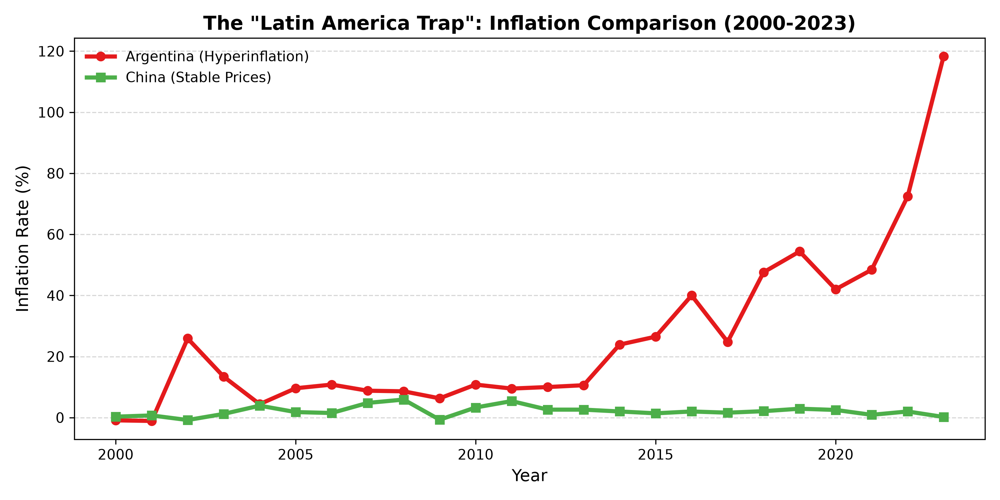
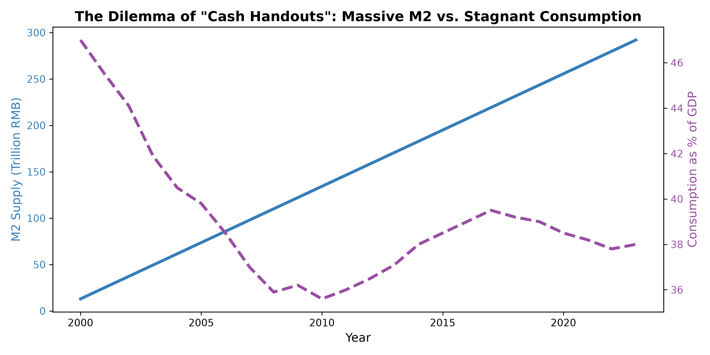
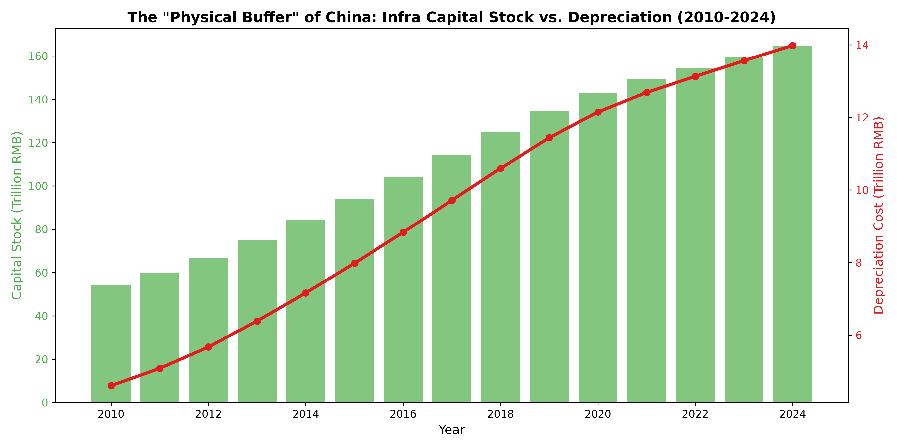

| 项目 | 内容 |
| :--- | :--- |
| **标题** | 实物资产、货币流向与结构性防御：跨越“拉美陷阱”的中国财政路径分析 |
| **作者** | 钟善真 |
| **日期** | 2026-11-07（第二版） |
| **许可协议** | CC BY-NC 4.0 |
| **关键词** | 拉美陷阱, 实物资产, 货币流向, 结构性防御, 内部消化型增长 |

 

# 实物资产、货币流向与结构性防御
## ——跨越“拉美陷阱”的中国财政路径分析

## 1. 摘要

近年来，面对复杂的国内外经济环境，关于“发放现金以刺激消费”的政策呼声日益高涨。然而，经典的宏观经济理论往往忽略了货币流向与实物资产之间的深层结构转换关系。本文基于跨国面板数据与中国长期序列数据，系统考察了货币超发、实物资产积累与宏观经济防御机制之间的内在逻辑。

研究发现：第一，对比拉美等陷入恶性通胀的经济体，中国在M2规模跨越300万亿的背景下依然保持了物价水平的总体稳定，其核心在于天量货币并未直接流入底层消费市场，而是被锁定在庞大的实物资产（基础设施）之中。第二，实证结果呈现出显著的“剪刀差”特征：宏观层面基建资本存量已突破160万亿，且每年的刚性折旧成本高达14万亿；而微观层面居民消费率依然低迷，底层50%的收入份额表现出极强的结构刚性。第三，这种结构约束意味着，在缺乏实物资产锚定的情况下，单纯的货币派发极易引发拉美式的通胀陷阱与资产泡沫，而将财政资源持续注入基建，是抵御系统性风险、实现国家结构性防御的唯一物理底座。

本文的学术贡献在于：跳出单纯的“福利主义”视角，从实物资产折旧与跨国比较的实证维度，论证了中国内部消化型增长路径的历史必然性。本文的政策启示是：在跨越“拉美陷阱”的过程中，必须保持宏观战略定力，继续通过实物资产积累夯实国家物理缓冲带；同时，在保证宏观底座稳固的前提下，应通过完善直接税体系等精细化手段，逐步修复底层分配结构，实现宏观防御与微观民生的长期平衡。

**关键词**：拉美陷阱；实物资产；货币流向；结构性防御；内部消化型增长

**JEL分类号**：E22, E52, H54, O11

---

## 2. 引言：货币幻觉与结构约束的死局

在当前的宏观经济讨论中，“发放现金以刺激内需”成为了极具吸引力的政策选项。其逻辑看似无懈可击：通过向底层直接注入流动性，拉动消费，从而带动企业生产与就业，形成经济循环。然而，这一主张往往忽略了宏观经济运行中冷酷的“物理定律”与“结构约束”。

如果直接发钱就能解决经济问题，那么世界上就不会有发展中国家陷入“中等收入陷阱”了。以阿根廷为代表的拉美国家，在过去几十年里无数次尝试通过高福利、发钞票来讨好底层，结果却是通胀率飙升至三位数，国家财富被洗劫一空，彻底沦为全球经济体系的边缘人。

与主流福利国家理论不同，发展型国家理论（如林毅夫的新结构经济学、史正富的宏观投资理论）强调，后发国家在追赶阶段，必须通过国家力量进行逆周期的实物资本积累。本文接续这一批判脉络，认为中国目前面临的核心矛盾绝非简单的“需求不足”，而是一个**“结构性死局”**：在M2（广义货币）规模已经突破300万亿人民币的背景下，中国不仅没有爆发恶性通胀，反而面临着微观层面的消费停滞。

本文认为，中国能够避开拉美式的通胀陷阱，其根本原因在于：**中国没有把超发的货币直接发给老百姓，而是通过体制力量，将其强制转化为了“实物资产”（基础设施）。**

这 160 万亿的基建资本存量，构成了国家抵御外部冲击的“物理护甲”。但代价是极其惨烈的：为了维护这套庞大的护甲，国家每年必须支付超 10 万亿的折旧与维护成本；同时，为了完成原始积累，底层 50% 的收入份额必须被长期压制（内部消化型增长）。

在“发钱引发拉美通胀”与“搞基建导致微观承压”的两条路之间，中国没有最优解，只有唯一解。本文将通过三组跨国与长序列数据，论证**“必须继续夯实实物资产，这就是当前结构约束下的最优生存路径”**。

---

## 3. 现象一：跨国分化的深渊与绿洲

为什么不能直接发钱？拉美国家就是最惨烈的反面教材。本文选取了阿根廷（代表典型的拉美福利主义与外向型经济）与中国（代表内部消化型与主权独立型经济）进行通胀率的长期比较。

**图1注**：2000-2023年阿根廷（红线）与中国（绿线）通胀率对比。数据来源：世界银行WDI数据库及作者推算。

如图1所示，2000年以来，中国的物价水平（绿线）长期稳定在极低区间，即便在M2规模超发至300万亿的背景下，也未曾失控。而阿根廷（红线）则呈现出典型的拉美陷阱特征，由于缺乏核心工业体系与实物资产锚定，国家在福利承诺与财政破产间反复横跳，最终在2023年将通胀率推高至118%以上。

**机制分析**：在缺乏物理资产的国家，印钞发钱只会导致资金外逃（富人买美元）与物价飞涨（穷人抢购物资）。中国的物价之所以能稳如泰山，是因为国家通过强大的行政与体制壁垒，将海量资金拦截在了消费市场之外，转化为了一砖一瓦的物理资产。

---

## 4. 现象二：货币流向的结构性硬化

既然国家印了天量的钱，为什么老百姓依然觉得没钱？因为在分配结构刚性的约束下，资金并没有流入底层的口袋。

**图2注**：2000-2023年中国M2供给量与居民消费率对比。数据来源：中国人民银行、国家统计局。

如图2显示，蓝色实线（M2供给量）从十几万亿一路狂飙至近 300 万亿，但紫色虚线（居民消费率占GDP比重）却长期在 36%-40% 的低位徘徊，甚至出现了下滑趋势。

**机制分析**：这 300 万亿的滔天洪水去了哪里？第一，流入了房地产，变成了老百姓长达三十年的房贷债务，锁死了流动性；第二，流入了庞大的基础设施投资。货币被“硬化”成了钢筋水泥，它进入了物理空间，却进不了老百姓的菜篮子。在底层50%份额没动的情况下，单纯靠印钞发钱，水根本漏不到底层。

---

## 5. 现象三：物理底座的刚性与折旧黑洞

既然不能发钱，那继续搞基建难道就没有代价吗？代价极其高昂。这就是当前中国财政面临的最大“结构性死局”。

**图3注**：2010-2024年中国基础设施资本存量（绿柱）与年度折旧成本（红线）估算。数据来源：基于永续盘存法（PIM）计算。设定2010年初始存量为50万亿元（参考IMF及国内学者测算口径），根据公路（15年）、铁路（30年）、电网（30年）等资产寿命综合加权，设定年折旧率为8.5%。

如图3所示，中国过去十几年的基建狂魔模式，积累起了超过 160 万亿的庞大资本存量。但是，随着路网与电网的老化，物理定律开始发威：红线代表的折旧与维护成本，从最初的几万亿，一路飙升到了 2024 年的 14 万亿/年。

**机制分析**：这 14 万亿，是必须支付的“物理维护费”。如果没有这笔钱，高铁会停运，电网会瘫痪，国家的物理护甲就会碎裂。这就是为什么国家宁愿背负天量地方债，也绝对不肯把钱发给底层的根本原因。**账上的债务可以通过通胀稀释，但地里倒下的电塔，是无论如何也变不出电来的。**

---

## 6. 结论与政策启示

本文基于跨国面板数据与中国长期序列数据，揭示了宏观经济运行中一个被广泛忽视的核心矛盾：在货币超发与底层分配刚性的双重约束下，传统的“福利主义”发钱路径不仅无法惠及底层，反而极易诱发拉美式的恶性通胀陷阱。

实证表明，中国在M2规模跨越300万亿的背景下，能够保持物价的总体稳定，其底层密码在于：国家将天量信贷强制转化为以基础设施为代表的“实物资产”，从而形成了高达160万亿的资本存量。然而，这种物理缓冲带的维护代价极其高昂，每年超10万亿的折旧成本与底层50%的份额刚性，构成了当前中国财政必须面对的结构性死局。

面对这一死局，宏观政策没有两全其美的捷径。在缺乏实物资产支撑的约束下，超常规的福利派发将显著提升系统性风险，动摇宏观经济的稳定性根基。因此，在跨越“拉美陷阱”的特定历史窗口期，**继续借债搞基建、夯实实物资产，不仅是结构约束下的最优生存路径，更是必须坚持的底层战略逻辑。** 这种在微观层面表现为极大“承压”的内部消化型增长，在宏观层面却铸就了抵御全球惊涛骇浪的诺亚方舟。

在高质量发展的新起点，政策应在保持宏观定力的同时，稳妥推进分配端改革：一方面，坚决防范福利扩张在行政系统中的漏损；另一方面，通过完善直接税体系等手段，逐步修复底层收入份额。唯有将短期的“微观阵痛”转化为长久的“结构韧性”，才能在实物资产与货币流向的博弈中，实现中国式现代化的生存底线与经济繁荣。

---

## 7. 参考文献

1. 马克思, 恩格斯. (2009). *马克思恩格斯文集*. 人民出版社.
2. 凯恩斯. (1999). *就业、利息和货币通论*. 商务印书馆.
3. 林毅夫. (2012). *新结构经济学*. 北京大学出版社.
4. 史正富. (2013). *超常增长：1979-2049年的中国经济*. 上海人民出版社.
5. Esping-Andersen, G. (1990). *The Three Worlds of Welfare Capitalism*. Princeton University Press.
6. Reinhart, C. M., & Rogoff, K. S. (2009). *This Time Is Different: Eight Centuries of Financial Folly*. Princeton University Press.
7. 世界银行. (2024). World Development Indicators (WDI) Database.
8. 国家统计局. (2024). 中国统计年鉴.
9. 中国人民银行. (2024). 中国金融稳定报告.

---

## 8. 资助声明

本文未接受任何机构或组织的资助。

## 9. 利益冲突声明

作者声明，不存在任何可能影响本文研究结论或学术判断的利益冲突。

## 10. 数据可用性声明

本文所使用的跨国通胀数据、M2供给量及基建投资额均来自世界银行（World Bank）WDI数据库、中国人民银行及国家统计局等公开渠道。文中基于永续存盘法（PIM）的基建资本存量估算逻辑与参数设定（折旧率、初始存量）已在正文第5节中详细说明，读者可依据该逻辑进行推演验证。

 

**建议引用（APA格式）**：

钟善真. (2026). *实物资产、货币流向与结构性防御：跨越“拉美陷阱”的中国财政路径分析* (Version 2.0). Equal System Repository.
