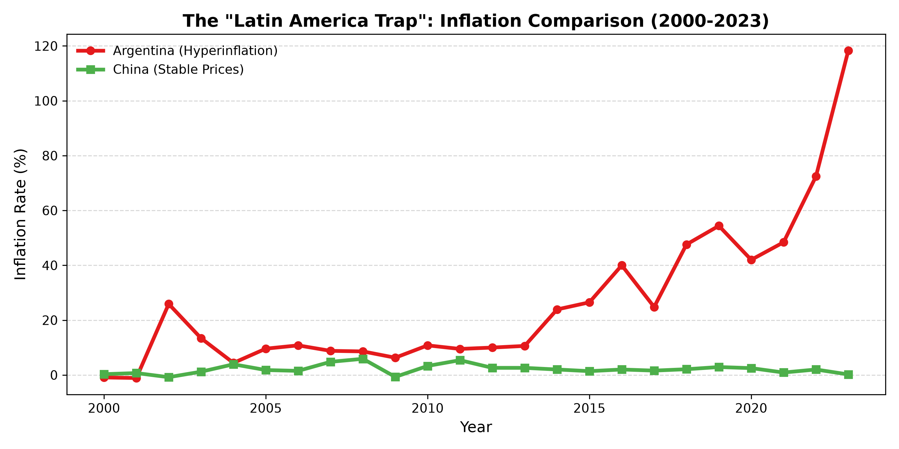
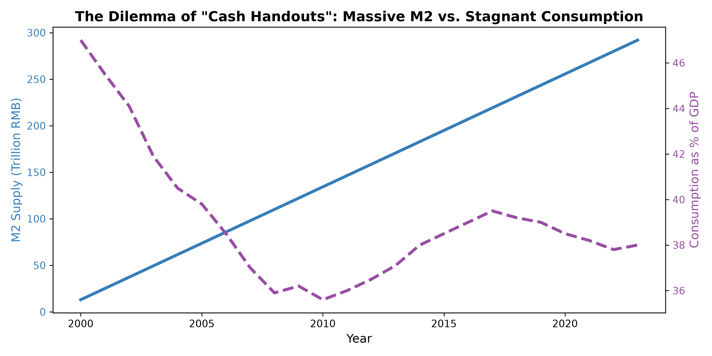
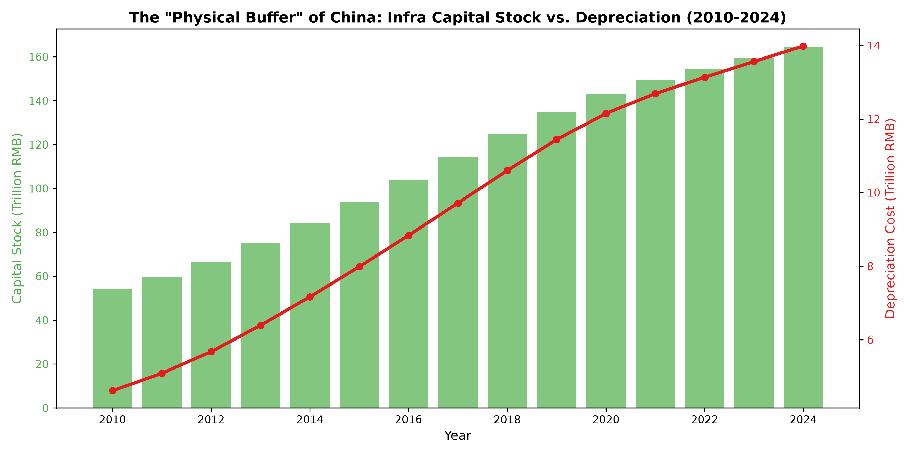

| Item | Content |
| :--- | :--- |
| **Title** | Physical Assets, Monetary Flow, and Structural Defense: An Analysis of China's Fiscal Path to Cross the "Latin American Trap" |
| **Author** | Zhong Shanzhen |
| **Date** | 2026-11-07 (Version 2.0) |
| **License** | CC BY-NC 4.0 |
| **Keywords** | Latin American Trap, Physical Assets, Monetary Flow, Structural Defense, Internal Absorption Growth |

 

# Physical Assets, Monetary Flow, and Structural Defense
## — An Analysis of China's Fiscal Path to Cross the "Latin American Trap"

## 1. Abstract

In recent years, amid a complex domestic and international economic environment, the policy call to "distribute cash to stimulate consumption" has been growing louder. However, classical macroeconomic theories often overlook the deep structural transformation relationship between monetary flow and physical assets. Based on cross-country panel data and China's long-term time series data, this paper systematically examines the internal logic among monetary over-issuance, physical asset accumulation, and macroeconomic defense mechanisms.

The findings are as follows: First, compared with economies trapped in hyperinflation like Latin America, China has maintained overall price stability despite its M2 scale crossing 300 trillion RMB. The core reason is that massive amounts of money did not flow directly into the grassroots consumption market, but were locked into massive physical assets (infrastructure). Second, the empirical results show a significant "scissors gap" characteristic: at the macro level, the infrastructure capital stock has exceeded 160 trillion RMB, with rigid annual depreciation costs reaching 14 trillion RMB; at the micro level, the household consumption rate remains sluggish, and the income share of the bottom 50% exhibits strong structural rigidity. Third, this structural constraint implies that, without the anchoring of physical assets, pure monetary distribution will easily trigger Latin American-style inflation traps and asset bubbles. Continuously injecting fiscal resources into infrastructure is the only physical foundation to resist systemic risks and achieve national structural defense.

The academic contribution of this paper is that it breaks out of the pure "welfarist" perspective and, from the empirical dimensions of physical asset depreciation and cross-country comparison, demonstrates the historical inevitability of China's internal absorption growth path. The policy implication is that in the process of crossing the "Latin American Trap," China must maintain macro strategic resolve and continue to consolidate the national physical buffer zone through physical asset accumulation. Meanwhile, under the premise of a stable macro foundation, it should gradually repair the grassroots distribution structure through refined means such as improving the direct tax system, achieving long-term balance between macro defense and micro livelihood.

**Keywords**: Latin American Trap; Physical Assets; Monetary Flow; Structural Defense; Internal Absorption Growth

**JEL Classification**: E22, E52, H54, O11

---

## 2. Introduction: Monetary Illusion and the Structural Deadlock

In current macroeconomic discussions, "distributing cash to stimulate domestic demand" has become a highly attractive policy option. Its logic appears flawless: injecting liquidity directly into the grassroots will boost consumption, thereby driving corporate production and employment, forming an economic cycle. However, this proposition often ignores the cold "physical laws" and "structural constraints" in macroeconomic operations.

If simply distributing cash could solve economic problems, no developing country would fall into the "middle-income trap." Latin American countries, represented by Argentina, have attempted countless times over the past decades to please the grassroots through high welfare and money printing. The result has been inflation soaring to triple digits, national wealth being plundered, and a complete descent into the periphery of the global economic system.

Unlike mainstream welfare state theories, the developmental state theory (such as Justin Yifu Lin's New Structural Economics and Shi Zhengfu's macro-investment theory) emphasizes that in the catch-up phase, late-developing countries must conduct counter-cyclical physical capital accumulation through state power. This paper continues this critical thread, arguing that the core contradiction China currently faces is by no means a simple "lack of demand," but a **"structural deadlock"**: against the backdrop of M2 (broad money) exceeding 300 trillion RMB, China has not experienced hyperinflation but rather micro-level consumption stagnation.

This paper argues that the fundamental reason China can avoid the Latin American-style inflation trap is: **China did not distribute the over-issued currency directly to the people, but forcibly transformed it into "physical assets" (infrastructure) through institutional power.**

This 160 trillion RMB infrastructure capital stock constitutes the "physical armor" against external shocks. But the cost is extremely tragic: to maintain this massive armor, the state must pay over 10 trillion RMB annually in depreciation and maintenance costs; at the same time, to complete primitive accumulation, the income share of the bottom 50% must be suppressed in the long term (internal absorption growth).

Between the two paths of "distributing cash leading to Latin American inflation" and "investing in infrastructure causing micro pressure," China has no optimal solution, only a unique solution. Through three sets of cross-country and long-term time series data, this paper demonstrates that **"continuing to consolidate physical assets is the optimal survival path under current structural constraints."**

---

## 3. Phenomenon 1: The Abyss and Oasis of Cross-Country Divergence

Why can't cash be distributed directly? Latin American countries provide the most tragic negative example. This paper selects Argentina (representing typical Latin American welfarism and an outward-oriented economy) and China (representing internal absorption and sovereign independence) for a long-term comparison of inflation rates.

**Note for Figure 1**: Inflation rate comparison between Argentina (red line) and China (green line) from 2000 to 2023. Data source: World Bank WDI Database and author's estimates.

As shown in Figure 1, since 2000, China's price level (green line) has long been stable in an extremely low range, and has not spiraled out of control even against the backdrop of M2 over-issuance reaching 300 trillion RMB. Argentina (red line), however, exhibits typical Latin American trap characteristics. Lacking a core industrial system and physical asset anchoring, the state repeatedly oscillated between welfare promises and fiscal bankruptcy, ultimately pushing inflation above 118% in 2023.

**Mechanism Analysis**: In countries lacking physical assets, printing money to distribute cash only leads to capital flight (the rich buying US dollars) and soaring prices (the poor snapping up goods). The reason China's prices remain rock solid is that the state, through strong administrative and institutional barriers, intercepted massive funds outside the consumer market and transformed them into physical assets of bricks and mortar.

---

## 4. Phenomenon 2: Structural Hardening of Monetary Flow

Since the state has printed massive amounts of money, why do ordinary people still feel poor? Because under the constraint of distribution structural rigidity, funds have not flowed into the pockets of the grassroots.

**Note for Figure 2**: Comparison of China's M2 supply and household consumption rate from 2000 to 2023. Data source: People's Bank of China, National Bureau of Statistics.

As shown in Figure 2, the solid blue line (M2 supply) has surged from over 10 trillion to nearly 300 trillion RMB, but the dashed purple line (household consumption rate as a percentage of GDP) has long hovered at a low level of 36%-40%, even showing a downward trend.

**Mechanism Analysis**: Where did the massive flood of 300 trillion RMB go? First, it flowed into real estate, turning into thirty-year mortgage debt for ordinary people and locking up liquidity; second, it flowed into massive infrastructure investment. The currency was "hardened" into steel and concrete. It entered physical space but could not enter the ordinary people's grocery basket. With the bottom 50% share unchanged, simply printing money and distributing cash will not let the water leak to the grassroots.

---

## 5. Phenomenon 3: Rigidity of the Physical Foundation and the Depreciation Black Hole

Since cash cannot be distributed, is there no cost to continuing to build infrastructure? The cost is extremely high. This is the biggest "structural deadlock" facing China's fiscal system today.

**Note for Figure 3**: Estimation of China's infrastructure capital stock (green bars) and annual depreciation cost (red line) from 2010 to 2024. Data source: Calculation based on the Perpetual Inventory Method (PIM). The initial stock in 2010 is set at 50 trillion RMB (referencing IMF and domestic scholars' calculation standards), and the annual depreciation rate is set at 8.5% based on a comprehensive weighting of asset lifespans such as roads (15 years), railways (30 years), and power grids (30 years).

As shown in Figure 3, China's "infrastructure mania" model over the past decade has accumulated a massive capital stock exceeding 160 trillion RMB. However, as road networks and power grids age, physical laws begin to exert their power: the depreciation and maintenance cost represented by the red line has soared from a few trillion initially to 14 trillion RMB per year in 2024.

**Mechanism Analysis**: This 14 trillion RMB is the "physical maintenance fee" that must be paid. Without this money, high-speed rail will halt, and power grids will paralyze, shattering the nation's physical armor. This is the fundamental reason why the state would rather bear massive local government debt than distribute the money to the grassroots. **Debts on the books can be diluted through inflation, but downed power towers in the fields will never generate electricity again.**

---

## 6. Conclusion and Policy Implications

Based on cross-country panel data and China's long-term time series data, this paper reveals a core contradiction widely overlooked in macroeconomic operations: under the dual constraints of monetary over-issuance and grassroots distribution rigidity, the traditional "welfarist" cash distribution path not only fails to benefit the grassroots but also easily induces Latin American-style hyperinflation traps.

Empirical evidence shows that China can maintain overall price stability against the backdrop of M2 crossing 300 trillion RMB. The underlying code is that the state forcibly transformed massive credit into "physical assets" represented by infrastructure, thereby forming a capital stock of 160 trillion RMB. However, the maintenance cost of this physical buffer zone is extremely high. The annual depreciation cost exceeding 10 trillion RMB and the rigidity of the bottom 50% share constitute a structural deadlock that China's fiscal system must face.

Facing this deadlock, macroeconomic policy has no shortcut that achieves both objectives. Under the constraint of lacking physical asset support, unconventional welfare distribution will significantly elevate systemic risks and shake the foundation of macroeconomic stability. Therefore, in the specific historical window of crossing the "Latin American Trap," **continuing to borrow for infrastructure and consolidating physical assets is not only the optimal survival path under structural constraints but also the underlying strategic logic that must be adhered to.** This internal absorption growth, which manifests as extreme "pressure" at the micro level, has forged a Noah's Ark against global stormy waves at the macro level.

At the new starting point of high-quality development, while maintaining macro strategic resolve, policies should steadily advance distribution-side reforms: on the one hand, resolutely prevent welfare expansion from leaking in the administrative system; on the other hand, gradually repair the grassroots income share through means such as improving the direct tax system. Only by transforming short-term "micro pain" into long-term "structural resilience" can China achieve the survival bottom line and economic prosperity of Chinese modernization in the game between physical assets and monetary flow.

---

## 7. References

1. Marx, K., & Engels, F. (2009). *Collected Works of Marx and Engels*. People's Publishing House.
2. Keynes, J. M. (1999). *The General Theory of Employment, Interest and Money*. The Commercial Press.
3. Lin, J. Y. (2012). *New Structural Economics*. Peking University Press.
4. Shi, Z. (2013). *Extraordinary Growth: The Chinese Economy from 1979 to 2049*. Shanghai People's Publishing House.
5. Esping-Andersen, G. (1990). *The Three Worlds of Welfare Capitalism*. Princeton University Press.
6. Reinhart, C. M., & Rogoff, K. S. (2009). *This Time Is Different: Eight Centuries of Financial Folly*. Princeton University Press.
7. World Bank. (2024). World Development Indicators (WDI) Database.
8. National Bureau of Statistics. (2024). *China Statistical Yearbook*.
9. People's Bank of China. (2024). *China Financial Stability Report*.

---

## 8. Funding Statement

This research received no specific grant from any funding agency in the public, commercial, or not-for-profit sectors.

## 9. Conflict of Interest Statement

The author declares no conflict of interest that could have influenced the research findings or academic judgment presented in this paper.

## 10. Data Availability Statement

The cross-country inflation data, M2 supply, and infrastructure investment data used in this paper are sourced from public databases, including the World Bank WDI Database, the People's Bank of China, and the National Bureau of Statistics. The estimation logic and parameter settings (depreciation rate, initial stock) for infrastructure capital stock based on the Perpetual Inventory Method (PIM) have been detailed in Section 5 of the main text, allowing readers to replicate the calculation based on this logic.

 

**Suggested Citation (APA Format)**:

Zhong, S. (2026). *Physical Assets, Monetary Flow, and Structural Defense: An Analysis of China's Fiscal Path to Cross the "Latin American Trap"* (Version 2.0). Equal System Repository.
